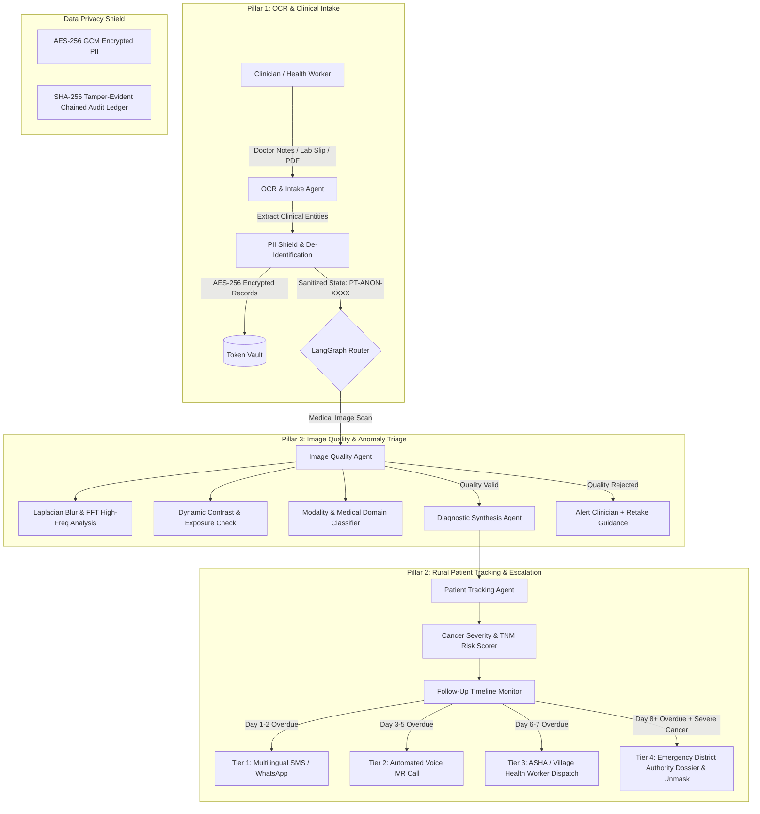

# CerviSetu: Privacy-First Multi-Agent Clinical AI & Rural Patient Tracking System

[]()
[]()
[]()
[]()

**CerviSetu** is an enterprise-grade, privacy-first multi-agent system built on **LangGraph** designed to assist oncologists and rural healthcare teams. It combines automated clinical intake, medical image quality triage (blur/anomaly detection), and an active rural patient tracking pipeline with progressive escalations for severe cancer non-responders.

---

## Key Pillars & System Architecture



---

## 3 Core Pillars Explained

### 1. OCR + Clinical Intake & Dashboard Agent
- **Ingestion**: Ingests clinical notes, handwritten/printed prescription slips, and lab reports.
- **De-Identification**: Automatically strips patient names, phone numbers, Aadhaar/SSN IDs, and exact addresses before sending data to reasoning agents.
- **Structured Extraction**: Extracts cancer type (Oral, Breast, Cervical, Lung, Colorectal), TNM staging, biopsy status, and symptom profiles into structured clinical records.

### 2. Rural Patient Follow-Up & Emergency Escalation Agent
Specially engineered for rural settings where patients face travel/economic barriers and contact might be limited:
- **Severity Scoring**: Quantifies cancer risk (Stage, biopsy status, constitutional symptoms).
- **Progressive Multi-Channel Notification Tiers**:
  - **Tier 1 (Day 1–2 Missed)**: Multilingual SMS / WhatsApp reminder (Hindi / Regional Language).
  - **Tier 2 (Day 3–5 Missed)**: Automated Voice / IVR call to patient and primary guardian.
  - **Tier 3 (Day 6–7 Missed)**: Physical home-visit order dispatched to local **ASHA / Anganwadi** community health workers with sector coordinates.
  - **Tier 4 (Day 8+ Missed + Severe Cancer)**: Gated unmasking of patient address from the AES-256 vault and automatic compilation of an official **Emergency District Health Authority Dossier** for immediate on-ground medical intervention.

### 3. Medical Image Quality & Anomaly Triage Agent
Prevents diagnostic models from operating on corrupted or blurry imagery:
- **Laplacian Blur Variance**: Computes spatial gradient sharpness (threshold: 85.0).
- **FFT High-Frequency Energy Ratio**: Measures attenuation of fine tissue textures.
- **Exposure & Contrast Inspector**: Detects underexposure, severe glare, and low RMS contrast.
- **Domain Relevance Classifier**: Rejects non-medical photos (selfies, screenshots, landscapes) and validates medical modalities (X-Ray, Histopathology H&E, Dermoscopy).
- **Clinician Actionable Feedback**: Provides real-time capture correction advice.

---

## Data Privacy & Security Shield

- **Zero-Knowledge LLM Payloads**: LLMs and reasoning nodes only ever see tokenized IDs (`PT-ANON-XXXX`).
- **AES-256-GCM Token Vault**: Patient PII (Name, Phone, Village Address) is stored in an encrypted vault isolated from model workflows.
- **Tamper-Evident Chained Audit Ledger**: Every clinical decision, notification dispatch, and PII unmasking is cryptographically hashed with SHA-256 in a block-chained audit ledger.

---

## Quickstart & Installation

### Prerequisites
- Python 3.10+
- [`uv`](https://github.com/astral-sh/uv) package manager installed

```bash
# Clone the repository
git clone https://github.com/ihatecoding01/health_hackathon.git
cd health_hackathon

# Create virtual environment and install dependencies via uv
uv venv
uv add cryptography opencv-python-headless numpy pillow fastapi uvicorn pytest httpx jinja2 python-multipart langgraph langchain-core python-dotenv pydantic
```

---

## Usage

### 1. Launch the Interactive Web Dashboard
```bash
uv run python main.py --serve --port 8000
```
Open your browser at **`http://localhost:8000`** to access:
- **Clinical Intake & OCR**: Ingest cases and view real-time LangGraph multi-agent execution.
- **Image Triage & Blur Inspector**: Test sharp vs motion-blurred vs underexposed medical scans.
- **Rural Follow-Up Simulator**: Test the interactive timeline slider (0 to 14 days overdue) and observe progressive Tier 1–4 escalations.
- **Privacy Vault & Audit Ledger**: Inspect token separation and live cryptographically chained compliance logs.

### 2. Run Automated CLI Case Demonstration
```bash
uv run python main.py --demo
```

### 3. Run Test Suite
```bash
uv run pytest -v
```

---

## Project Structure

```
health_hackathon/
├── pyproject.toml              # UV / Python project configuration
├── uv.lock                     # Deterministic dependency lockfile
├── .env.example                # Sample environment variables
├── README.md                   # Complete system documentation
├── conftest.py                 # Pytest configuration
├── main.py                     # CLI demo & server entrypoint
├── docs/
│   ├── SYSTEM_ARCHITECTURE_AND_FEATURES.md # Master Architecture, DFD, Sequence & Feature Spec
│   ├── UI_REDESIGN_SPEC.md     # Clinical CareUI design specification
│   ├── clinical_intake_questionnaire.md # Oncology clinical data dictionary
│   └── 2026-08-20.md           # Initial problem & requirement specifications
├── frontend/                   # CerviSetu Web Application (React 19 + CareUI + Tailwind v4)
│   ├── package.json
│   ├── vite.config.ts
│   ├── index.html
│   └── src/
├── src/
│   ├── config.py               # System thresholds & encryption keys
│   ├── core/
│   │   ├── security.py         # AES-256 TokenVault, PIIShield, Chained AuditLedger
│   │   ├── state.py            # LangGraph ClinicalAgentState & data schemas
│   │   └── database.py         # SQLite persistence layer
│   ├── tools/
│   │   ├── ocr_tools.py        # Document parser & clinical entity extractor
│   │   ├── image_tools.py      # Laplacian blur, FFT analysis, contrast, domain validation
│   │   └── tracker_tools.py    # Risk scoring, SMS/IVR/ASHA dispatch, authority escalation
│   ├── agents/
│   │   ├── ocr_intake_agent.py # Pillar 1 agent
│   │   ├── image_triage_agent.py # Pillar 3 agent
│   │   ├── diagnostic_agent.py # Clinical reasoning agent
│   │   └── tracker_agent.py    # Pillar 2 agent
│   ├── graph/
│   │   ├── nodes.py            # LangGraph node definitions & routing gates
│   │   └── workflow.py         # LangGraph StateGraph builder
│   └── dashboard/
│       ├── app.py              # FastAPI REST endpoints & WebSocket bridges
│       └── static/             # Modern Dark-mode Clinical UI (HTML/CSS/JS)
└── tests/
    ├── test_security.py        # Vault & PII redaction tests
    ├── test_image_tools.py     # Blur, FFT & contrast tests
    ├── test_tracker_tools.py   # Follow-up escalation & unmasking tests
    ├── test_ocr_tools.py       # Clinical entity extraction tests
    ├── test_workflow.py        # End-to-end LangGraph state tests
    └── test_api.py             # FastAPI integration tests
```

---

## License
MIT License. Built for Health Hackathon 2026.
