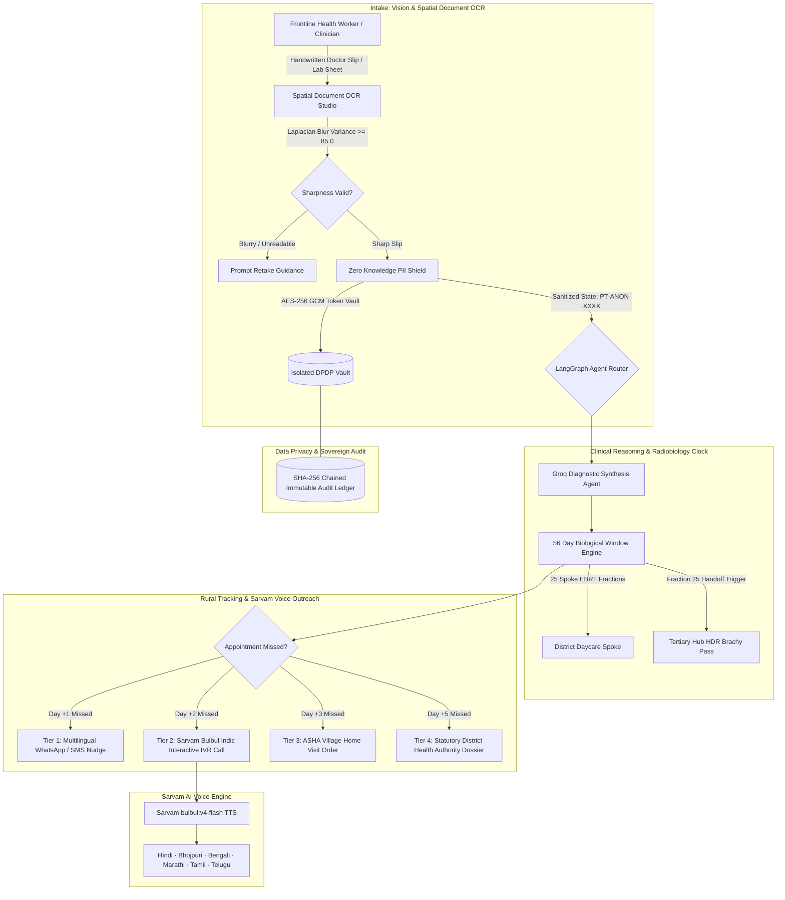

# CerviSetu: Privacy-First Multi-Agent Clinical AI & Rural Oncology Hub-and-Spoke Network

[]()
[]()
[]()
[]()
[]()
[]()

**CerviSetu** is an enterprise grade, privacy first clinical multi-agent platform designed for cervical cancer care across India's hub and spoke healthcare infrastructure. Combining **LangGraph**, **Sarvam AI Indic Speech & Vision**, and **Groq LPU** inference, CerviSetu bridges rural district daycare spokes with regional tertiary cancer centres to enforce the strict **56 Day Radiobiological Curative Window** and prevent treatment dropouts.

---

## System Architecture



---

## Core Capabilities

### 1. Handwritten Clinical Slip Spatial OCR Studio
- **High Precision Clinical Slip Digitization**: Parses handwritten and printed oncologist prescription slips, pathology reports, and staging summaries.
- **In Place Bounding Highlights**: Clinical entities (`Cancer Site`, `FIGO Staging`, `Biopsy Histopathology`, `EBRT Teletherapy Order`, `Hub Brachytherapy Referral`, `56 Day Curative Limit`) are highlighted in non colliding, readable bounding capsules with confidence indicators (`96% to 99%`).
- **Two Way Synchronized Hover Tracing**: Hovering an entity on the prescription slip illuminates the bounding capsule and simultaneously highlights its corresponding row in the Structured Clinical Entity Key Values table.
- **Zero Knowledge DPDP Token Vault**: One click toggle between unmasked clinical views and anonymized workstation views (`PT ANON 7B93`) compliant with the Digital Personal Data Protection (DPDP) Act 2023.
- **Dual Visual Modes**: Toggle between the authentic Clinical Prescription Sheet and the 2D Geometric Spatial Wireframe showing normalized coordinates (`top`, `left`, `width`, `height`) and IoU alignment precision.
- **Animated Sweeping Laser Scan Beam**: Real time visual feedback during OCR extraction.

### 2. Sarvam AI Indic Voice Intelligence (`bulbul:v4-flash`)
- **Native Indic Text to Speech**: Integrates Sarvam AI `bulbul:v4-flash` to synthesize clinical adherence reminders in 6 major regional languages and dialects:
  - **Hindi (Devanagari)** (`ritu_hi_medical`)
  - **Bhojpuri (Purvanchal)** (`ritu_hi_medical`)
  - **Bengali (Bangla)** (`roopa_bn_conversational`)
  - **Marathi** (`sneha_mr_conversational`)
  - **Tamil** (`kavitha_ta_conversational`)
  - **Telugu** (`ananya_te_conversational`)
- **Vernacular Script & SSML**: Generates SSML prompts with conversational cadence, Devanagari/regional scripts, and Latin transliteration.
- **Direct In Browser Audio**: Instant streaming and playback of generated 24kHz WAV audio directly from the dashboard.

### 3. The 56 Day Radiobiological Curative Engine
- **Biological Ceiling Monitoring**: In cervical cancer chemoradiation, treatment interruptions extending overall treatment time beyond 56 days cause accelerated clonogenic repopulation, eroding pelvic tumor control at a rate of 0.8% to 1.2% per day.
- **29 Fraction Tracking**: Coordinates 25 local teletherapy fractions (50 Gy EBRT) at district daycare spokes and triggers automated handoff passes for 4 high dose rate (HDR) intracavitary brachytherapy fractions at regional tertiary hubs.
- **Progressive Multi Tier Escalation**:
  - **Tier 1 (24 Hours Missed)**: Multilingual SMS and WhatsApp reminders.
  - **Tier 2 (48 Hours Missed)**: Automated Sarvam voice IVR outreach to patient and caregiver.
  - **Tier 3 (72 Hours Missed)**: Village ASHA worker dispatch ticket with GPS sector coordinates.
  - **Tier 4 (120 Hours Missed)**: Emergency unmasking and statutory District Chief Medical Officer escalation dossier.

### 4. Laplacian Blur Variance & Image Quality Guard
- **Laplacian Blur Variance**: Rejects illegible slips with variance below the 85.0 threshold.
- **FFT High Frequency Analysis**: Detects fine tissue texture attenuation.
- **Dynamic Contrast & Exposure**: Inspects glare, shadows, and low RMS contrast before clinical inference.

### 5. Multi Agent Reasoning Canvas & District Impact Modeling
- **Live LangGraph Trace**: Visualizes execution DAG latency across `ocr_intake`, `pii_token_vault`, `image_triage`, `radiotherapy_clock`, and `rural_tracker` nodes.
- **District Impact Calculator**: Computes annual lives saved, travel kilometers avoided, and financial savings based on district population and spoke clinic network size.
- **Developer API Studio**: Interactive cURL snippets and live testing console for EHR integration.

---

## Tech Stack

| Layer | Technology |
|---|---|
| **Frontend** | React 19, TypeScript, Vite, Tailwind CSS v4, CareUI Design System |
| **Icons & Branding** | Solar Icons (Outline / Linear), Sovereign Caring Hands Emblem SVG |
| **Backend Framework** | FastAPI (Python 3.14+), Uvicorn, Pydantic v2 |
| **Agent Orchestration** | LangGraph, LangChain Core |
| **Voice AI (TTS & ASR)** | Sarvam AI API (`bulbul:v4-flash`), Indic SSML Engine |
| **High Speed LLM** | Groq LPU (`qwen/qwen3.8-27b`), OpenAI / Anthropic / Google Fallbacks |
| **Computer Vision** | OpenCV Headless, NumPy, Pillow, Laplacian Spatial Kernel |
| **Security & Privacy** | AES-256-GCM Token Vault, SHA-256 Block Chained Audit Ledger |
| **Package Management** | `uv` (Python), `npm` (Frontend) |

---

## Getting Started

### Prerequisites
- Python 3.10+ (Python 3.12 or 3.14 recommended)
- Node.js 18+ & npm
- [`uv`](https://github.com/astral-sh/uv) package manager

### 1. Clone & Configure Environment
```bash
git clone https://github.com/ihatecoding01/health_hackathon.git
cd health_hackathon

# Copy sample environment configuration
cp .env.example .env
```

Add your API keys to `.env`:
```env
# Groq Oncology Inference Key
GROQ_API_KEY=gsk_your_groq_api_key_here
GROQ_MODEL=qwen/qwen3.8-27b

# Sarvam AI Key (Indic Voice & Vision)
SARVAM_API_KEY=sk_your_sarvam_api_key_here
SARVAM_BASE_URL=https://api.sarvam.ai
SARVAM_TTS_MODEL=bulbul:v4-flash

# Vault Secret Key (AES 256 GCM)
VAULT_SECRET_KEY=k9X2mQ7vL4zP1wR8tY5nJ0bV3cE6hA8dF4gK7uM2wP9=
```

### 2. Install Dependencies & Build Frontend
```bash
# Set up Python virtual environment via uv
uv venv
uv sync

# Install frontend dependencies and build production assets
cd frontend
npm install
npm run build
cd ..
```

### 3. Launch the Platform
```bash
# Run the FastAPI server hosting both API and production frontend
.\.venv\Scripts\python.exe main.py --serve --port 8000
```
Open **`http://localhost:8000`** in your browser to access the complete application.

---

## Running the Test Suite

```bash
# Run test suite
.\.venv\Scripts\python.exe -m pytest tests/test_showcase.py tests/test_database.py tests/test_security.py -v
```

---

## API Endpoints Reference

### Showcase & Interactive Intelligence (`/api/showcase`)
- `POST /api/showcase/parse-prescription`: High precision OCR extraction with spatial bounding coordinates and DPDP tokenization.
- `POST /api/showcase/voice-script`: Regional Indic voice adherence script generator.
- `POST /api/showcase/synthesize-speech`: Live Sarvam AI `bulbul:v4-flash` audio synthesis.
- `POST /api/showcase/graph-trace`: Multi agent LangGraph execution DAG trace.
- `POST /api/showcase/district-impact`: Public health population impact modeling.
- `POST /api/showcase/register-pilot`: Pilot district hospital onboarding request.

### Clinical & Tracking Engine (`/api/*`)
- `POST /api/clinical/intake`: Intake clinical slip and trigger LangGraph triage.
- `GET /api/patient/{token}/healing-clock`: Retrieve 29 step fraction progress against the 56 day timer.
- `POST /api/patient/{token}/dispatch-tier`: Simulate progressive missed appointment escalations.
- `GET /api/facilities/hubs-spokes`: Query district radiation spokes and tertiary cancer centre hub pairings.
- `GET /api/logs/chain`: Audit immutable SHA 256 ledger blocks and DPDP compliance.

---

## Project Structure

```
health_hackathon/
├── main.py                     # Server entrypoint and CLI demo
├── pyproject.toml              # UV / Python dependencies
├── .env.example                # Sample environment keys
├── README.md                   # System documentation
├── frontend/                   # CerviSetu Web Application (React 19 + Tailwind v4)
│   ├── src/
│   │   ├── components/
│   │   │   ├── showcase/       # Vision OCR, Voice, Reasoning, Impact, API Studios
│   │   │   ├── icons/          # Solar Icons & CerviSetu Emblem SVG
│   │   │   ├── CareGateway.tsx # Authentication gateway
│   │   │   ├── LandingPage.tsx # Master public portal & showcase
│   │   │   └── OverviewPanel.tsx
│   │   ├── api/client.ts       # Typed API client
│   │   └── App.tsx
│   └── vite.config.ts
├── backend/                    # Core Engine & Services
│   ├── config.py               # Settings, keys, image thresholds
│   ├── core/
│   │   ├── security.py         # AES-256 TokenVault, PIIShield, Chained AuditLedger
│   │   ├── state.py            # LangGraph State schemas
│   │   └── database.py         # Persistence layer
│   ├── tools/
│   │   ├── ocr_tools.py        # Clinical entity extraction
│   │   ├── image_tools.py      # Laplacian blur & FFT validation
│   │   └── tracker_tools.py    # Multi tier escalation dispatch
│   ├── agents/                 # Specialized LangGraph agents
│   └── dashboard/
│       ├── app.py              # FastAPI application factory
│       ├── routers/            # Domain API routers
│       │   ├── showcase.py     # Sarvam voice, vision OCR, impact endpoints
│       │   ├── patient.py      # Healing clock & fraction tracking
│       │   ├── clinical.py     # Diagnostic cases & intake
│       │   └── facilities.py   # Hub & spoke directory
│       └── static/             # Compiled production frontend assets
└── tests/                      # Automated test suite
```

---

## License
MIT License. Built for Health Hackathon 2026.
