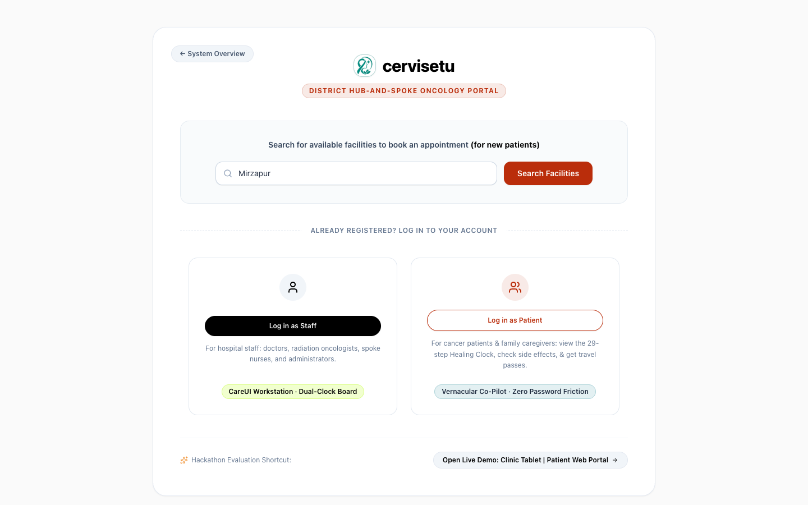
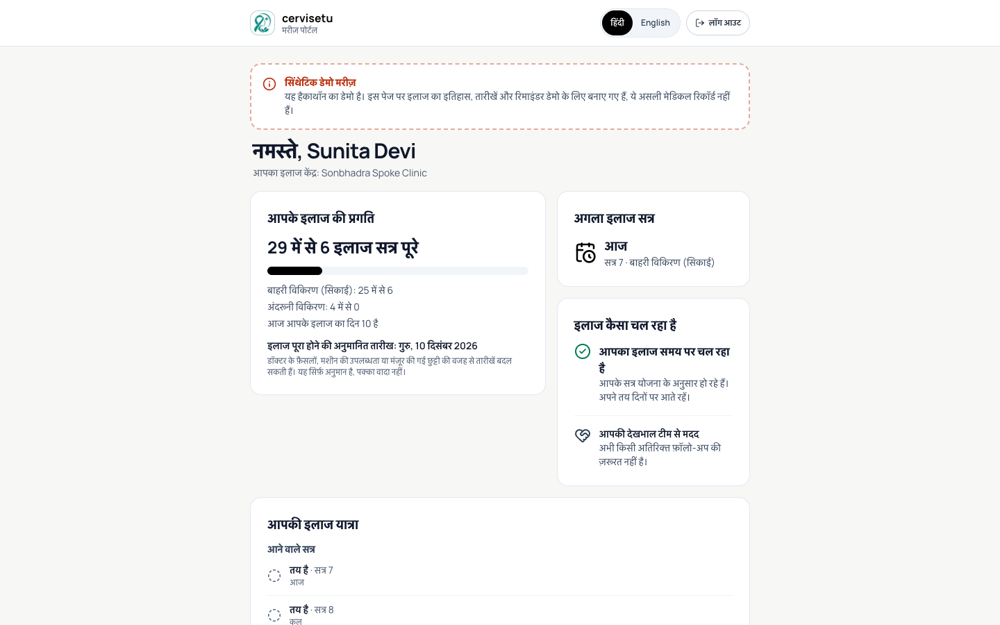
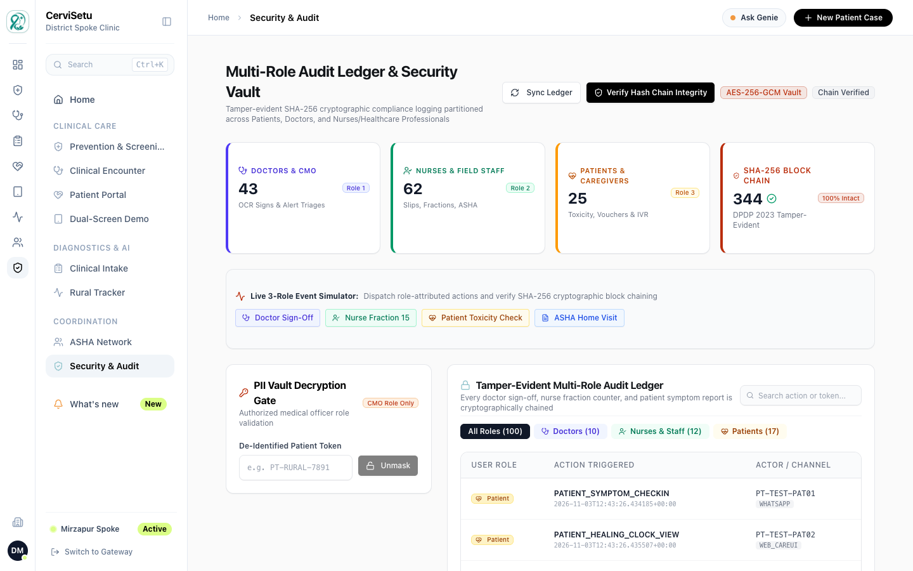
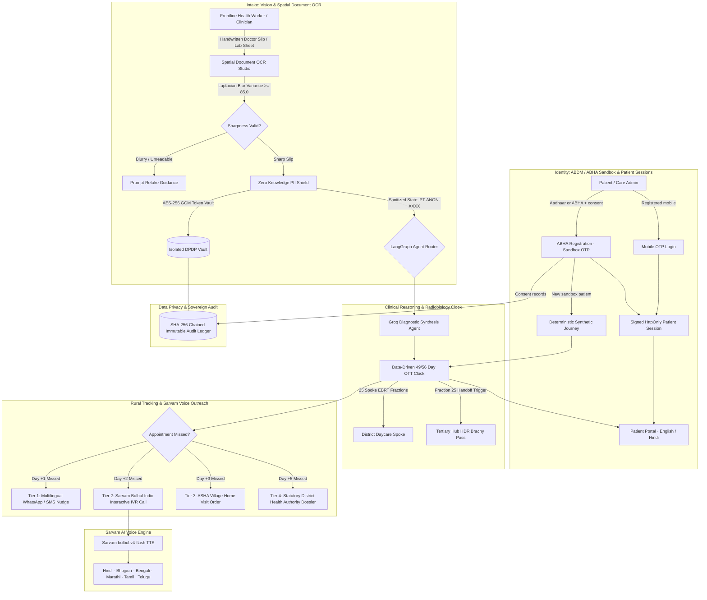

<div align="center">
  
  <h1>CerviSetu</h1>
  <h3>Privacy-First Multi-Agent Clinical AI & Rural Oncology Hub-and-Spoke Network</h3>
  <p><strong>Keeping every cervical cancer patient inside the 56 day curative window, from district spoke to tertiary hub.</strong></p>

  <a href="#running-the-test-suite"></a>
  <a href="https://langchain-ai.github.io/langgraph/"></a>
  <a href="https://www.python.org/"></a>
  <a href="https://react.dev/"></a>
  <a href="https://fastapi.tiangolo.com/"></a>
  <a href="https://www.sarvam.ai/"></a>
  <a href="https://groq.com/"></a>
  <a href="https://abdm.gov.in/"></a>
  <a href="#security--privacy"></a>
</div>

<br>

<div align="center">
  <!-- Replace # with the implementation video link -->
  <a href="#"></a>
</div>

<br>

**CerviSetu** is a privacy-first clinical multi-agent platform for cervical cancer care across India's hub and spoke healthcare infrastructure. Combining **LangGraph**, **Sarvam AI Indic Speech & Vision**, and **Groq LPU** inference, CerviSetu bridges rural district daycare spokes with regional tertiary cancer centres to enforce the strict **56 Day Radiobiological Curative Window** and prevent treatment dropouts.

---

## Contents

- [Application Preview](#application-preview)
- [System Architecture](#system-architecture)
- [Core Capabilities](#core-capabilities)
- [Tech Stack](#tech-stack)
- [Getting Started](#getting-started)
- [Running the Test Suite](#running-the-test-suite)
- [API Endpoints Reference](#api-endpoints-reference)
- [Security & Privacy](#security--privacy)
- [Project Structure](#project-structure)
- [License](#license)

---

## Application Preview

Screenshots of the running application. All patients shown are synthetic demo data.

<table>
  <tr>
    <td width="50%" align="center">
      
      <br><strong>Landing page</strong><br><sub>Public showcase of the 56 day protocol, Indic voice, vision OCR and agent flow.</sub>
    </td>
    <td width="50%" align="center">
      
      <br><strong>Staff workstation</strong><br><sub>Traffic-light ward board grouping patients by the 49/56 day clock.</sub>
    </td>
  </tr>
  <tr>
    <td width="50%" align="center">
      
      <br><strong>Care gateway</strong><br><sub>Facility search, staff login, and patient login by ABHA or mobile OTP.</sub>
    </td>
    <td width="50%" align="center">
      
      <br><strong>Patient portal (Hindi)</strong><br><sub>Session-protected progress, next session and treatment journey, in English or Hindi.</sub>
    </td>
  </tr>
  <tr>
    <td width="50%" align="center">
      
      <br><strong>Clinical encounter</strong><br><sub>Chemo clearance, discharge sign-off and hub transfer for the attending clinician.</sub>
    </td>
    <td width="50%" align="center">
      
      <br><strong>Prevention & screening</strong><br><sub>HPV vaccination, screening and precancer surveillance continuum.</sub>
    </td>
  </tr>
  <tr>
    <td width="50%" align="center">
      
      <br><strong>ASHA network</strong><br><sub>Village home-visit tickets raised by the escalation engine.</sub>
    </td>
    <td width="50%" align="center">
      
      <br><strong>Security & audit</strong><br><sub>SHA-256 chained audit ledger with chain verification.</sub>
    </td>
  </tr>
  <tr>
    <td colspan="2" align="center">
      
      <br><strong>Dual-screen demo</strong><br><sub>Clinic tablet and patient phone side by side, driven by the same live data.</sub>
    </td>
  </tr>
</table>

---

## System Architecture



---

## Core Capabilities

### 1. Handwritten Clinical Slip Spatial OCR Studio
- **High Precision Clinical Slip Digitization**: Parses handwritten and printed oncologist prescription slips, pathology reports, and staging summaries.
- **Real Document OCR (opt-in)**: Uploaded slips and reports can be read by Sarvam Vision when `CERVISETU_OCR_ENABLED=1` and a provider is configured, with page, size, timeout and blur-rejection limits.
- **In Place Bounding Highlights**: Clinical entities (`Cancer Site`, `FIGO Staging`, `Biopsy Histopathology`, `EBRT Teletherapy Order`, `Hub Brachytherapy Referral`, `56 Day Curative Limit`) are highlighted in non colliding, readable bounding capsules with confidence indicators (`96% to 99%`).
- **Two Way Synchronized Hover Tracing**: Hovering an entity on the prescription slip illuminates the bounding capsule and simultaneously highlights its corresponding row in the Structured Clinical Entity Key Values table.
- **Zero Knowledge DPDP Token Vault**: One click toggle between unmasked clinical views and anonymized workstation views (`PT ANON 7B93`) compliant with the Digital Personal Data Protection (DPDP) Act 2023.
- **Dual Visual Modes**: Toggle between the authentic Clinical Prescription Sheet and the 2D Geometric Spatial Wireframe showing normalized coordinates (`top`, `left`, `width`, `height`) and IoU alignment precision.
- **Animated Sweeping Laser Scan Beam**: Real time visual feedback during OCR extraction.

### 2. Sarvam AI Indic Voice Intelligence (`bulbul:v4-flash`)
- **Native Indic Text to Speech**: Integrates Sarvam AI `bulbul:v4-flash` to synthesize clinical adherence reminders in 6 major regional languages and dialects:
  - **Hindi (Devanagari)** (`ritu_hi_medical`)
  - **Bhojpuri (Purvanchal)** (`ritu_hi_medical`)
  - **Bengali (Bangla)** (`roopa_bn_conversational`)
  - **Marathi** (`sneha_mr_conversational`)
  - **Tamil** (`kavitha_ta_conversational`)
  - **Telugu** (`ananya_te_conversational`)
- **Vernacular Script & SSML**: Generates SSML prompts with conversational cadence, Devanagari/regional scripts, and Latin transliteration.
- **Direct In Browser Audio**: Instant streaming and playback of generated 24kHz WAV audio directly from the dashboard.
- **Credit-Aware AI Usage**: Generated audio is cached and AI calls are tracked (`/api/dev/ai-usage`), so repeated demos do not spend Sarvam credits again.

### 3. The 56 Day Radiobiological Curative Engine
- **Biological Ceiling Monitoring**: In cervical cancer chemoradiation, treatment interruptions extending overall treatment time beyond 56 days cause accelerated clonogenic repopulation, eroding pelvic tumor control at a rate of 0.8% to 1.2% per day.
- **Real Date-Driven Clock**: The overall treatment time (OTT) clock is computed from real calendar dates against the GEC-ESTRO 49 day target and 56 day limit. It accounts for treatment weekdays, planned rest days, facility downtime and clinician-approved pauses.
- **29 Fraction Tracking**: Coordinates 25 local teletherapy fractions (50 Gy EBRT) at district daycare spokes and triggers automated handoff passes for 4 high dose rate (HDR) intracavitary brachytherapy fractions at regional tertiary hubs.
- **Progressive Multi Tier Escalation**:
  - **Tier 1 (24 Hours Missed)**: Multilingual SMS and WhatsApp reminders.
  - **Tier 2 (48 Hours Missed)**: Automated Sarvam voice IVR outreach to patient and caregiver.
  - **Tier 3 (72 Hours Missed)**: Village ASHA worker dispatch ticket with GPS sector coordinates.
  - **Tier 4 (120 Hours Missed)**: Emergency unmasking and statutory District Chief Medical Officer escalation dossier.
- **Scheduled Escalation Cycle**: A background scheduler runs the escalation cycle on an interval (`CERVISETU_ESCALATION_INTERVAL_HOURS`, default 24).

### 4. ABDM / ABHA Registration & Patient Portal
- **ABHA Registration (Sandbox)**: Create a synthetic ABHA number and address from Aadhaar/Virtual ID, or link an existing ABHA. Every DPDP consent item must be granted, and each one is recorded.
- **OTP Security**: OTPs are stored hashed, expire after 10 minutes, lock after 5 wrong attempts, and limit resends. Aadhaar is never stored in plaintext, only as a keyed hash.
- **Collision-Safe & Resumable**: ABHA numbers and addresses are allocated with bounded retries. The OTP is consumed only after registration is saved, so a failed attempt can be retried with the same OTP without creating a duplicate patient. Concurrent verifies of the same OTP are serialized by a database lease.
- **Mobile OTP Login**: Returning patients log in with their registered mobile number.
- **Session-Protected Patient Portal**: A signed, HttpOnly, SameSite-strict session cookie (30 minutes) scopes every portal request to the logged-in patient. Patients see their progress, next session, treatment journey and session history, in **English or Hindi**.
- **Synthetic Demo Journeys**: New sandbox patients get a deterministic, clearly labelled synthetic treatment journey. These patients are excluded from the real case queue, ward board and escalations, and their FHIR export is tagged `SYNTHETIC_DEMO`.

### 5. Laplacian Blur Variance & Image Quality Guard
- **Laplacian Blur Variance**: Rejects illegible slips with variance below the 85.0 threshold.
- **FFT High Frequency Analysis**: Detects fine tissue texture attenuation.
- **Dynamic Contrast & Exposure**: Inspects glare, shadows, and low RMS contrast before clinical inference.

### 6. Multi Agent Reasoning Canvas & District Impact Modeling
- **Live LangGraph Trace**: Visualizes execution DAG latency across `ocr_intake`, `pii_token_vault`, `image_triage`, `radiotherapy_clock`, and `rural_tracker` nodes.
- **District Impact Calculator**: Computes annual lives saved, travel kilometers avoided, and financial savings based on district population and spoke clinic network size.
- **Developer API Studio**: Interactive cURL snippets and live testing console for EHR integration.
- **FHIR Export**: Patient data can be exported as a FHIR bundle (`/api/fhir/patient/{token}`).

### 7. Prevention, Clinical Encounter & ASHA Coordination
- **Prevention Continuum**: HPV vaccination records and outreach, screening, precancer treatment and surveillance.
- **Clinical Encounter**: Chemo clearance, LINAC downtime reporting, hub deficiency returns and discharge sign-off.
- **ASHA Network**: Field tickets for home visits, with recorded outcomes.

---

## Tech Stack

| Layer | Technology |
|---|---|
| **Frontend** | React 19, TypeScript 6, Vite 8, Tailwind CSS v4, CareUI Design System |
| **Icons & Branding** | Solar Icons, Lucide, CerviSetu teal ribbon emblem (`#018C7F`) |
| **Localization** | English and Hindi patient UI (`frontend/src/i18n`) |
| **Backend Framework** | FastAPI (Python 3.14+), Uvicorn, Pydantic v2 |
| **Agent Orchestration** | LangGraph, LangChain Core |
| **Voice AI (TTS & ASR)** | Sarvam AI API (`bulbul:v4-flash`), Indic SSML Engine |
| **Document OCR** | Sarvam Vision (opt-in), OpenCV blur gate |
| **High Speed LLM** | Groq LPU (`qwen/qwen3.8-27b`), OpenAI / Anthropic / Google Fallbacks |
| **Computer Vision** | OpenCV Headless, NumPy, Pillow, Laplacian Spatial Kernel |
| **Health Interoperability** | ABDM / ABHA sandbox flow, FHIR patient bundle export |
| **Security & Privacy** | AES-256-GCM Token Vault, HMAC-SHA256 keyed hashes, signed patient sessions, SHA-256 Block Chained Audit Ledger |
| **Persistence** | SQLite (local), optional Supabase |
| **Testing** | pytest (163 tests) |
| **Package Management** | `uv` (Python), `npm` (Frontend) |

---

## Getting Started

### Prerequisites
- Python 3.14+
- Node.js 18+ & npm
- [`uv`](https://github.com/astral-sh/uv) package manager

### 1. Clone & Configure Environment
```bash
git clone https://github.com/ihatecoding01/health_hackathon.git
cd health_hackathon

# Copy sample environment configuration
cp .env.example .env
```

Add your API keys to `.env`:
```env
# Groq Oncology Inference Key
GROQ_API_KEY=gsk_your_groq_api_key_here
GROQ_MODEL=qwen/qwen3.8-27b

# Sarvam AI Key (Indic Voice & Vision)
SARVAM_API_KEY=sk_your_sarvam_api_key_here
SARVAM_BASE_URL=https://api.sarvam.ai
SARVAM_TTS_MODEL=bulbul:v4-flash

# Vault Secret Key (AES 256 GCM). Generate your own; never commit it.
VAULT_SECRET_KEY=your_32_byte_base64_key_here

# Optional
CERVISETU_ABDM_MODE=sandbox_simulated   # ABHA flow is simulated; refused when CERVISETU_ENV=production
CERVISETU_OCR_ENABLED=0                 # set to 1 with CERVISETU_OCR_PROVIDER=sarvam_vision for real OCR
```

Generate a vault key with:
```bash
python3 -c "import base64, os; print(base64.b64encode(os.urandom(32)).decode())"
```

> Keep API keys private. Never paste them into chats or commit them; rotate any key that has been shared.

### 2. Install Dependencies & Build Frontend
```bash
# Set up Python virtual environment via uv
uv venv
uv sync

# Install frontend dependencies and build production assets
cd frontend
npm install
npm run build
cd ..
```

### 3. Launch the Platform
```bash
# macOS / Linux
uv run python main.py --serve --port 8000

# Windows
.\.venv\Scripts\python.exe main.py --serve --port 8000
```
Open **`http://localhost:8000`** in your browser to access the complete application.

| Path | View |
|---|---|
| `/` | Landing page |
| `/gateway` | Care gateway: staff login, ABHA registration, patient mobile OTP login |
| `/staff/overview` | Staff workstation (also `/staff/prevention`, `/staff/encounter`, `/staff/intake`, `/staff/tracker`, `/staff/asha`, `/staff/audit`) |
| `/patient/{token}` | Patient portal (requires a patient session) |
| `/demo` | Dual-screen clinic tablet and patient phone demo |

**Demo login:** in the gateway, use patient mobile OTP login with `9876543210`. The sandbox OTP is shown on screen.

---

## Running the Test Suite

```bash
# Run the full test suite (163 tests)
uv run pytest -q

# Windows
.\.venv\Scripts\python.exe -m pytest -q
```

Tests run offline: LLM calls, Sarvam, OCR and the scheduler are disabled, and data goes to a temporary directory.

---

## API Endpoints Reference

### Showcase & Interactive Intelligence (`/api/showcase`)
- `POST /api/showcase/parse-prescription`: High precision OCR extraction with spatial bounding coordinates and DPDP tokenization.
- `POST /api/showcase/voice-script`: Regional Indic voice adherence script generator.
- `POST /api/showcase/synthesize-speech`: Live Sarvam AI `bulbul:v4-flash` audio synthesis.
- `POST /api/showcase/graph-trace`: Multi agent LangGraph execution DAG trace.
- `POST /api/showcase/district-impact`: Public health population impact modeling.
- `POST /api/showcase/register-pilot`: Pilot district hospital onboarding request.

### ABDM / ABHA Registration (`/api/abdm`)
- `GET /api/abdm/consents`: Consent items the patient must grant.
- `POST /api/abdm/otp/request`: Start ABHA generation or linking and send a sandbox OTP.
- `POST /api/abdm/otp/resend`: Resend the OTP (rate limited).
- `POST /api/abdm/otp/verify`: Verify the OTP, complete registration and start a patient session.
- `POST /api/abdm/login/mobile/request`: Mobile OTP login for registered patients.
- `GET /api/abdm/profile/{token}`: Masked synthetic ABHA profile.

### Patient Portal (`/api/portal`, session-scoped)
- `GET /api/portal/session`: Current patient session.
- `POST /api/portal/logout`: End the session.
- `GET /api/portal/{token}/overview`: Progress, next session and treatment journey.
- `GET /api/portal/{token}/sessions`: Treatment session history.

### Clinical & Tracking Engine (`/api/*`)
- `POST /api/run-case`: Run a clinical case through the LangGraph pipeline.
- `GET /api/cases`: Active clinical case queue.
- `GET /api/ward-board`: Traffic-light ward board.
- `GET /api/patient/{token}/healing-clock`: Retrieve 29 step fraction progress against the 56 day timer.
- `GET /api/patient/{token}/clock`: Date-driven OTT clock for a patient's treatment plan.
- `POST /api/patient/{token}/treatment-plan`: Create a treatment plan.
- `POST /api/simulate-escalation`: Simulate progressive missed appointment escalations.
- `POST /api/escalation/run-cycle`: Run one escalation cycle.
- `GET /api/facilities/search`: Search district radiation spokes and tertiary cancer centre hubs.
- `GET /api/fhir/patient/{token}`: FHIR patient bundle export.

### Prevention (`/api/prevention`)
- `POST /api/prevention/vaccination`, `POST /api/prevention/screening`, `POST /api/prevention/precancer-treatment`: Record prevention events.
- `GET /api/prevention/precancer-surveillance`: Precancer surveillance list.

### Audit & Logging (`/api/*`)
- `GET /api/audit-logs`: Audit ledger entries.
- `GET /api/logs/verify-chain`: Verify the SHA-256 chained audit ledger and DPDP compliance.
- `GET /api/logs/asha/tickets`: ASHA field tickets.

Full interactive docs are available at **`/docs`** while the server is running.

---

## Security & Privacy

- **PII Vault**: Patient PII is encrypted with AES-256-GCM. Identifiers such as Aadhaar, ABHA numbers, ABHA addresses and mobile numbers are stored only as HMAC-SHA256 keyed hashes.
- **Consent**: ABHA registration requires every DPDP consent item, and each consent is recorded with a hash.
- **Patient Sessions**: The portal uses a signed, HttpOnly, SameSite-strict cookie limited to `/api`. A patient can only read their own data.
- **Audit Ledger**: Every sensitive action is written to a SHA-256 chained, append-only ledger that can be verified end to end.
- **Sandbox Boundaries**: The ABHA flow is simulated and refused in production mode. Synthetic demo patients are labelled at every level and kept out of real clinical queues.
- **Known Limitations**: Staff screens are open for the hackathon demo and need real staff authentication before production use. The PII vault is a separate file store, so registration is made safe by idempotent, resumable steps rather than one cross-store transaction.

---

## Project Structure

```
health_hackathon/
├── main.py                     # Server entrypoint and CLI demo
├── pyproject.toml              # UV / Python dependencies
├── .env.example                # Sample environment keys
├── README.md                   # System documentation
├── docs/                       # Architecture, flows and screenshots
├── frontend/                   # CerviSetu Web Application (React 19 + Tailwind v4)
│   ├── public/
│   │   └── cervisetu-logo.png  # Brand emblem and favicon
│   ├── src/
│   │   ├── components/
│   │   │   ├── showcase/       # Vision OCR, Voice, Reasoning, Impact, API Studios
│   │   │   ├── careui/         # CareUI design system
│   │   │   ├── icons/          # Solar Icons & CerviSetu logo component
│   │   │   ├── CareGateway.tsx # Login gateway: staff, ABHA, mobile OTP
│   │   │   ├── AbhaRegistration.tsx # Stepped ABHA registration with consent
│   │   │   ├── MobileOtpLogin.tsx   # Patient mobile OTP login
│   │   │   ├── PatientPortal.tsx    # Session-protected patient portal
│   │   │   ├── LandingPage.tsx # Master public portal & showcase
│   │   │   └── OverviewPanel.tsx
│   │   ├── i18n/               # English / Hindi patient strings
│   │   ├── api/                # Typed API clients (client, abdm, portal)
│   │   └── App.tsx
│   └── vite.config.ts
├── backend/                    # Core Engine & Services
│   ├── config.py               # Settings, keys, image thresholds
│   ├── core/
│   │   ├── security.py         # AES-256 TokenVault, PIIShield, Chained AuditLedger
│   │   ├── patient_session.py  # Signed patient session cookies
│   │   ├── state.py            # LangGraph State schemas
│   │   └── database.py         # Persistence layer
│   ├── tools/
│   │   ├── abdm_registration.py # ABHA sandbox registration and OTP engine
│   │   ├── synthetic_journey.py # Deterministic synthetic demo journeys
│   │   ├── treatment_clock.py  # Date-driven 49/56 day OTT clock
│   │   ├── escalation_scheduler.py # Scheduled escalation cycle
│   │   ├── document_ocr.py     # Opt-in real document OCR
│   │   ├── fhir_export.py      # FHIR patient bundle export
│   │   ├── ocr_tools.py        # Clinical entity extraction
│   │   ├── image_tools.py      # Laplacian blur & FFT validation
│   │   └── tracker_tools.py    # Multi tier escalation dispatch
│   ├── agents/                 # Specialized LangGraph agents
│   └── dashboard/
│       ├── app.py              # FastAPI application factory
│       ├── routers/            # Domain API routers
│       │   ├── showcase.py     # Sarvam voice, vision OCR, impact endpoints
│       │   ├── abdm.py         # ABHA registration and OTP login
│       │   ├── portal.py       # Session-scoped patient portal
│       │   ├── patient.py      # Healing clock & fraction tracking
│       │   ├── clinical.py     # Diagnostic cases, ward board & intake
│       │   ├── prevention.py   # Vaccination, screening & surveillance
│       │   ├── logs.py         # Audit ledger & multi-role logging
│       │   └── facilities.py   # Hub & spoke directory
│       └── static/             # Compiled production frontend assets
└── tests/                      # Automated test suite (163 tests)
```

---

## License
MIT License. Built for Health Hackathon 2026.
