<div align="center">
  
  <h1>CerviSetu</h1>
  <h3>Cervical Cancer Referral Pathway for India's Health Posts, Hospitals and ASHA Workers</h3>
  <p><strong>No woman lost between an abnormal screening and care.</strong></p>

  <a href="#running-the-test-suite"></a>
  <a href="https://www.python.org/"></a>
  <a href="https://react.dev/"></a>
  <a href="https://fastapi.tiangolo.com/"></a>
  <a href="https://langchain-ai.github.io/langgraph/"></a>
  <br>
  <a href="https://www.sarvam.ai/"></a>
  <a href="https://abdm.gov.in/"></a>
  <a href="#security--privacy"></a>
  <a href="#multilingual-interface-7-languages"></a>
</div>

<br>

<div align="center">
  <!-- Replace # with the implementation video link. A scene-by-scene script is in docs/VIDEO_DEMO_WALKTHROUGH.md -->
  <a href="#"></a>
</div>

<br>

**CerviSetu** connects health posts, referral hospitals, ASHA workers and patients across the cervical cancer referral pathway. When a woman has an abnormal screening (VIA, VILI, Pap or HPV), she is referred to a hospital, and many never arrive. CerviSetu follows every referral for **14 days**: daily reminders, then calls from the health post, then an ASHA home visit that records her decision. Every case stays visible until the hospital confirms she has arrived.

The platform has **six role-based portals** (patient, doctor, nurse, ASHA worker, hospital desk and administrator) built on one shared design. Each role sees only what it needs. Every screen can be switched between **English, Hindi, Bhojpuri, Bengali, Marathi, Tamil and Telugu**.

> CerviSetu is decision support and coordination software. It is **not a diagnostic tool**. Every clinical decision stays with a clinician.

---

## Contents

- [Application Preview](#application-preview)
- [The Referral Pathway](#the-referral-pathway)
- [System Architecture](#system-architecture)
- [Portals and Features](#portals-and-features)
  - [Landing Page](#landing-page)
  - [Care Gateway and Sign-in](#care-gateway-and-sign-in)
  - [Patient Portal](#patient-portal)
  - [Doctor Portal](#doctor-portal)
  - [Nurse Portal](#nurse-portal)
  - [ASHA Worker Portal](#asha-worker-portal)
  - [Hospital Desk](#hospital-desk)
  - [Administrator Portal](#administrator-portal)
  - [Ask Genie (AI Assistant)](#ask-genie-ai-assistant)
  - [Multilingual Interface (7 Languages)](#multilingual-interface-7-languages)
  - [Responsive Design](#responsive-design)
- [Platform Capabilities](#platform-capabilities)
- [Tech Stack](#tech-stack)
- [Getting Started](#getting-started)
- [Deploying the Frontend (Cloudflare Pages)](#deploying-the-frontend-cloudflare-pages)
- [Running the Test Suite](#running-the-test-suite)
- [API Endpoints Reference](#api-endpoints-reference)
- [Security & Privacy](#security--privacy)
- [Known Limitations](#known-limitations)
- [Project Structure](#project-structure)
- [License](#license)

---

## Application Preview

Screenshots of the running application. Every patient shown is fictional demo data.

<table>
  <tr>
    <td width="50%" align="center">
      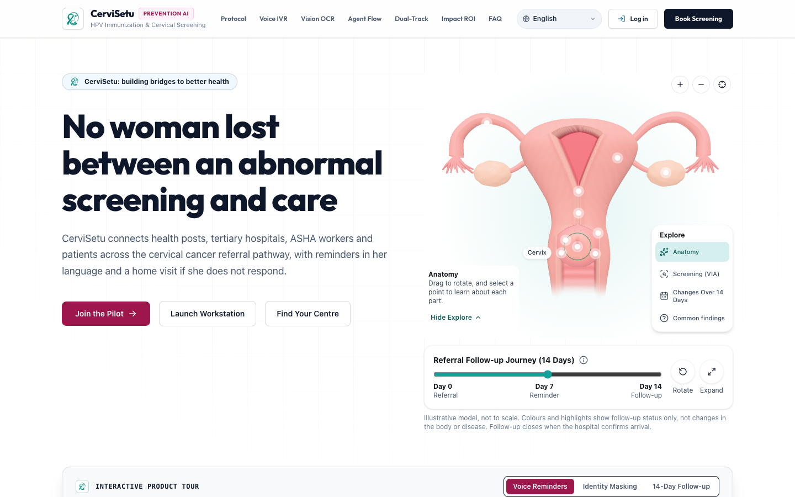
      <br><strong>Landing page</strong><br><sub>Interactive 3D cervix model, the 14-day follow-up journey and a product tour.</sub>
    </td>
    <td width="50%" align="center">
      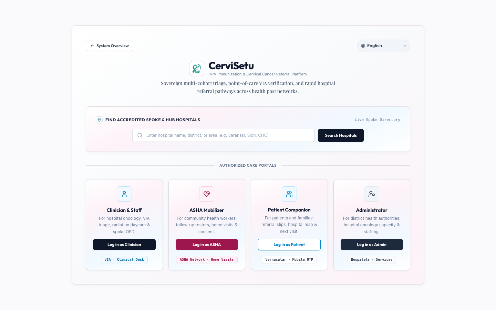
      <br><strong>Care gateway</strong><br><sub>One entry point for staff, ASHA workers and patients.</sub>
    </td>
  </tr>
  <tr>
    <td width="50%" align="center">
      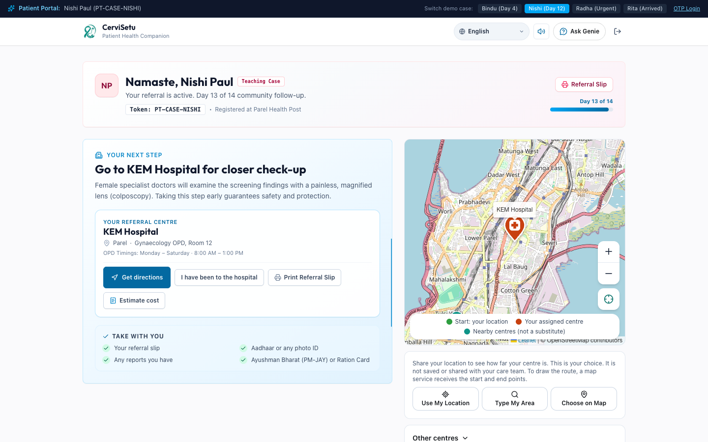
      <br><strong>Patient portal</strong><br><sub>Next step, referral centre, directions, cost estimate and a map of nearby centres.</sub>
    </td>
    <td width="50%" align="center">
      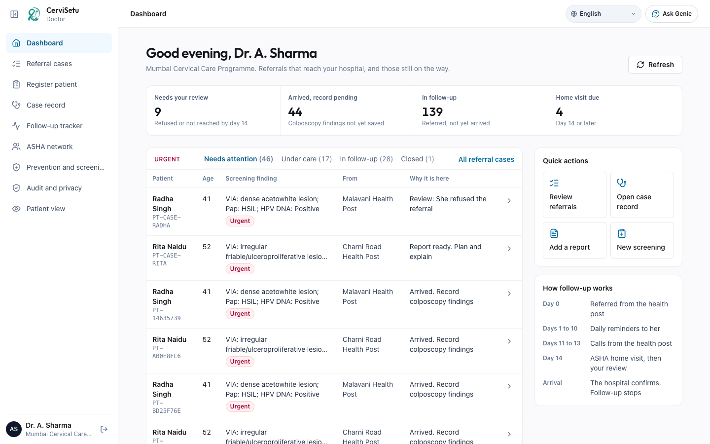
      <br><strong>Doctor dashboard</strong><br><sub>Urgent cases first, with counts for review, follow-up and arrivals.</sub>
    </td>
  </tr>
  <tr>
    <td width="50%" align="center">
      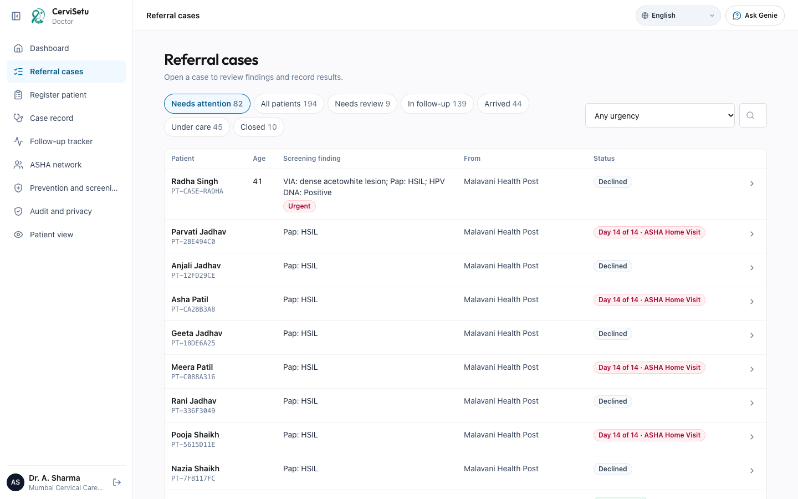
      <br><strong>Referral cases</strong><br><sub>Opens on "Needs attention", with filters for all patients, review, follow-up, arrivals, care and closed.</sub>
    </td>
    <td width="50%" align="center">
      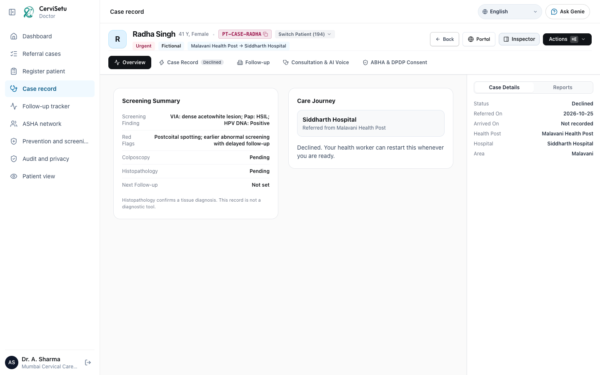
      <br><strong>Case record</strong><br><sub>Screening summary, care journey, clinical findings, follow-up history and reports.</sub>
    </td>
  </tr>
  <tr>
    <td width="50%" align="center">
      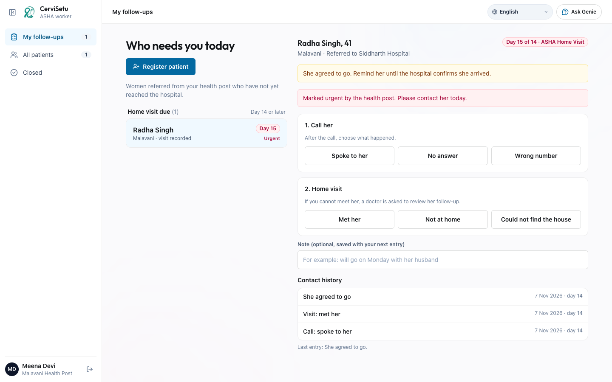
      <br><strong>ASHA worker</strong><br><sub>Who needs you today: home visits due, then reminders running.</sub>
    </td>
    <td width="50%" align="center">
      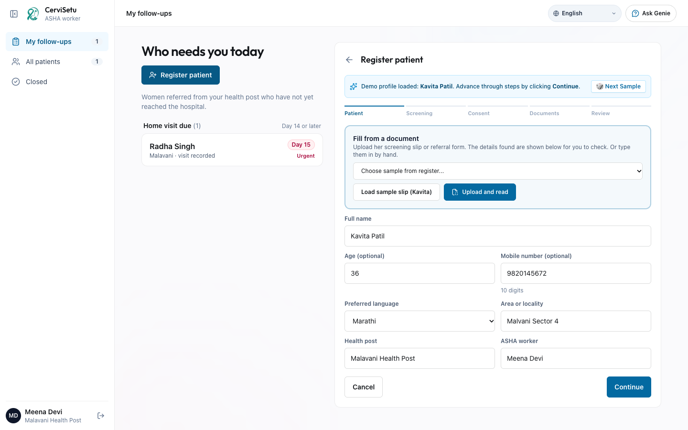
      <br><strong>ASHA patient registration</strong><br><sub>Step-by-step registration with a duplicate check, consent and document upload.</sub>
    </td>
  </tr>
  <tr>
    <td width="50%" align="center">
      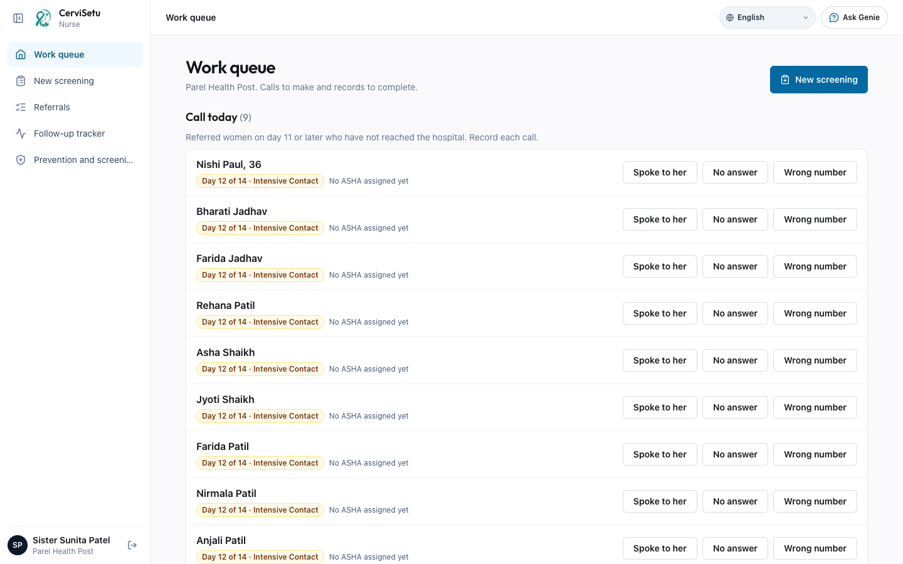
      <br><strong>Nurse</strong><br><sub>Work queue of referrals that need a call or action today.</sub>
    </td>
    <td width="50%" align="center">
      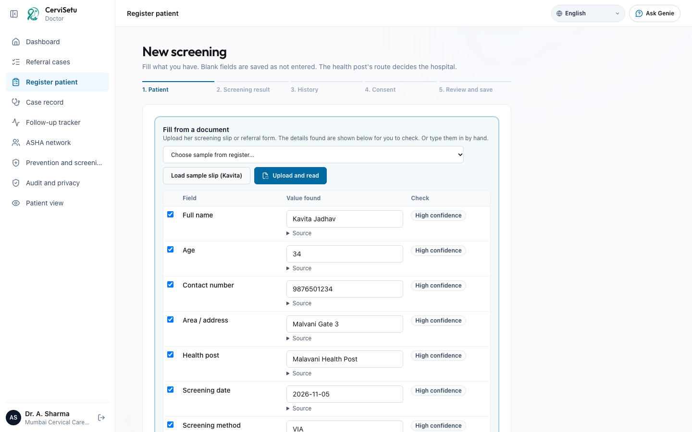
      <br><strong>Register patient</strong><br><sub>Five-step intake for nurses and doctors.</sub>
    </td>
  </tr>
  <tr>
    <td width="50%" align="center">
      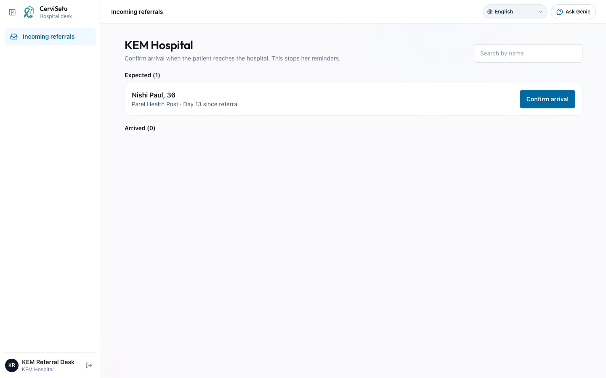
      <br><strong>Hospital desk</strong><br><sub>Incoming referrals and arrival confirmation.</sub>
    </td>
    <td width="50%" align="center">
      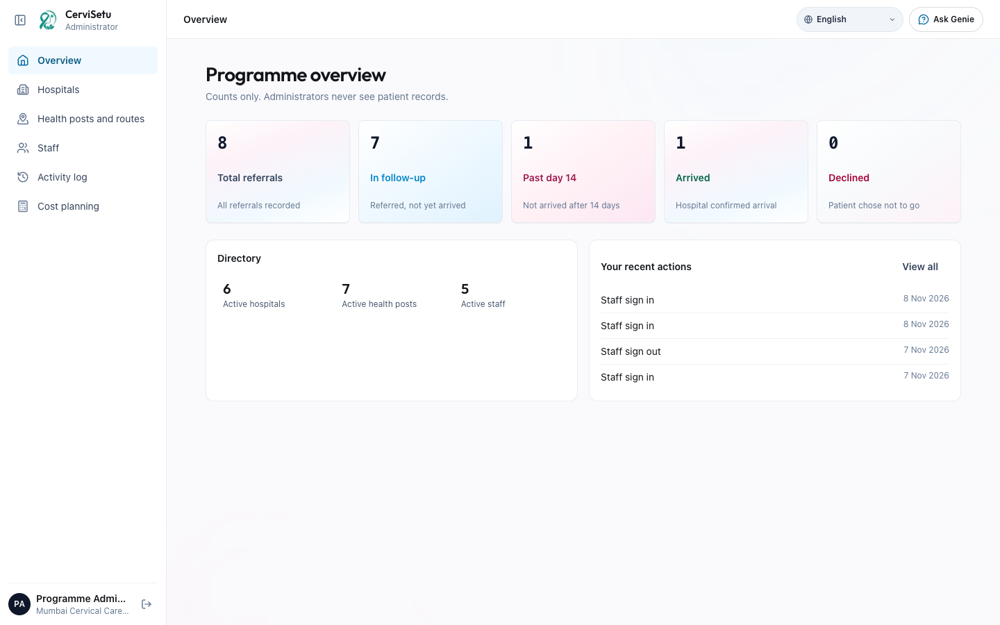
      <br><strong>Administrator</strong><br><sub>Programme counts, directory, staff and activity log.</sub>
    </td>
  </tr>
  <tr>
    <td width="50%" align="center">
      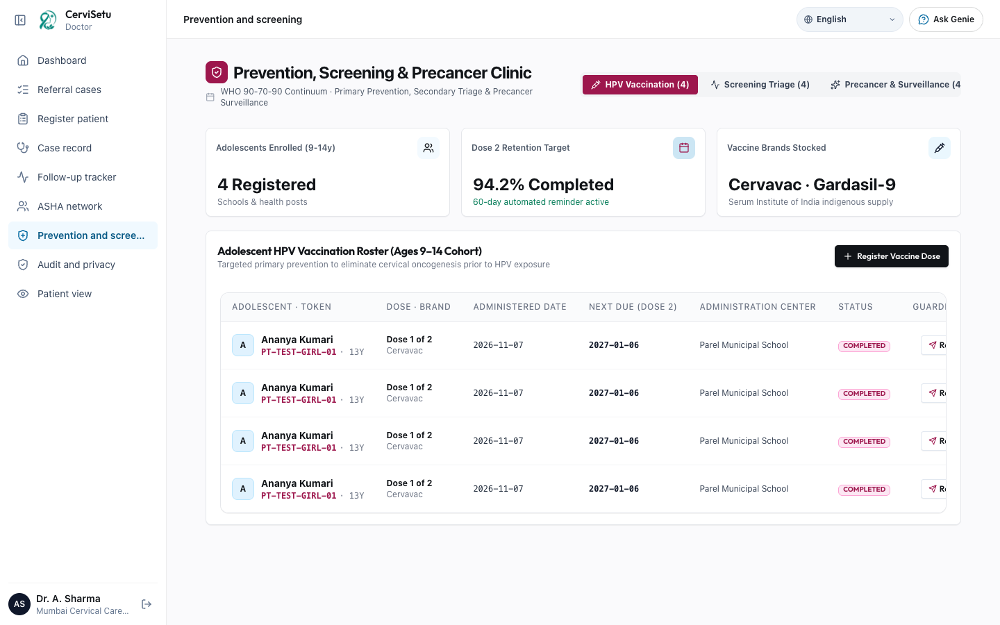
      <br><strong>Prevention and screening</strong><br><sub>HPV vaccination, screening triage and precancer surveillance.</sub>
    </td>
    <td width="50%" align="center">
      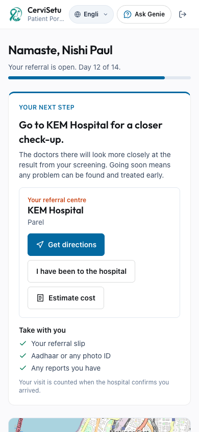
      <br><strong>Patient portal on a phone</strong><br><sub>Every portal adapts to phone, tablet and laptop widths.</sub>
    </td>
  </tr>
</table>

---

## The Referral Pathway

```
Health post screening ──► Referral ──► 14-day follow-up ──► Arrival ──► Colposcopy ──► Biopsy ──► Report ──► Treatment plan ──► Completed
                                             │
                                             ├─ Days 1 to 10:  daily reminder to the patient (and her family, if she agrees)
                                             ├─ Days 11 to 13: calls from the health post
                                             └─ Day 14:        ASHA home visit that records her decision
```

- **Statuses**: Referred, Arrived, Colposcopy done, Biopsy taken, Report ready, Treatment planned and Completed, plus Declined.
- **Follow-up stops** as soon as the hospital confirms arrival.
- **Declined is not the end**: a woman who declines goes to doctor review, and her health worker can restart the referral when she is ready.
- **Consent first**: contact and follow-up consent are recorded at registration. Without consent, no reminders are sent.
- **Daily cycle**: a scheduled job moves every open referral to the right step of the 14 days.

---

## System Architecture

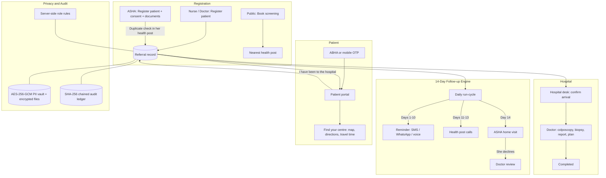

---

## Portals and Features

### Landing Page
- **Interactive 3D cervix model**: drag to rotate, zoom and switch between anatomy, screening (VIA) and common findings. The model is illustrative and labelled as such.
- **14-day follow-up journey**: an interactive timeline from referral (day 0) to reminders (day 7) and the ASHA visit (day 14).
- **Interactive product tour**: voice reminders, identity masking and the 14-day follow-up, shown in place.
- **Showcase studios**: Indic voice reminders (Sarvam), sample document reading (vision OCR), the agent flow, a district impact calculator and an API studio.
- **Book screening**: a public page that helps a woman find a screening at a nearby health post.
- **Layout-aware header**: section links move into a menu when a language's labels do not fit, so nothing is pushed off screen.

### Care Gateway and Sign-in
- **One entry point** with separate paths for staff, ASHA workers and patients.
- **Staff sign-in**: choose a role (doctor, nurse, ASHA worker, hospital desk or administrator) and sign in with a staff ID and PIN. Sessions are signed, HttpOnly cookies, with PIN lockout and audited sign-ins.
- **Patients**: ABHA registration (sandbox) with every DPDP consent item, or mobile OTP login for returning patients.

### Patient Portal
A two-column layout on laptops that stacks naturally on tablets and phones.
- **Your next step**: one clear sentence about what to do now, with the day of her referral ("Day 12 of 14").
- **Referral centre card**: her assigned hospital, with **Get directions** (Google Maps), **I have been to the hospital** (tells her health post; the hospital then confirms) and **Estimate cost**.
- **Cost estimate**: opens inside the card and breaks down consultation, colposcopy, biopsy, medicines and travel. It is clearly marked as **sample figures for demonstration, not real hospital charges**, until real prices are configured.
- **Take with you**: a short checklist (referral slip, Aadhaar or photo ID, previous reports).
- **Find your centre map**: her assigned centre and nearby centres, with a clear note that nearby centres are not a substitute unless her health worker says so.
- **Location tools**: use my location, type my area or choose on the map. Only after she shares a location does the distance panel appear, with a **realistic travel-time range** ("X to Y min by car in usual traffic", based on city speeds).
- **Care journey**: her progress through the pathway, plus **Need help?**, reminder messages and her details.
- **Ask Genie**: questions about her own referral in her language, with voice.
- **Session-protected**: she can only ever see her own record.

### Doctor Portal
- **Dashboard**: shows **urgent cases only**, with counts for needs review, arrived and reports pending, in follow-up, and home visits due. Quick actions open referrals, a case record, report upload and a new screening.
- **Referral cases**: opens on **Needs attention**, sorted by priority. Filters for **All patients**, review, follow-up, arrived, under care and closed, plus an urgency filter and search by name, patient ID or referral ID.
- **Case record**: a patient header with ID, urgency and route (health post → hospital), and a patient switcher.
  - **Overview**: screening summary, red flags, colposcopy, histopathology and next follow-up.
  - **Case record**: record colposcopy, biopsy, histopathology, MRI, final diagnosis, treatment plan and remarks, and move the status forward.
  - **Follow-up**: every reminder, call, visit and reply in order.
  - **Consultation and AI voice**: record or type a consultation and get an editable draft. Voice commands appear as buttons and do nothing until the doctor confirms.
  - **ABHA and DPDP consent**.
  - **Reports rail**: case details and attached reports (VIA and colposcopy images, histopathology, MRI), stored encrypted.
- **Register patient**: the same step-by-step registration nurses use (patient, screening result, history, consent, review).
- **Follow-up tracker**: where every open referral is in the 14 days.
- **ASHA network**: assign an ASHA worker and see field activity.
- **Prevention and screening**: HPV vaccination (with outreach), screening triage and precancer surveillance.
- **Audit and privacy**: the chained audit ledger with chain verification.
- **Teaching cases**: reference cases for doctors, kept apart from real patient queues.

### Nurse Portal
- **Work queue**: referrals that need a call or action today.
- **New screening**: a 5-step intake (patient, screening result, history, consent, review and save) that creates a referral and routes it to the right hospital for the health post.
- **Referrals**: the same filterable list, defaulting to all patients.
- **Follow-up tracker** and **Prevention and screening**.
- **Calls**: record call outcomes (no answer, spoke to her, family reminded) on days 11 to 13.

### ASHA Worker Portal
Designed for a phone in the field.
- **Who needs you today**: home visits due (day 14 or later) first, then women whose reminders are still running.
- **Patient panel**: call her, record the outcome, or record a home visit and her decision.
- **Register patient**: a step-by-step form (patient, screening, consent, documents, review).
  - **Duplicate check** by name and phone within her own health post, before a new record is created.
  - **Consent** for contact and follow-up. If follow-up is refused, the case goes to doctor review and no reminders are sent.
  - **Document upload**: screening report and referral slip only, and only with the woman's photo consent. ASHA workers can never upload or open clinical reports.
  - The health post always comes from her session, not the form, and the same request sent twice creates one record.
- **Privacy by design**: ASHA workers never see screening findings, only what they need to reach her.
- **Closed**: women who arrived or completed care.

### Hospital Desk
- **Incoming referrals**: women referred to this hospital, with the health post and red flags.
- **Confirm arrival**: stops the 14-day follow-up and moves the case to the doctor.

### Administrator Portal
- **Overview**: total referrals, in follow-up, past day 14, arrived and declined, plus directory counts and recent actions. Administrators never see patient records.
- **Hospitals**: add, edit, activate and deactivate referral hospitals.
- **Health posts and routes**: which hospital each health post refers to, with a confirmation before a route changes.
- **Staff**: add staff, change roles and disable accounts.
- **Activity log**: every administrative action, filterable.
- **Cost planning**: a programme cost planner (setup, training, messaging, per-facility and per-doctor costs). No price is invented: blank prices stay visibly missing, and totals that depend on them are not shown.

### Ask Genie (AI Assistant)
- Available in every portal, with answers limited to what that role is allowed to see.
- Speaks and listens in the selected language (Sarvam speech-to-text and text-to-speech).
- Can open the right page or patient for staff. It never makes a clinical decision.

### Multilingual Interface (7 Languages)
- **Every screen translates**: English, हिंदी Hindi, भोजपुरी Bhojpuri, বাংলা Bengali, मराठी Marathi, தமிழ் Tamil and తెలుగు Telugu, including greetings, headings, buttons and full sentences.
- **Static dictionaries** (`frontend/src/i18n/site/<lang>.json`) cover the fixed interface.
- **Runtime translation** covers dynamic text such as names, hospitals, health posts and sentences built around them. `/api/i18n/translate` translates whole sentences (not word by word), transliterates names, and keeps IDs, dates and medical acronyms (HPV, VIA, CIN, ABHA) unchanged. Results are cached on disk and in the browser, so each string is translated once.
- **Context, not literal translation**: patient-facing text uses everyday local wording, and staff screens keep standard medical terms.
- **One switcher everywhere**, remembered on the device.

### Responsive Design
- Checked at phone (320 to 430 px), tablet (768 to 1024 px) and laptop/desktop (1280 to 1920 px) widths.
- The staff sidebar becomes a menu on phones. Wide tables scroll inside their own box instead of the page.
- The case record's reports rail moves below the content on smaller screens.
- Tab labels and buttons stay on one line in every language.

---

## Platform Capabilities

### Referral Engine
- 14-day follow-up cycle with daily reminders, health post calls and the day 14 ASHA visit.
- Patient replies ("I have visited", "I need help", "call me back") are recorded on the referral.
- Encrypted file storage (AES-256-GCM) for VIA and colposcopy images and reports, with type and size checks (10 MB).
- Every change writes an event to the referral history and an entry to the audit ledger.

### Messaging
- SMS, WhatsApp and voice go through Twilio when configured, and only to approved test numbers. Otherwise messaging runs in simulation mode and says so. Same-day duplicates are prevented.
- Voice reminders in Indic languages use Sarvam `bulbul` text-to-speech and are cached, so repeated demos do not spend credits again.

### Documents and Voice
- **Document reading (opt-in)**: upload a photo or PDF and see every block Sarvam Vision read, at its real position. Values can be corrected before use.
- **Ask this document**: answers come with the supporting quote, or it says the answer is not in the document.
- **Voice consultation** drafts with confirmable voice commands. Recordings are encrypted and expire.
- **Image quality guard**: blurry photos are rejected (Laplacian variance) before reading.

### Document Reading (OCR, decision support)
- In the doctor's case record, **Read document** runs OCR (Sarvam Vision) on an attached Pap, HPV, VIA, colposcopy, biopsy, histopathology, lab or consultation document, including multi-page PDFs.
- Proposed findings are shown with the source text, page, a *High confidence* or *Needs review* label with reasons, and the value already in the record side by side.
- The doctor edits and ticks the fields to keep. Only those are saved. Status, final diagnosis and treatment are never changed by OCR. A short AI summary is clearly labelled as unconfirmed.
- Patient ID mismatches, blurred scans, unclear wording and conflicts are flagged. Duplicate uploads are kept once. Nurses can read, only doctors confirm, ASHA workers upload screening papers only, and patients and administrators have no access.
- Full details: [docs/OCR_DOCUMENT_READING.md](docs/OCR_DOCUMENT_READING.md). Fictional test documents: `docs/demo_documents/`.

### Interoperability
- ABDM / ABHA sandbox registration and mobile OTP login.
- FHIR patient bundle export (`/api/fhir/patient/{token}`).

---

## Tech Stack

<div align="center">
  <a href="https://react.dev/"></a>
  <a href="https://www.typescriptlang.org/"></a>
  <a href="https://vite.dev/"></a>
  <a href="https://tailwindcss.com/"></a>
  <a href="https://threejs.org/"></a>
  <a href="https://leafletjs.com/"></a>
  <br>
  <a href="https://fastapi.tiangolo.com/"></a>
  <a href="https://docs.pydantic.dev/"></a>
  <a href="https://langchain-ai.github.io/langgraph/"></a>
  <a href="https://opencv.org/"></a>
  <br>
  <a href="https://sqlite.org/"></a>
  <a href="https://supabase.com/"></a>
  <a href="https://hl7.org/fhir/"></a>
  <a href="https://github.com/astral-sh/uv"></a>
</div>

| Layer | Technology |
|---|---|
| **Frontend** | React 19, TypeScript 6, Vite 8, Tailwind CSS v4, a shared `AppShell` for every portal, CareUI components |
| **3D and Maps** | Three.js cervix model on the landing page; Leaflet with OpenStreetMap for centres |
| **Icons and Branding** | Lucide, Solar Icons, CerviSetu emblem |
| **Localization** | 7 languages: static dictionaries plus a cached runtime translation route |
| **Backend** | FastAPI (Python 3.14+), Uvicorn, Pydantic v2 |
| **AI** | Sarvam AI (LLM, speech-to-text, text-to-speech, vision), Groq (`llama-3.3-70b-versatile`) as a fallback, LangGraph |
| **Messaging** | Twilio (SMS, WhatsApp, voice) when configured, simulation otherwise |
| **Interoperability** | ABDM / ABHA sandbox, FHIR patient bundle export |
| **Security** | AES-256-GCM vault and file encryption, HMAC-SHA256 keyed hashes, signed sessions, SHA-256 chained audit ledger |
| **Persistence** | SQLite (local), optional Supabase |
| **Testing** | pytest, Playwright for browser checks |
| **Package Management** | `uv` (Python), `npm` (frontend) |

---

## Getting Started

### Prerequisites
- Python 3.14+
- Node.js 18+ and npm
- [`uv`](https://github.com/astral-sh/uv)

### 1. Clone and Configure
```bash
git clone https://github.com/ihatecoding01/health_hackathon.git
cd health_hackathon
cp .env.example .env
```

Add your keys to `.env`:
```env
SARVAM_API_KEY=sk_your_sarvam_api_key_here
SARVAM_BASE_URL=https://api.sarvam.ai
SARVAM_TTS_MODEL=bulbul:v4-flash

GROQ_API_KEY=gsk_your_groq_api_key_here       # optional fallback
GROQ_MODEL=llama-3.3-70b-versatile

VAULT_SECRET_KEY=your_32_byte_base64_key_here  # generate your own; never commit it

# Optional
CERVISETU_ABDM_MODE=sandbox_simulated
CERVISETU_OCR_ENABLED=1
CERVISETU_DATA_DIR=data                        # database, encrypted files and translation cache
```

Generate a vault key with:
```bash
python3 -c "import base64, os; print(base64.b64encode(os.urandom(32)).decode())"
```

### 2. Install and Build
```bash
uv venv
uv sync

cd frontend
npm install
npm run build
cd ..
```

### 3. Run
```bash
# macOS / Linux
uv run python main.py --serve --port 8000

# Windows
.\.venv\Scripts\python.exe main.py --serve --port 8000
```
Open **`http://localhost:8000`**.

| Path | View |
|---|---|
| `/` | Landing page |
| `/book-screening` | Find a screening at a nearby health post |
| `/gateway` | Care gateway: staff, ASHA worker and patient sign-in |
| `/staff/overview` | Staff portal home for the signed-in role. Doctor and nurse pages include `/staff/cases`, `/staff/encounter`, `/staff/intake`, `/staff/tracker`, `/staff/asha`, `/staff/prevention` and `/staff/audit` |
| `/patient/{token}` | Patient portal (requires a patient session) |

**Sign in:** staff choose a role on the sign-in screen, where the sample credentials are pre-filled. Patients use mobile OTP login; the sandbox OTP is shown on screen.

For frontend development with hot reload:
```bash
cd frontend
npm run dev
```

### Updating Translations
```bash
cd frontend
node scripts/extract-strings.mjs      # add new UI strings to the source list (append-only)
node scripts/build-translations.mjs   # rebuild the per-language dictionaries
```
English source strings live in `frontend/scripts/tr/source.json` and translations in `frontend/scripts/tr/<lang>.*.txt` (`index|translation` lines). Anything not in the dictionaries is translated at runtime and cached in `$CERVISETU_DATA_DIR/i18n_cache/`.

---

## Deploying the Frontend (Cloudflare Pages)

The frontend can be hosted on Cloudflare Pages while the FastAPI backend runs elsewhere (for example behind a Cloudflare tunnel).

1. Start the backend and open a tunnel:
   ```bash
   uv run python main.py --serve --port 8000
   npm run tunnel
   ```
2. In Cloudflare Pages, set `BACKEND_TUNNEL_URL` to the tunnel URL.
3. `functions/api/[[path]].ts` proxies every `/api/*` request to it.

If the tunnel is not configured, `/api` returns `503 TUNNEL_NOT_CONFIGURED`.

---

## Running the Test Suite

```bash
uv run pytest -q

# Windows
.\.venv\Scripts\python.exe -m pytest -q
```

Tests run offline: LLM calls, Sarvam, OCR and the scheduler are disabled, and data goes to a temporary directory. They cover the referral pathway, role access, ASHA registration (validation, consent, duplicates and uploads), patient data isolation, Genie role limits, ABHA and the audit ledger.

Frontend checks:
```bash
cd frontend
npx tsc --noEmit -p tsconfig.app.json
npx oxlint src
npm run build
```

---

## API Endpoints Reference

### Referrals (`/api/referrals`)
- `GET /api/referrals`: referrals visible to the signed-in role.
- `POST /api/referrals`: create a referral (nurse, doctor).
- `POST /api/referrals/register`, `POST /api/referrals/duplicates`: ASHA registration and duplicate check.
- `POST /api/referrals/run-cycle`: run one day of the 14-day follow-up.
- `GET /api/referrals/{id}/events`: referral history.
- `POST /api/referrals/{id}/status|clinical|review`: doctor updates.
- `POST /api/referrals/{id}/arrival`: confirm arrival (hospital desk, doctor).
- `POST /api/referrals/{id}/contact|visit`: call outcomes and ASHA home visits.
- `POST /api/referrals/{id}/reminder|reply|assign-asha`: reminders, patient replies and ASHA assignment.
- `GET|POST /api/referrals/{id}/files`, `GET /api/referrals/{id}/files/{file_id}`: encrypted reports and images.

### Patient Portal (`/api/portal`, session-scoped)
- `GET /api/portal/session`, `POST /api/portal/logout`
- `GET /api/portal/{token}/overview`: next step, referral and journey.
- `GET /api/portal/{token}/centres`: assigned and nearby centres.
- `POST /api/portal/{token}/reply`: "I have been to the hospital" and other replies.
- `POST /api/portal/{token}/genie`: patient questions.

### Administration (`/api/admin`)
- `GET|POST /api/admin/hospitals`, `PUT /api/admin/hospitals/{id}`, `POST /api/admin/hospitals/{id}/status`
- `GET|POST /api/admin/health-posts`, `POST /api/admin/health-posts/{name}/status`, `PUT /api/admin/routes/{name}`
- `GET|POST /api/admin/staff`, `PUT /api/admin/staff/{id}`, `POST /api/admin/staff/{id}/status`
- `GET /api/admin/dashboard`

### Staff, Genie and Translation
- `POST /api/staff/login|demo-login|logout`, `GET /api/staff/session`: staff sessions.
- `POST /api/genie/ask|transcribe|speak|patient-ask`: Ask Genie, with voice in and out.
- `POST /api/i18n/translate`: runtime translation of dynamic text (cached).

### Prevention (`/api/prevention`)
- `POST /api/prevention/vaccination`, `GET /api/prevention/vaccinations`, `POST /api/prevention/vaccination/outreach`
- `POST /api/prevention/screening`, `GET /api/prevention/screenings`
- `POST /api/prevention/precancer-treatment`, `GET /api/prevention/precancer-surveillance`

### ABDM / ABHA (`/api/abdm`)
- `GET /api/abdm/consents`, `POST /api/abdm/otp/request|resend|verify`, `POST /api/abdm/login/mobile/request`, `GET /api/abdm/profile/{token}`

### Documents, Voice and Messaging
- `POST /api/documents/extract`, `POST /api/documents/ask`
- `POST /api/encounter/{token}/voice-consult`, `GET /api/encounter/{token}/consult-audio/{id}`
- `GET /api/messages`, `POST /api/messages/test`, `POST /api/messages/provider-status`

### Clinical, Audit and Showcase
- `POST /api/run-case`, `GET /api/cases`, `GET /api/fhir/patient/{token}`
- `GET /api/audit-logs`, `GET /api/logs/verify-chain`, `GET /api/dev/ai-usage`
- `GET /api/facilities/search`
- `POST /api/showcase/parse-prescription|voice-script|synthesize-speech|graph-trace|district-impact|register-pilot`

Full interactive docs are at **`/docs`** while the server is running.

---

## Security & Privacy

- **Role rules on the server**: every staff API is checked against the signed-in role, and each role sees only its own fields. ASHA workers never see screening findings, the hospital desk sees only its own referrals, and administrators never see patient records.
- **PII vault**: patient PII is encrypted with AES-256-GCM. Aadhaar, ABHA and mobile numbers are stored only as HMAC-SHA256 keyed hashes.
- **Encrypted files**: uploaded reports and images are encrypted at rest and checked for type and size.
- **Consent**: contact, follow-up and photo consent are recorded. No consent means no reminders and no uploads.
- **Patient sessions**: a signed, HttpOnly, SameSite-strict cookie. A patient can only read her own record.
- **Audit ledger**: every sensitive action is written to a SHA-256 chained, append-only ledger that can be verified end to end.
- **Clinician in control**: AI drafts, voice commands and extracted values do nothing until a clinician confirms them.
- **Document reading**: with OCR enabled, the document image goes to Sarvam for reading, so use synthetic documents unless an agreement is in place.

---

## Known Limitations

- The staff roster is a fixed sample with demo sign-in, the ABHA flow is a sandbox, and all patients are fictional.
- The patient cost estimate uses sample figures until real hospital charges are configured.
- Travel times are estimated ranges from city speeds, not live traffic.
- Live messaging needs a provider account, consent and approved templates before use with real patients.
- Production use needs real staff identity, hospital agreements and a clinical and compliance review.

---

## Project Structure

```
health_hackathon/
├── main.py                       # Server entrypoint
├── pyproject.toml                # Python dependencies (uv)
├── .env.example                  # Sample environment keys
├── docs/                         # Architecture, flows, screenshots, video walkthrough
├── functions/api/                # Cloudflare Pages Function proxying /api
├── frontend/
│   ├── scripts/                  # Translation source, per-language files and build scripts
│   └── src/
│       ├── App.tsx               # Routing between landing, gateway and portals
│       ├── api/                  # Typed API clients (referrals, portal, admin, staff, abdm)
│       ├── i18n/                 # Language state, page translator, runtime translation
│       ├── lib/                  # Router, geo and travel-time helpers, voice recorder
│       └── components/
│           ├── app/              # AppShell, Ask Genie, shared status and UI tokens
│           ├── landing/          # Landing page, 3D cervix model, book screening
│           ├── auth/             # Care gateway, staff sign-in, ABHA, mobile OTP
│           ├── patient/          # Patient portal, Find Your Centre map, referral journey
│           ├── clinical/         # Worklists, case record, intake, hospital desk, prevention
│           ├── field/            # ASHA home, ASHA patient registration, ASHA network
│           ├── dashboard/        # Doctor/nurse layout, follow-up tracker, documents, messages
│           ├── admin/            # Admin workspace, hospitals, audit ledger, cost planner
│           ├── showcase/         # Voice, vision OCR, agent canvas, impact and API studios
│           └── careui/           # Base UI components
├── backend/
│   ├── config.py
│   ├── core/                     # Vault, audit ledger, staff and patient sessions, database, LLM client
│   ├── tools/
│   │   ├── referral_pathway.py   # Referrals, 14-day cycle, ASHA registration, encrypted files
│   │   ├── teaching_cases.py     # Doctors' teaching cases
│   │   ├── care_locations.py     # Health posts, hospitals and coordinates
│   │   ├── messaging.py          # SMS / WhatsApp / voice, simulated unless configured
│   │   ├── abdm_registration.py  # ABHA sandbox and OTP
│   │   ├── document_ocr.py       # Opt-in document reading
│   │   ├── image_tools.py        # Blur and image quality checks
│   │   └── fhir_export.py        # FHIR bundle export
│   ├── agents/                   # LangGraph agents
│   └── dashboard/
│       ├── app.py                # FastAPI application
│       ├── routers/              # referrals, portal, admin, genie, i18n, staff, prevention, ...
│       └── static/               # Built frontend
└── tests/                        # pytest suite
```

---

## License
MIT License. Built for Health Hackathon 2026.
