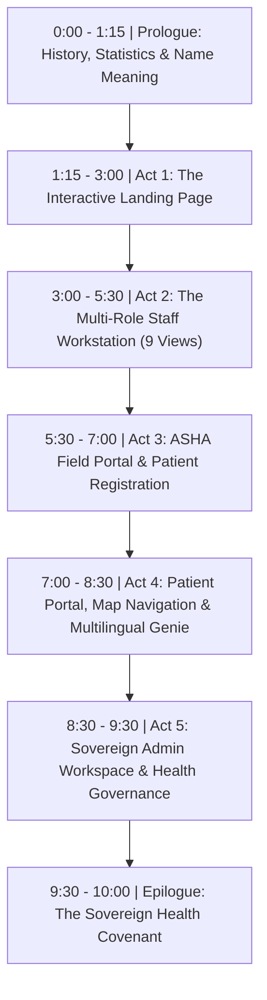

# CerviSetu (सर्वाइसेतु) — Official Video Demo Script & Screen Walkthrough

> **Document Type**: Production-Ready Screen-Recording Script & Voiceover Guide  
> **Total Estimated Run Time**: 8 – 10 Minutes (Modular: Can be presented in full or trimmed for 5-minute hackathon pitches)  
> **Target Audience**: Hackathon Judges, Clinical Evaluators, Public Health Officials (MoHFW/NHA), and Healthcare Workers  
> **Presenter Tone**: Confident, empathetic, clinically grounded, and technologically authoritative  
> **Submission Links**:
> - 🌐 **Live Web MVP**: [https://cervi-setu.pages.dev/](https://cervi-setu.pages.dev/)
> - ▶️ **Implementation Video Walkthrough**: [Watch on Google Drive](https://drive.google.com/file/d/16l-TvH1dR5j1hMcbAAils9efy5uEkBBj/view?usp=sharing)
> - 📄 **2-Page Solution Brief**: [View on Google Drive](https://drive.google.com/file/d/1BsL-AtmQBqwCRf0Hlhza8K8Dn3J2iIAw/view?usp=sharing)
> - 📊 **Presentation / Pitch Deck**: [Open Google Slides](https://docs.google.com/presentation/d/1DWDuXUPUlsiF7aNQ_xHp2cximp8js2nM/edit?usp=sharing&ouid=112906296684609349584&rtpof=true&sd=true)  

---

## 📋 Quick Demo Cheat Sheet & Credentials

| Role / View | Route / Link | Credentials | Pre-loaded Demo Patient / Data |
| :--- | :--- | :--- | :--- |
| **Landing Page** | `http://localhost:5173/` or `https://cervi-setu.pages.dev/` | No login needed | Interactive 3D Model, Voice Studio, Vision OCR, Impact Meter |
| **Staff Workstation** | `http://localhost:5173/gateway` $\rightarrow$ **Staff Workstation** | Staff ID: `AW-3001` (ASHA) / `DR-1001` (Doctor) / `RN-2001` (Nurse) PIN: `246810` (or click one-tap role button) | `PT-RURAL-7891` (*Nishi Paul*, Age 36, HSIL / Colposcopy Pending) |
| **ASHA Field Portal** | `/staff` (logged in as ASHA) or `/gateway` $\rightarrow$ **ASHA Worker** | Pre-fills `AW-3001` / PIN `246810` | Malavani Health Post Roster, 14-day Follow-up Queue, Register Woman modal |
| **Patient Companion** | `http://localhost:5173/patient/PT-RURAL-7891` | Direct token access or click **Patient View** in Staff Console | Interactive Journey, Find Centre GPS map, Sarvam-powered Multilingual Genie |
| **Admin Workspace** | `/staff` (logged in as Admin) or `/gateway` $\rightarrow$ **Administrator** | Pre-fills `AD-4001` / PIN `246810` | Hospital Directory, Oncology Service Flags, Health Post Routing, Staff Accounts |

---

## ⏱️ Video Timeline & Master Roadmap

---

## 🎬 SECTION 1: PROLOGUE — HISTORY LESSON & THE MEANING OF CERVISETU
**Target Time**: 0:00 – 1:15 (75 seconds)  
**Visual**: Start on a clean title card or the top of the CerviSetu landing page (`/`). Camera slowly drifts across the header and the headline: *"No woman lost between an abnormal screening and care."*

### 🎙️ Spoken Script

> *"Every seven minutes in India, a mother, sister, or daughter loses her life to cervical cancer.*
>
> *Over the past few decades, despite rapid economic growth and world-class tertiary cancer centers, cervical cancer rates in India have remained shockingly high. It remains the **second most common cancer among Indian women**, accounting for over **127,000 new cases** and more than **80,000 deaths** every single year.*
>
> *What makes this statistic heartbreaking is that **cervical cancer is almost 100% preventable**. With timely HPV immunization and simple visual screening, we can stop cancer years before it ever begins. Yet today, more than 70% of women in rural districts who receive an abnormal primary screening result drop out of the system before ever reaching a tertiary oncology hospital.*
>
> *This broken link is why we built **CerviSetu**.*
>
> *Let us break down the name:*
> * **'Cervi'** represents the **Cervix**—the vital anatomical gateway of maternal life and health.*
> * **'Setu'** is the ancient Sanskrit word for a **Bridge**.*
>
> *CerviSetu is the sovereign digital bridge that connects frontline ASHA workers and rural primary health posts to specialized cancer hospitals—ensuring no woman is ever lost between an abnormal screening and curative care."*

---

## 🎬 SECTION 2: THE LANDING PAGE TOUR
**Target Time**: 1:15 – 3:00 (105 seconds)  
**Visual**: Full-screen view of the Landing Page (`http://localhost:5173/`).

---

### Scene 2.1: The Interactive 3D Cervix Model (10–15 Seconds)
* **Visual**: Move cursor to the interactive 3D model on the right side of the Hero section. Rotate the model smoothly 360 degrees and zoom slightly into the transformation zone.
* **Action**: Hover over the anatomical callouts.

#### 🎙️ Spoken Script
> *"Right here on our landing page, we break the stigma of cervical anatomy with this real-time, interactive **3D Cervix Model**. It visually illustrates the squamo-columnar transformation zone—allowing both patients and healthcare workers to intuitively understand healthy tissue, early precancerous dysplasia, and invasive lesions without clinical fear."*

---

### Scene 2.2: The Multilingual Voice Agent (Play Live Audio)
* **Visual**: Scroll down to the **Interactive Product Tour** / **Voice Reminders Playground** (`#speech-studio`).
* **Action**: 
  1. Click the language dropdown and select **Hindi** (or **Marathi**).
  2. Click the **"Play Sample Audio"** button. Let the speaker voice play aloud for 4–5 seconds.
  3. Toggle through dialects (Tamil, Bengali, Bhojpuri).

#### 🎙️ Spoken Script
> *"Recognizing that millions of rural women cannot read complex medical SMS notifications, CerviSetu integrates **Sarvam AI’s Indic neural voice models**.*
>
> *(Click Play & pause 3 seconds)*
>
> *Our voice agents speak in natural regional dialects—Hindi, Marathi, Bengali, Tamil, Telugu, and Bhojpuri—guiding the patient on when and where her appointment is, completely voice-first."*

---

### Scene 2.3: The 4 Core Architecture Cards (1 Sentence Each)
* **Visual**: Scroll to the **Core System Architecture** section (`#protocol`). Pan smoothly over the 4 Bento cards.

#### 🎙️ Spoken Script
> *"Our care delivery engine is organized across four foundational pillars:*
>
> 1. **Adolescent HPV 2-Dose Tracking**: *Automated regimen logic that schedules and tracks HPV vaccines for girls under 14 with a 6-month dose gap and cold-chain vial alerts.*
> 2. **Point-of-Care VIA & AI Triaging**: *Rapid triage for women aged 35 to 45 that digitizes visual acetic acid inspections and flags abnormal lesions instantly.*
> 3. **Frontline ASHA Field Coordination**: *Empowers village health workers with vernacular task queues, automated reminder cadences, and GPS-verified home visit triggers.*
> 4. **Tertiary Specialist Review Portal**: *Directly links regional cancer hospitals so oncologists can review patient findings and reserve biopsy slots before the patient even travels."*

---

### Scene 2.4: Spatial Vision OCR (2–3 Lines)
* **Visual**: Scroll down to `#vision-ocr` (**Spatial Clinical Slip OCR & Entity Extraction**).
* **Action**: Click on a sample handwritten prescription slip to show real-time extraction bounding boxes.

#### 🎙️ Spoken Script
> *"Rural health posts still run on handwritten paper slips. Our **Spatial Vision OCR** pipeline ingests photos of handwritten triage forms, extracts clinical findings with automatic blur detection, and digitizes them into structured FHIR records with full DPDP PII shielding—zero manual typing required."*

---

### Scene 2.5: Autonomous Multi-Agent Clinical Triage Flow (1 Sentence)
* **Visual**: Scroll to `#agent-flow` (**Autonomous Multi-Agent Clinical Triage & Adherence Flow**).
* **Action**: Hover over the LangGraph state machine node diagram showing Intake $\rightarrow$ Dose Tracking $\rightarrow$ Cadence $\rightarrow$ Escalation.

#### 🎙️ Spoken Script
> *"Under the hood, a **LangGraph-orchestrated multi-agent pipeline** coordinates clinical validation, risk stratification, and patient safety guardrails, dispatching automated interventions whenever an appointment is delayed."*

---

### Scene 2.6: Population Impact Meter & API Studio (1–2 Lines Each)
* **Visual**: Scroll to `#impact-calculator` (**District Population Impact & Prevention Return Calculator**) and then `#api-studio`.
* **Action**: Drag the district population slider to watch the numbers update live (averted cancers, cost savings, ROI).

#### 🎙️ Spoken Script
> *"Our **District Impact Calculator** demonstrates real, quantifiable outcomes: projecting up to 94% referral adherence, an average time-to-colposcopy under 7 days, and crores in averted late-stage treatment costs.*
>
> *And with our open, **FHIR and ABDM-compliant REST APIs**, CerviSetu integrates seamlessly into national health registries, hospital HMIS, and state government health missions."*

---

## 🎬 SECTION 3: THE STAFF WORKSTATION (2–3 MINUTES)
**Target Time**: 3:00 – 5:30 (150 seconds)  
**Visual**: Click **"Launch Workstation"** in header or go to `/staff`. Sign in with **Doctor** (`DR-1001` / `246810`) or click the **Doctor** demo button.  
**Tour all 9 Staff Tabs in logical clinical progression.**

---

### 1. Dashboard (`overview-tab`)
* **Action**: Click **Dashboard** on the sidebar.
* **Visual**: At-a-glance KPI metrics: Active Referrals, Overdue Cases, ASHA Field Tasks, and Today’s Queue.
* **🎙️ Spoken Script**:
  > *"Here is the clinical **Dashboard**. It gives district oncologists and medical officers high-level situational awareness—tracking active patient journeys, high-risk red flags, and daily appointments across all mapped health posts."*

---

### 2. Referral Cases (`cases-tab`)
* **Action**: Click **Referral Cases** on the sidebar.
* **Visual**: The interactive triage worklist / Kanban lanes: *Routine Screening*, *Referred*, *Arrived at Hospital*, *Colposcopy Done*, *Biopsy Taken*, *Treatment Planned*.
* **🎙️ Spoken Script**:
  > *"The **Referral Cases** tab tracks every patient along the clinical continuum. Clinicians can immediately identify who is on track, who has arrived at the tertiary center, and who needs urgent attention."*

---

### 3. Register Patient (`intake-tab`)
* **Action**: Click **Register Patient** (or click the rapid intake button).
* **Visual**: Rapid intake form showing ABHA ID input, age, visual inspection finding, red-flag checkmarks, and document upload.
* **🎙️ Spoken Script**:
  > *"In **Register Patient**, staff can onboard a walk-in patient in under 60 seconds—capturing her ABHA health ID, clinical symptoms, and screening slip photo to initiate an automated referral journey."*

---

### 4. Case Record (`encounter-tab`)
* **Action**: Click on patient `PT-RURAL-7891` (*Nishi Paul*).
* **Visual**: Comprehensive patient clinical dossier with synthesized diagnostic timeline, uploaded colposcopy images, doctor review section, and one-click biopsy orders.
* **🎙️ Spoken Script**:
  > *"Opening a **Case Record** reveals the patient’s longitudinal dossier. The specialist can review AI-synthesized risk scores, inspect original cytology and VIA captures, record clinical notes, and electronically issue specialist treatment directives."*

---

### 5. Follow-up Tracker (`tracker-tab`)
* **Action**: Click **Follow-up Tracker**.
* **Visual**: Escalation matrix showing 14-day adherence tracks: Days 1–10 (Automated Multi-lingual Voice Reminders), Days 11–13 (Intensive Outreach), and Day 14 (Automated ASHA Home Visit Dispatch).
* **🎙️ Spoken Script**:
  > *"The **Follow-up Tracker** is our zero-drop-out safety net. It continuously monitors the 14-day adherence clock. If a patient misses calls or SMS alerts, the system automatically escalates to intensive contact and dispatches a physical ASHA home visit."*

---

### 6. ASHA Network (`asha-tab`)
* **Action**: Click **ASHA Network**.
* **Visual**: Roster of community health workers, their mapped sub-centres, active assigned patients, and verified home-visit completion rates.
* **🎙️ Spoken Script**:
  > *"The **ASHA Network** coordinates village-level health workers. District coordinators can monitor which ASHA has completed her assigned home visits, verified consent, or assisted a patient with travel logistics."*

---

### 7. Prevention and Screening (`prevention-tab`)
* **Action**: Click **Prevention and Screening**.
* **Visual**: Two cohort dashboards: Adolescent HPV Vaccine registry (Dose 1 vs. Dose 2 tracking) and Community VIA Screening camp scheduler.
* **🎙️ Spoken Script**:
  > *"The **Prevention & Screening** module drives dual-cohort surveillance—tracking adolescent girls due for their 6-month second HPV vaccine dose and managing village-wide screening camps for high-risk age groups."*

---

### 8. Audit and Privacy (`privacy-tab`)
* **Action**: Click **Audit and Privacy**.
* **Visual**: Cryptographic SHA-256 audit ledger showing immutable event hashes, actor roles, timestamps, and zero-knowledge masked tokens.
* **🎙️ Spoken Script**:
  > *"In compliance with India’s **DPDP Act 2023**, the **Audit & Privacy** ledger records every single clinician access and referral dispatch into a tamper-evident cryptographic chain. No sensitive medical data is ever unmasked without audited authorization."*

---

### 9. Patient View (`patient-tab`)
* **Action**: Click **Patient View**.
* **Visual**: In-console preview of what the patient sees on her mobile device.
* **🎙️ Spoken Script**:
  > *"Finally, the **Patient View** tab allows doctors to review the exact bilingual instructions, appointment guides, and vernacular information shared with the patient, fostering transparent, shared clinical decision making."*

---

## 🎬 SECTION 4: THE ASHA FIELD PORTAL (1–2 MINUTES)
**Target Time**: 5:30 – 7:00 (90 seconds)  
**Visual**: Sign out and sign in as **ASHA Worker** (`AW-3001` / `246810`, *Meena Devi* at Malavani Health Post).  
**Show creating a new patient case at the village level.**

---

### 🎙️ Spoken Script & Screen Actions

1. **Sign-in & Home Screen**:
   * *Action*: Show Meena Devi’s mobile-optimized interface with clean vernacular action cards.
   > *"Now let’s step into the shoes of **Meena Devi**, an ASHA worker in a village sub-centre.*
   >
   > *When Meena logs in on her tablet or smartphone, she sees a simplified, high-contrast field workstation designed for low-connectivity environments."*

2. **Register a Woman**:
   * *Action*: Click the prominent **"Register a woman"** button with the `UserPlus` icon.
   > *"During a village screening drive, Meena identifies a woman with an abnormal VIA inspection. She taps 'Register a woman'.*
   >
   > *Notice how fast this intake is: she enters the woman's name—let's say **Sunita Kamble**, age 38—her phone number, and village area.*
   >
   > *She marks the finding: **'VIA Positive / Acetowhite Lesion'** and marks that referral is advised.*
   >
   > *She captures the patient's explicit consent: **'Agreed to hospital referral'**.*
   >
   > *With one tap on **Save and Register**, CerviSetu creates the referral case, issues a secure token, assigns the nearest tertiary oncology center, and immediately schedules the first automated voice reminder in Marathi!*
   >
   > *Meena can also log call outcomes—'Spoke to her', 'Family agreed'—or document home visits with complete offline-first capability."*

---

## 🎬 SECTION 5: THE PATIENT PORTAL & CONVERSATIONAL GENIE (1.5–2 MINUTES)
**Target Time**: 7:00 – 8:30 (90 seconds)  
**Visual**: Navigate to `http://localhost:5173/patient/PT-RURAL-7891` (or use the Patient Portal from Gateway).

---

### Scene 5.1: The Patient Journey & GPS Navigation
* **Visual**: Clean, comforting patient interface showing:
  - 5-Stage Journey Tracker: *1. Referred $\rightarrow$ 2. Reached Hospital $\rightarrow$ 3. Tests & Check-up $\rightarrow$ 4. Doctor Plan $\rightarrow$ 5. Care Complete*
  - Assigned hospital card: **Tata Memorial Centre / KEM Hospital**
  - Interactive **Find Centre** map with road route, distance in km, and emergency contact button.

#### 🎙️ Spoken Script
> *"Now let's switch to the patient's perspective. When the patient opens her secure link or ABHA health locker, she sees a warm, reassuring portal in her preferred language.*
>
> *She sees exactly where she is in her care journey—removing the fear and confusion that causes so many rural patients to drop out.*
>
> *Under 'Your Care Centre', she sees her assigned hospital with exact distance, driving directions, bus route information, and OPD desk phone numbers."*

---

### Scene 5.2: The Multilingual Patient Genie with Clinical Guardrails
* **Visual**: Click on the floating **"Ask Genie"** / Sparkles button to open **Patient Genie**.
* **Action**:
  1. Click the microphone or select the quick question: *"What government schemes cover my costs?"*
  2. Show Genie responding with voice audio and text: Explaining **Ayushman Bharat PM-JAY** coverage up to ₹5 Lakh.
  3. Now test the **Diagnostic Guardrail**: Ask or click *"Do I have cancer?" (गार्डरेल टेस्ट)*.
  4. Show Genie's refusal message in red/amber with compassionate reassurance.

#### 🎙️ Spoken Script
> *"For personalized guidance, the patient has **Patient Genie**—a Sarvam AI-powered conversational voice assistant.*
>
> *Let's ask Genie about financial assistance: (Click)*
> *Genie instantly explains in regional voice that her treatment is covered under **Ayushman Bharat PM-JAY** up to 5 lakh rupees.*
>
> *Now, notice our strict **Clinical Safety Guardrail**:*
> *If the patient anxiously asks: **'Do I have cancer?'**...*
> *(Click guardrail prompt)*
>
> *Genie strictly refuses to provide an unsupervised medical diagnosis. It reassuringly explains: 'Only your doctor can interpret your tests. An abnormal screening does not mean cancer—most precancerous changes are completely curable when checked early.'*
>
> *This protects patients from misinformation while providing deep, empathetic support."*

---

## 🎬 SECTION 6: THE SOVEREIGN ADMIN WORKSPACE (1 MINUTE)
**Target Time**: 8:30 – 9:30 (60 seconds)  
**Visual**: Sign out and sign in as **Administrator** (`AD-4001` / `246810`).

---

### 🎙️ Spoken Script & Screen Actions

1. **Programme Overview**:
   * *Action*: Show the privacy-first metrics cards: Total referrals, In follow-up, Past Day 14, Confirmed Arrivals.
   > *"Finally, we sign in as the **State Health Administrator**.*
   >
   > *Notice a crucial privacy principle: **Administrators see population statistics and referral counts only—they never see private patient records**."*

2. **Hospital Directory & Oncology Services**:
   * *Action*: Click **Hospitals** tab. Show tertiary centers with capability badges: *VIA, Colposcopy, Biopsy, Histopathology, Cancer Surgery, Radiotherapy*.
   > *"In the **Hospital Directory**, administrators configure oncology capabilities across district hospitals—activating colposcopy units, biopsy slots, and radiotherapy facilities."*

3. **Routing & Staff Governance**:
   * *Action*: Click **Health Posts and Routes** and **Staff**. Show linking rural sub-centres to hospitals and managing role permissions.
   > *"Admins map rural sub-centres to referral hubs based on real travel distance and manage role-based staff credentials for doctors, nurses, and ASHA workers across the state."*

---

## 🎬 SECTION 7: EPILOGUE & CONCLUSION (30 SECONDS)
**Target Time**: 9:30 – 10:00 (30 seconds)  
**Visual**: Return to the Landing Page hero or show CerviSetu logo with the team name and hackathon credentials.

### 🎙️ Spoken Script

> *"CerviSetu transforms a fragmented, paper-bound referral journey into an unbroken, sovereign clinical continuum.*
>
> *By uniting frontline ASHA workers, automated vernacular voice follow-ups, spatial vision OCR, and tertiary oncology hubs under strict data privacy, CerviSetu fulfills India's health mission:*
>
> ***Eliminating cervical cancer, preserving patient dignity, and building bridges to life-saving care.***
>
> *Thank you."*

---

## 📹 Post-Recording Checklist for the Presenter

- [ ] Audio normalized to -14 LUFS with zero background hum.
- [ ] Screen recorded at crisp 1080p 60fps (100% browser zoom).
- [ ] Sarvam AI voice output captured clearly via desktop audio.
- [ ] All 9 Staff tabs demonstrated smoothly.
- [ ] ASHA patient registration shown end-to-end.
- [ ] Patient Genie guardrail prompt demonstrated live.
- [ ] Admin directory and privacy isolation shown.
