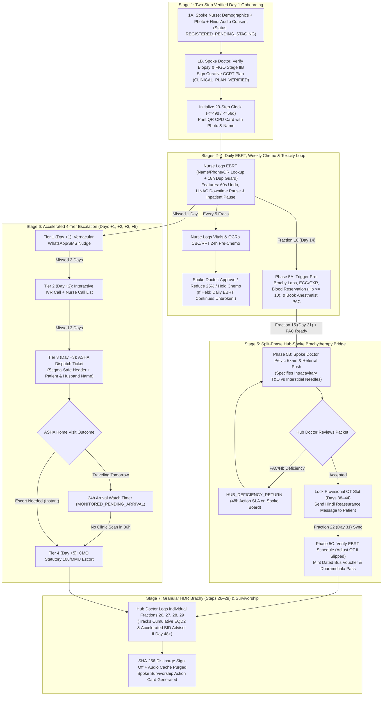
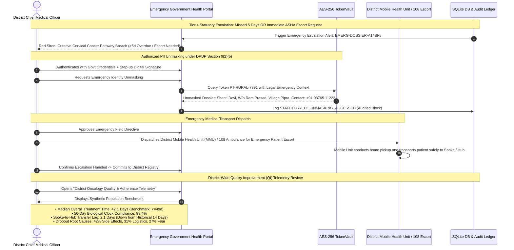

# CerviSetu: Clinician & Healthcare Professional User Flow Specification

> **Platform**: CerviSetu (*Cervical Care Bridge*)  
> **Document Type**: Clinical Workflow, Interaction Architecture & System Specification — Clinician & Frontline Healthcare Workforce  
> **Target Audience**: Radiation Oncologists, Medical Oncologists, Oncology Nurses, Radiotherapy Technologists, ASHA Coordinators, System Architects, and Hackathon Evaluators  
> **Version**: 2.1.0 (Audited Clinical-Grade Handoff & Point-of-Care Safety Architecture)  
> **Functional Allocation**: **30% Clinician Friction Reduction & 70% Patient Accompaniment Coordination**  
> **Regulatory Posture**: Assistive & Non-Diagnostic (CDSCO SaMD Safe · DPDP Act 2023 Compliant · ABDM FHIR R4 Aligned)

---

## 1. Clinical Foundation, The 49d/56d Imperative & Point-of-Care Safety

Curative chemoradiation for locally advanced cervical cancer (FIGO Stages IB3–IVA) is strictly time-sensitive:
* **Biological Target**: **$\le 49$ days** (GEC-ESTRO optimal benchmark).
* **Hard Safety Limit**: **$\le 56$ days** (NCG / ABS ceiling).
* **Radiobiological Penalty**: Every additional day beyond 56 days incurs an estimated **$0.8\%$ to $1.2\%$ loss of pelvic tumor control** due to accelerated repopulation of clonogenic cancer cells (*Perez et al., Vitzthum et al.*).

### 1.1 Core Architectural Upgrades from Clinical Audit (`temp.md`)
Following a clinical and human-factors audit, four critical failure points were identified and resolved in Version 2.1.0:

1. **"Masked Network / Unmasked Point-of-Care" Identity Architecture**:
   - *Clinical Reality*: Blindly tokenizing patients as `PT-RURAL-XXXX` on treatment vault tablets and chemotherapy workstations creates a fatal wrong-patient radiation/chemo hazard.
   - *Architecture*: Authenticated treating clinicians (`ROLE_SPOKE_DOCTOR`, `ROLE_SPOKE_NURSE`, `ROLE_HUB_DOCTOR`) view **Patient Full Name + Reference Photo + Age + Token** (`Shanti Devi · 48y · PT-RURAL-7891`) during active point-of-care delivery.
   - *Privacy Isolation*: Zero-knowledge tokenization (`PT-RURAL-XXXX`) is strictly preserved for background AI pipelines (LangGraph), cloud telemetry, and external DPDP audit exports.
2. **Split-Phase Hub-Spoke Referral Bridge (Fraction 10 Prep $\rightarrow$ Fraction 15 Booking $\rightarrow$ Fraction 22 Ticket Minting)**:
   - *Clinical Reality*: Triggering pre-brachy labs (CBC/RFT) and Pre-Anesthetic Clearance (PAC) on Day 21 (Fraction 15) guarantees a 3–5 day delay in public district hospitals, delaying the referral until Day 26.
   - *Architecture*: Investigations and PAC are initiated at **Fraction 10 (Day 14)** so that PAC clearance is already completed when the pelvic response exam is performed on **Fraction 15 (Day 21)**. Logistics (dated bus and Dharamshala passes) are dynamically verified and minted at **Fraction 22 (Day 31)**, preventing wasted travel tickets if EBRT slips.
3. **Compressed Escalation Thresholds & 24h ASHA Arrival Watch Timer**:
   - *Clinical Reality*: Waiting 6 days before dispatching an ASHA worker and 8 days before CMO intervention consumes the entire 7-day buffer between Day 49 and Day 56 before field contact begins.
   - *Architecture*: Escalations are compressed to **Day +1 (WhatsApp/SMS)**, **Day +2 (IVR Call + Nurse Outreach)**, **Day +3 (Immediate ASHA Home Visit)**, and **Day +5 (CMO Statutory MMU/108 Escort)**. When an ASHA logs a visit as resolved, a **24-hour Arrival Watch Timer** ensures that if the patient does not scan into the clinic within 36 hours, it automatically promotes to Tier-4 CMO escort.
4. **Stigma-Safe ASHA Field Interface & Direct Tier-4 Promotion**:
   - *Field Reality*: Showing husband's name (`पति: राम प्रसाद`) while masking the patient's name creates severe ambiguity in joint rural households. Conversely, displaying "CerviSetu Cancer Care" risks village ostracization.
   - *Architecture*: ASHA PWA displays **Patient First Name + Husband/Guardian Name** (`मरीज: शांति देवी, पति: राम प्रसाद`) under a neutral header (**मातृ एवं महिला स्वास्थ्य सेवा / Women's Health Follow-Up**). Tapping `[अस्पताल गाड़ी की आवश्यकता / Escort Needed]` promotes immediately to Tier 4 without a 48-hour wait.

---

## 2. Professional Role Personas & Permission Matrix

```
+---------------------------------------------------------------------------------------------------------+
|                                    DISTRICT SPOKE CLINIC (Local ~12 km)                                 |
|                                                                                                         |
|   +-------------------------------------+             +-------------------------------------+           |
|   |   Dr. Ananya Sharma (Spoke MD)      |             |   Nurse Sunita Patel (Spoke Nurse)  |           |
|   |   • Staging & NCG Plan Sign-off     | <---------> |   • Day 1 QR Onboarding & Consent   |           |
|   |   • Weekly Cisplatin Lab Clearances |             |   • Daily 1-Tap Fraction Logger     |           |
|   |   • Grade 2+ Ward Toxicity Alerts   |             |   • Pre-Chemo Lab OCR Ingestion     |           |
|   |   • Day 21 Pelvic Response & Gate   |             |   • Fraction 10 Pre-Brachy Prep     |           |
|   +-------------------------------------+             +-------------------------------------+           |
+---------------------------------------------------------------------------------------------------------+
                                                     |
                                   Day 21 Referral   | ~75 km Geodesic Transfer
                                   & Telemetry Bridge|
                                                     v
+---------------------------------------------------------------------------------------------------------+
|                                  CENTRAL TERTIARY HUB (RCC ~75 km)                                      |
|                                                                                                         |
|   +-------------------------------------------------------------------------------------------------+   |
|   |   Dr. Rajesh Mukherjee (Hub Senior Radiation Oncologist & Brachytherapist)                      |   |
|   |   • Inbound Referral Triage (Days 38–44 Target Window)                                          |   |
|   |   • Step 2B: Lock Provisional OT Slot (Days 38–44) / Handle Deficiency Returns                 |   |
|   |   • Granular High-Dose-Rate (HDR) Delivery Tracking (Individual Fractions 26, 27, 28, 29)      |   |
|   |   • Accelerated BID Brachytherapy Advisor for Late Arrivals (Day 48+)                           |   |
|   |   • Final Biological Clock Compliance Audit (<=49d / <=56d) & Cryptographic Discharge Sign-off  |   |
|   +-------------------------------------------------------------------------------------------------+   |
+---------------------------------------------------------------------------------------------------------+
                                                     ^
                                                     | Field Tracking & Escalation
+----------------------------------------------------+----------------------------------------------------+
|                                    RURAL COMMUNITY & GOVERNANCE                                         |
|                                                                                                         |
|   +-------------------------------------+             +-------------------------------------+           |
|   |   Meena Devi (Village ASHA Worker)  |             |   Dr. V. K. Rai (District CMO)      |           |
|   |   • Stigma-Safe Tier 3 Home Visits  |             |   • Tier 4 Emergency Dossier Review |           |
|   |   • Unambiguous Household Lookup    | <---------> |   • 108 Ambulance / MMU Dispatch    |           |
|   |   • Instant Tier-4 Escort Promotion |             |   • Synthetic Cohort QI Telemetry   |           |
|   +-------------------------------------+             +-------------------------------------+           |
+---------------------------------------------------------------------------------------------------------+
```

| Role Identifier | Representative Persona | Primary Setting | Point-of-Care Display Access | Authentication Profile | Primary Device Surface |
|---|---|---|---|---|---|
| **`ROLE_SPOKE_DOCTOR`** | Dr. Ananya Sharma (Radiation Oncologist) | District Hospital Oncology Daycare | **Unmasked Point-of-Care**: Full Name, Reference Photo, Age, Staging, Token (`PT-RURAL-XXXX`). | Hospital SSO / ABDM HPR + MFA | Desktop Workstation / Tablet |
| **`ROLE_SPOKE_NURSE`** | Nurse Sunita Patel (Oncology Frontline Nurse) | Radiotherapy Treatment Vault & Daycare Ward | **Unmasked Point-of-Care**: Full Name, Photo, Age, Token, Phonetic/Phone/Village Lookup. | Device Certificate + 4-Digit Fast PIN / Badge Tap (<2s switch) | Clinic Tablet (CareUI Console) |
| **`ROLE_HUB_DOCTOR`** | Dr. Rajesh Mukherjee (Brachytherapist / HOD) | Regional Cancer Centre (RCC) Tertiary Hub | **Unmasked Point-of-Care**: Full Name, Photo, Age, Token, Pelvic Anatomy, Surgical Records. | Hospital SSO / ABDM HPR + MFA | High-Density Desktop Console |
| **`ROLE_ASHA_WORKER`** | Meena Devi (Accredited Social Health Activist) | Village / Gram Panchayat Sector | **Household Navigation**: Patient First Name + Husband/Guardian Name (`शांति देवी, पति: राम प्रसाद`), Landmark, Contact. *Diagnosis hidden.* | Persistent Mobile Token (Bilingual PWA) + Offline Sync | Mobile Web PWA / WhatsApp Bot |
| **`ROLE_DISTRICT_CMO`** | Dr. V. K. Rai (Chief Medical Officer) | District Health Office / Civil Surgeon | **Statutory Override**: Full Legal PII Unmasking (DPDP Sec 6(2)(b)) upon emergency trigger. | Government SSO + Step-up Digital Signature | Administrative Dashboard |

---

## 3. Restructured System Architecture & Clinical State Machine



---

## 4. Step-by-Step User Flows by Professional Role

### 4.1 Flow 1: Spoke Radiation Oncologist / Doctor Journey

```mermaid
sequenceDiagram
    autonumber
    actor MD as Spoke Radiation Oncologist
    participant UI as CareUI Clinical Workstation
    participant AI as LangGraph Diagnostic Pipeline
    participant Clock as Dual-Clock Engine
    participant DB as SQLite DB & TokenVault

    Note over MD,DB: Day 1: Staging Verification & Treatment Plan Initiation
    MD->>UI: Selects Patient (Shanti Devi · 48y · PT-RURAL-7891) in "Registered Awaiting Staging"
    UI->>AI: Trigger OCR Entity Extraction & Staging Model on Biopsy/CT Notes
    AI-->>UI: Staging: FIGO Stage IIB Cervical SCC; NCG Guideline: Curative CCRT
    MD->>UI: Reviews Pelvic Differentials; Validates Curative Intent
    MD->>UI: Prescribes Regimen: 25 EBRT (50Gy) + 5 Cisplatin cycles + 4 HDR Brachy
    MD->>UI: Affirmative Sign-Off (Cryptographically Hashed)
    UI->>Clock: Initialize Dual Biological Clocks (<=49d Optimal Target; <=56d Hard Limit)
    UI->>DB: Log CLINICAL_PLAN_VERIFIED (Transition to ACTIVE_CURATIVE_EBRT)

    Note over MD,DB: Weekly Chemotherapy Clearances (Every 7 Days)
    MD->>UI: Opens Weekly Chemotherapy Ward List
    UI->>MD: Displays Patient Card with 24h Ingested Labs: Hb 10.2, ANC 2100, Creatinine 0.85, eGFR 82
    alt Labs Within Safe Threshold
        MD->>UI: Clicks "Approve Cisplatin Cycle #2 (40 mg/m²)"
        UI->>DB: Log CISPLATIN_DOSE_APPROVED
    else Nephrotoxicity / Cytopenia Detected
        MD->>UI: Clicks "Hold Cisplatin / Repeat RFT in 48h (Keep Daily EBRT Running!)"
        UI->>DB: Log CISPLATIN_DOSE_HELD (EBRT Flag: ACTIVE)
    end

    Note over MD,DB: Morning Ward Toxicity Priority Handling
    UI-->>MD: Priority Flag: Shanti Devi reported Grade 2 Diarrhea (5 stools/day, cramping)
    MD->>UI: Reviews Voice Check-in Audio Note
    MD->>UI: Selects: "Prescribe Oral Loperamide + Extra Electrolytes + Nurse Telephony Call"
    UI->>DB: Log TOXICITY_CLINICAL_INTERVENTION (Schedules automated 48h follow-up check)

    Note over MD,DB: Day 21 (Fraction 15): Clinical Handoff & Hub Transfer Push
    UI-->>MD: Prompt: Fraction 15 Logged! Pre-Brachy Gate Ready (PAC Cleared at Fraction 10)
    MD->>UI: Conducts Mid-Treatment Pelvic Assessment: Documents tumor regression
    MD->>UI: Selects Applicator Suitability: [x] Intracavitary Tandem & Ovoids Suitable
    MD->>UI: Attaches Completed Pre-Brachy Packet (Hb 10.4, Creatinine 0.82, Anesthesia PAC Cleared)
    MD->>UI: Transmits Referral Window: "Request Hub OT Slot between Days 38 and 44"
    UI->>DB: Log DAY21_REFERRAL_INITIATED
```

#### Key Enhancements for Spoke Doctor:
- **Two-Identifier Point-of-Care View**: Patient name, age, reference photo, and token are always visible during clinical decision-making.
- **Chemotherapy Hold Safety Flag**: When Cisplatin is held for nephrotoxicity, the system explicitly flags that **daily radiation fractions must continue uninterrupted**.
- **Audit-Gated Alert Dismissal**: Replaces raw alert dismissal with mandatory clinical categorization (`[Mark Reviewed - Prescribed Supportive Meds]`, `[Admit to Daycare for IV Fluids]`, or `[Mild - Continued Monitoring]`) with automated 48-hour symptom resolution tracking.

---

### 4.2 Flow 2: Spoke Oncology Nurse & Radiotherapy Technologist Journey

```mermaid
sequenceDiagram
    autonumber
    actor Nurse as Spoke Oncology Nurse / Tech
    participant UI as CareUI Tablet Console
    participant Camera as Device Camera / Scanner
    participant Clock as Dual-Clock Engine
    participant DB as SQLite DB & TokenVault

    Note over Nurse,DB: Day 1: Frictionless Onboarding & Verification
    Nurse->>UI: Fast-PIN Login (<2s operator switch)
    Nurse->>UI: Enrolls Demographics: Shanti Devi, 48F, Mobile, Village Pipra, Landmark
    Nurse->>Camera: Takes Reference Photo of Patient Face
    Nurse->>UI: Plays Audio DPDP Consent Prompt in Hindi; Records Verbal "Yes / 1"
    UI->>DB: Generate Token PT-RURAL-7891 (Status: REGISTERED_PENDING_STAGING)
    Note over Nurse,UI: (Awaits Doctor Staging Sign-Off before Clock Starts)
    UI->>Nurse: Print Official QR OPD Card with Patient Photo, Name, and 29-Step Tracker

    Note over Nurse,DB: Daily Vault Routine: 1-Tap EBRT Fraction Logging (Fractions 1–25)
    Nurse->>UI: Opens Daily Vault Board
    alt Patient Has QR Card
        Nurse->>Camera: Scans QR Card
    else Forgotten QR Card Fallback
        Nurse->>UI: Searches by Phonetic Name ("Shanti") or Mobile (+91 98765 11223) or Village ("Pipra")
    end
    UI->>Nurse: Displays: Shanti Devi · 48y · PT-7891 | Step 14 Completed | Step 15 Due Today
    Nurse->>UI: Taps [ LOG FRACTION 15 AS DELIVERED (1-TAP) ]
    UI->>Clock: Idempotency Check (Passed >18h since Frac 14) -> Increment Step = 15
    UI->>Nurse: Shows 60-Second [ Undo Last Log ] Toast (Protection against mis-taps)
    UI->>DB: Log NURSE_FRACTION_LOGGED (Step 15/29)

    Note over Nurse,DB: Milestone Gate: Fraction 10 (Day 14) Pre-Brachy Prep
    alt Fraction == 10 Reached (Day 14)
        UI-->>Nurse: Alert: "Fraction 10 Milestone! Initiate Pre-Brachy Workup"
        Nurse->>UI: Orders repeat CBC/RFT, CXR, ECG, and reserves blood if Hb < 10 g/dL
        Nurse->>UI: Books Hospital Anesthetist PAC Slot for Day 18
        UI->>DB: Log PRE_BRACHY_WORKUP_INITIATED (F10_PREP)
    end

    Note over Nurse,DB: Closed-Loop Weekly Chemo Lab Ingestion (24h Pre-Chemo)
    Nurse->>Camera: Takes Photo of Paper Pathology Slip (CBC/RFT)
    UI->>UI: OCR extracts Hb, ANC, Platelets, Creatinine -> Auto-computes eGFR
    Nurse->>UI: Verifies extracted numbers on 4-field numeric keypad; Taps Submit
    UI->>DB: Labs Ingested & Pushed to Doctor's Chemo Approval Queue

    Note over Nurse,DB: Equipment Downtime Handling
    alt Machine Breakdown (LINAC / Cobalt-60 Down)
        Nurse->>UI: Toggles "LINAC Maintenance Downtime — Shift Cohort"
        UI->>Clock: Pauses Patient Delinquency Escalation Counters (Tiers 1–4)
        UI->>Clock: Retains Honest Biological Clock & Flags Eligible Patients for Weekend Make-up
    end
```

#### Key Enhancements for Spoke Nurse:
- **Fast-PIN Authentication**: Replaces heavy MFA on clinic tablets with device certificates and a 4-digit operator PIN for instantaneous switching between nurses during high-volume rushes.
- **Forgotten-Card Fallback**: Nurse can search by Phonetic Hindi/English Name, Mobile Number, or Village, resolving the lost-card roadblock.
- **Safety Interlocks**: 18-hour duplicate fraction tap guard, 60-second Undo toast, and a clinic-level machine downtime toggle that pauses false patient non-adherence alerts.
- **Fraction 10 Workup Trigger**: Prompts the pre-brachy workup on Day 14 so that labs and PAC clearance are fully ready when Fraction 15 is reached on Day 21.

---

### 4.3 Flow 3: Central Hub Radiation Oncologist & Brachytherapist Journey

```mermaid
sequenceDiagram
    autonumber
    actor HubMD as Central Hub Senior Oncologist
    participant UI as Tertiary Hub OT Console
    participant Scheduler as Hub Brachy Scheduler
    participant PassEngine as Logistics & Travel Pass Engine
    participant DB as SQLite DB & TokenVault

    Note over HubMD,DB: Day 21 (Fraction 15): Inbound Referral Review & Provisional OT Lock
    HubMD->>UI: Opens Inbound Spoke Transfers (Sorted by Biological Clock Urgency)
    UI->>HubMD: Shows: Shanti Devi · 48y · PT-7891 (Mirzapur Spoke, 75 km away)
    Note over UI,HubMD: Step 15/29 Completed · Projected Finish: Day 44 (<=49d Target)<br/>Requested Window: Days 38–44 · PAC Cleared · Intracavitary Suitable
    
    alt Inbound Packet Incomplete / Anemia Unresolved (Hb < 10)
        HubMD->>UI: Clicks "Return with Deficiency" (Selects: Arrange 1 Unit PRBC at Spoke)
        UI->>DB: Log HUB_DEFICIENCY_RETURN (48h Action SLA on Spoke Ward Board)
    else Clinical Packet Approved
        HubMD->>UI: Selects Provisional OT Date: Day 41; Suite: Brachy OT-2 (Tandem & Ovoids)
        HubMD->>UI: Clicks "Accept Transfer & Lock Provisional Slot"
        UI->>Scheduler: Lock Provisional Brachy Slot (Day 41)
        UI->>PassEngine: Send Hindi Reassurance Message to Patient ("Slot Reserved & Free Stay Guaranteed")
        UI->>DB: Log PROVISIONAL_HUB_SLOT_LOCKED
    end

    Note over HubMD,DB: Fraction 22 (Day 31): Dynamic Logistics Minting
    PassEngine->>Clock: Verify Patient EBRT Schedule (Fraction 22 Completed On-Time?)
    alt EBRT Slipped by 2 Days (e.g. Machine Downtime / Neutropenia)
        Clock->>Scheduler: Auto-shift OT Slot to Day 43
        PassEngine->>DB: Mint Bus & Dharamshala Passes Dated for Day 42 Transit
    else On-Track
        PassEngine->>DB: Mint State Bus Voucher (UP-RTC-7891) + Dharamshala Pass (DHM-402) for Day 40 Transit
    end

    Note over HubMD,DB: Days 41–44: Granular High-Dose-Rate Brachytherapy Execution (Steps 26–29)
    HubMD->>UI: Patient Arrives at Central Hub; Verifies Face & Token PT-7891
    loop Fractions 26, 27, 28, 29 (Delivered over 3–4 Days)
        HubMD->>UI: Performs Applicator Insertion / Approves CT Simulation Inverse Plan
        HubMD->>UI: Taps [ Log HDR Fraction N as Delivered ] (Tracks Cumulative EQD2: HR-CTV D90 >= 85Gy)
        UI->>DB: Update total_steps_completed = N (26, 27, 28, 29)
    end

    Note over HubMD,DB: Late Arrival Salvage Protocol (If Patient Arrives >= Day 48)
    opt Patient Arrived Late (>48 Days Elapsed)
        UI-->>HubMD: Advisory: Biological Clock Breach Warning (Projected Finish > 56d!)
        HubMD->>UI: Selects: NCG Accelerated BID Schedule (2 Insertions, Fractions 6h apart over 2 days)
    end

    Note over HubMD,DB: Discharge Summary, DPDP Audio Purge & Survivorship Handoff
    HubMD->>UI: Opens Final Discharge Verification
    UI->>HubMD: Telemetry: Elapsed Treatment Time = 44 Days (Optimal <=49d Benchmark Met!)
    HubMD->>UI: Digitally Signs Electronic Discharge Summary with SHA-256 Seal
    UI->>DB: Purge Transitory Patient Audio Recordings (DPDP Storage Limitation Compliance)
    UI->>DB: Generate Structured Spoke Survivorship Action Card (Day-7 ASHA Check, Months 3/6/12 Spoke Exams)
```

#### Key Enhancements for Hub Doctor:
- **Two-Stage Logistics Bridge**: Separates the **Provisional OT Slot Lock (Day 22)**—which reassures the patient—from the **Dynamic Ticket Minting (Fraction 22)**, ensuring travel passes match actual EBRT completion dates if minor delays occur.
- **Deficiency Return Protocol (`HUB_DEFICIENCY_RETURN`)**: Allows returning an incomplete referral with a tracked 48-hour SLA on the Spoke Doctor/Nurse ward board.
- **Granular Fractions 26–29 Logging**: Replaces the bulk "all 4 fractions delivered" button with individual fraction logging, cumulative $EQD2$ dose verification, and an accelerated twice-daily (BID) brachytherapy protocol for patients arriving close to Day 48.

---

### 4.4 Flow 4: Frontline ASHA Worker / Community Health Navigator Journey

```mermaid
sequenceDiagram
    autonumber
    actor ASHA as Frontline ASHA Worker
    participant PWA as ASHA Mobile Web PWA
    participant Engine as Escalation Engine
    actor Pat as Patient & Family in Village
    participant DB as SQLite DB & TokenVault

    Note over ASHA,DB: Tier 3 Escalation: Patient Misses 3 Consecutive Days
    Engine->>Engine: Detects: Shanti Devi Missed 3 Consecutive Fractions (Day +3)
    Engine->>PWA: Dispatches ASHA Field Task Ticket
    PWA-->>ASHA: High-Priority Task: "मातृ एवं महिला स्वास्थ्य सेवा / Women's Health Follow-Up"

    Note over ASHA,PWA: Opening Stigma-Safe Mobile Ticket
    ASHA->>PWA: Views Unambiguous Household Details:
    Note over ASHA,PWA: • मरीज: शांति देवी (पति: राम प्रसाद)<br/>• गांव: ग्राम पिपरा, वार्ड 4 (प्राथमिक स्कूल की पानी टंकी के पास)<br/>• संपर्क: +91 98765 11223<br/>• स्थिति: 14 / 29 चरण पूरे (3 दिन से अनुपस्थित)

    Note over ASHA,Pat: Village Home Visit & Indic Audio Counseling
    ASHA->>Pat: Visits Household in Person; Speaks with Shanti Devi & Family
    Pat-->>ASHA: Explains: "हमें अंदरूनी सिकाई से डर लगता है और वाराणसी में रुकने के पैसे नहीं हैं।"
    ASHA->>PWA: Taps [ 🎧 मरीज को सुनाएं: ब्रैकीथेरेपी की जानकारी ]
    PWA-->>Pat: Plays Oncology-Approved Hindi Audio on Anesthesia & Pain Relief
    ASHA->>Pat: Explains that Free Dharamshala Room (Room 402) & Bus Pass are already arranged

    Note over ASHA,DB: Logging Field Resolution & Branching
    alt Patient Agrees to Travel Tomorrow
        ASHA->>PWA: Selects Root Cause: "FEAR_OF_PROCEDURE" & "ACCOMMODATION_ANXIETY"
        ASHA->>PWA: Selects Outcome: "RESOLVED_PATIENT_TRAVELING_TOMORROW"
        ASHA->>PWA: Taps Submit Report
        PWA->>DB: Log ASHA_HOME_VISIT_COMPLETED (Token: PT-RURAL-7891)
        DB->>Engine: Start 24h Arrival Watch Timer (MONITORED_PENDING_ARRIVAL)
        opt Patient Fails to Scan in at Clinic Within 36 Hours
            Engine->>Engine: Timer Expired! Auto-Promote to Tier 4 CMO Escalation
        end
    else Patient Bedridden / Refuses / Transport Lacking
        ASHA->>PWA: Selects Outcome: [ अस्पताल गाड़ी की आवश्यकता / Escort Needed ]
        ASHA->>PWA: Taps Submit Report
        PWA->>Engine: Fast-Track Direct Promotion to Tier 4 (No Day +5 Wait!)
        Engine->>DB: Trigger Immediate CMO MMU / 108 Emergency Escort Dispatch
    end
```

#### Key Enhancements for ASHA Worker:
- **Stigma-Safe Privacy Banner**: Mobile header reads **मातृ एवं महिला स्वास्थ्य सेवा (Women's Health Follow-Up)** instead of cancer tags, shielding the patient from village gossip while allowing clear navigation.
- **Unambiguous Household Lookup**: Displays **मरीज: शांति देवी (पति: राम प्रसाद)**, eliminating identity confusion in joint rural households.
- **24-Hour Arrival Watch Timer**: Prevents false resolution drops by monitoring clinic attendance within 36 hours of an ASHA visit.
- **Fast-Track Tier-4 Promotion**: Tapping `[अस्पताल गाड़ी की आवश्यकता / Escort Needed]` escalates directly to CMO transport without waiting for Day +5.

---

### 4.5 Flow 5: District Chief Medical Officer (CMO) & Authority Flow



---

## 5. Cross-Role Interaction & State Synchronization Matrix

| Treatment Milestone | Patient Experience | Spoke Doctor Action | Spoke Nurse Action | Hub Doctor Action | ASHA / CMO Action | Audit Event Code |
|:---|:---|:---|:---|:---|:---|:---|
| **Day 1: Onboarding** | Receives QR OPD card with photo & 29-step clock | Verifies biopsy/stage; signs NCG CCRT prescription | Enrolls patient; takes photo; captures Hindi consent | Passive visibility on regional network map | Village awareness | `PATIENT_ONBOARDED_CONSENT_CAPTURED` & `CLINICAL_PLAN_VERIFIED` |
| **Days 2–20: Fractions 1–9** | Attends daily; gets pre-chemo hydration prompt | Reviews weekly blood tests; approves chemo | 1-tap logs fraction (18h guard, 60s undo); checks vitals | Passive | Passive | `FRACTION_LOGGED` / `CISPLATIN_DOSE_APPROVED` |
| **Symptom Alert (Grade 2+)** | Reports loose motions via vernacular audio | Reviews ward alert; orders Loperamide / IV fluids | Calls patient; dispenses ORS/loperamide | Passive | Notified if patient misses visit | `TOXICITY_ALERT_MANAGED` |
| **Fraction 10 (Day 14): Prep Gate** | Continues daily EBRT | Reviews pre-brachy blood tests | **Draws CBC/RFT, ECG/CXR; books Day 18 PAC slot** | Passive | Passive | `PRE_BRACHY_WORKUP_INITIATED` |
| **Fraction 15 (Day 21): Referral** | Listens to reassuring Brachy explainer audio | **Conducts pelvic exam; attaches PAC; pushes referral** | Verifies complete pre-brachy packet | **Receives inbound transfer; locks Provisional Slot** | Passive | `DAY21_REFERRAL_INITIATED` & `PROVISIONAL_HUB_SLOT_LOCKED` |
| **Fraction 22 (Day 31): Ticket Minting** | Unlocks dated ~75 km Bus Voucher & Dharamshala Pass | Receives confirmed transit schedule | Hands physical boarding pass to patient | Verifies OT slot aligned with EBRT completion | Coordinates family travel logistics | `TRAVEL_PASS_ISSUED` |
| **Days 38–45: Brachy (26–29)** | Completes 4 brachy applications at Hub | Receives electronic progress updates | Prepares daycare for patient return | **Logs individual HDR fractions (26–29); signs discharge** | Passive | `BRACHY_FRACTION_LOGGED` & `DISCHARGE_SIGNED` |
| **Missed Frac Day +1 (Tier 1)** | Receives WhatsApp/SMS nudge | Ward board flags missed fraction | Adds patient to morning call list | Passive | Passive | `TIER1_SMS_NUDGE_SENT` |
| **Missed Frac Day +2 (Tier 2)** | Receives automated IVR voice triage call | Ward board updates to Tier 2 | Conducts phone outreach to family | Passive | Passive | `TIER2_IVR_DISPATCHED` |
| **Missed Frac Day +3 (Tier 3)** | Awaiting field contact | Ward board shows Tier 3 ASHA dispatch | Coordinates with ASHA supervisor | Notified of potential slot shift | **Conducts home visit; 24h watch timer starts** | `TIER3_ASHA_DISPATCHED` / `ASHA_VISIT_RESOLVED` |
| **Missed Frac Day +5 / Escort (Tier 4)**| Approaching dangerous biological cutoff | Consults with District CMO | Prepares emergency transfer dossier | Holds standby emergency slot | **CMO unmasks PII; dispatches 108 ambulance** | `TIER4_STATUTORY_ESCALATION` |

---

## 6. UI & Surface Architecture Wireframes

### 6.1 Spoke Clinician Dual-Clock Ward Board (CareUI Desktop)

```
+=========================================================================================================+
| [ care ]  District Oncology Daycare (Mirzapur Spoke)       User: Dr. Ananya Sharma (Oncologist) [Logout]|
+=========================================================================================================+
|                                                                                                         |
|  ACTIVE WARD ROSTER: CERVICAL CANCER CURATIVE COHORT (GEC-ESTRO <=49d Target · NCG <=56d Limit)         |
|                                                                                                         |
|  +------------------------+-----------------------+---------------------+-----------------------------+ |
|  | PATIENT (NAME & TOKEN) | BIOLOGICAL CLOCK (OTT)| ADHERENCE / ACTIONS | CLINICAL PROTOCOL STATUS    | |
|  +------------------------+-----------------------+---------------------+-----------------------------+ |
|  | [PHOTO] Shanti Devi    | 🟢 Proj: Day 44 (<=49d)| 🟢 Attending Daily  | Step 15/29: Fraction 15 Log | |
|  | 48F · PT-RURAL-7891    | GEC-ESTRO On-Track    | Fraction 14 Done    | [Review Pre-Brachy Packet]  | |
|  | Cervix Stage IIB (CCRT)| Days Elapsed: 21 Days | No Missing Days     | [Transmit to Hub (Days 38-44)]|
|  +------------------------+-----------------------+---------------------+-----------------------------+ |
|  | [PHOTO] Geeta Kushwaha | 🟡 Proj: Day 52 (<=56d)| 🟡 Missed Day +1    | Step 8/29: Cisplatin Cycle 2| |
|  | 52F · PT-RURAL-4421    | NCG Warning Margin    | Tier 1 WhatsApp Sent| [Labs: Hb 9.8, Cr 1.1]      | |
|  | Cervix Stage IIIA      | Days Elapsed: 12 Days | Phone Follow-Up Done| [Approve Chemo] [Hold Chemo]| |
|  +------------------------+-----------------------+---------------------+-----------------------------+ |
|  | [PHOTO] Kamla Bind     | 🔴 Proj: Day 58 (>56d)| 🔴 Overdue Day +3   | Step 12/29: Tier 3 Dispatched|
|  | 45F · PT-RURAL-1102    | HARD CLOCK BREACH     | ASHA Visiting Today | [View ASHA Ticket Progress] | |
|  | Cervix Stage IIIC1     | Days Elapsed: 20 Days | Watch Timer: Active | [Escalate to CMO Transport] | |
|  +------------------------+-----------------------+---------------------+-----------------------------+ |
|                                                                                                         |
|  MORNING WARD ALERTS (TOXICITY & CLINICAL FLAGS)                                                        |
|  ⚠️ [ALERT] Shanti Devi (PT-7891) reported Grade 2 Diarrhea (5 stools/day). Patient co-pilot gave ORS.  |
|     Action Required: [Prescribe Loperamide]  [Admit for IV Fluids]  [Mark Reviewed - Low Severity]      |
|                                                                                                         |
+=========================================================================================================+
```

### 6.2 Nurse 1-Tap Daily Treatment Vault Logger (CareUI Tablet)

```
+=========================================================================================================+
| [ care ]  Radiation Vault Console (Tablet Mode)                   Operator: Nurse Sunita Patel [Sync]   |
+=========================================================================================================+
|                                                                                                         |
|  [ 📷 Tap to Scan Patient OPD QR Card ]                                                                 |
|  Forgotten Card Lookup: [ Search by Name ("Shanti") / Mobile / Village ("Pipra")       ] [ Find ]        |
|                                                                                                         |
|  PATIENT IDENTIFIED: [PHOTO] Shanti Devi · 48F · PT-RURAL-7891 (Village: Pipra, Mirzapur)               |
|                                                                                                         |
|  29-STEP HEALING CLOCK PROGRESS:                                                                        |
|  ● ● ● ● ●  ● ● ● ● ●  ● ● ● ● ○  ○ ○ ○ ○ ○  ○ ○ ○ ○ ○   ◇ ◇ ◇ ◇                                        |
|  Completed: 14 / 29 Steps  |  Next Due: Step 15 (EBRT Fraction 15 · 2.0 Gy to Pelvis)                  |
|                                                                                                         |
|  +---------------------------------------------------------------------------------------------------+  |
|  |                                                                                                   |  |
|  |                    [   LOG FRACTION 15 AS DELIVERED (1-TAP)   ]                                   |  |
|  |                    (Linear Accelerator #1 · Verified 200 cGy Dose)                                 |  |
|  |                                                                                                   |  |
|  +---------------------------------------------------------------------------------------------------+  |
|  [ ✓ Undo Last Log (60s) ]                                        [ LINAC Down — Shift Cohort Toggle ] |
|                                                                                                         |
|  PRE-CHEMOTHERAPY LAB INGESTION (Weekly Cycle #3 Due in 24h):                                           |
|  [ 📷 Scan Paper Lab Slip ] -> OCR: Hb [ 10.4 ]  ANC [ 2200 ]  Platelets [ 180k ]  Creatinine [ 0.82 ]  |
|  Auto eGFR: 84 mL/min (Normal) -> [ Submit Verified Labs to Doctor Queue ]                              |
|                                                                                                         |
+=========================================================================================================+
```

### 6.3 Central Hub Inbound Transfer & OT Slot Confirmation (CareUI Hub Desktop)

```
+=========================================================================================================+
| [ care ]  Regional Cancer Centre (RCC Varanasi) — Brachytherapy Suite    User: Dr. Rajesh Mukherjee    |
+=========================================================================================================+
|                                                                                                         |
|  INBOUND TRANSFERS AWAITING BRACHYTHERAPY SLOT CONFIRMATION (STEP 2B)                                    |
|                                                                                                         |
|  REFERRAL #BR-2026-7891 | [PHOTO] Shanti Devi · 48F · PT-RURAL-7891 | Origin: Mirzapur Spoke (75 km)     |
|  • Clinical Stage: Cervix FIGO Stage IIB SCC (Good mid-treatment clinical regression)                    |
|  • Current Milestone: Fraction 15 Completed on Day 21 · Projected Finish: Day 44 (<=49d Target)         |
|  • Requested Procedure Window: Days 38 to 44                                                            |
|  • Pre-Brachy Gate Status: [✓ CBC/RFT Normal] [✓ ECG Attached] [✓ Anesthesia PAC Cleared on Day 18]     |
|                                                                                                         |
|  SELECT CONFIRMED PROVISIONAL OT PROCEDURE DATE & SUITE:                                                |
|  [ Date: Day 41 (Wednesday) ▼ ]   [ Suite: Brachy OT-2 (Afternoon) ▼ ]   [ Applicator: Tandem+Ovoids ▼]  |
|                                                                                                         |
|  LOGISTICS BRIDGE ACTIVATION PREVIEW:                                                                   |
|  ℹ️ Step 2B Action: Locks Provisional Slot & dispatches patient Hindi reassurance notification.          |
|  ℹ️ Step 2C Action: Dated State Bus Voucher & Dharamshala Pass auto-mint at Fraction 22 (Day 31).       |
|                                                                                                         |
|      [ LOCK PROVISIONAL OT SLOT (Step 2B) ]        [ RETURN WITH DEFICIENCY (48h Action SLA) ]           |
|                                                                                                         |
+=========================================================================================================+
```

### 6.4 Frontline ASHA Worker Mobile Dispatch Ticket (Smartphone PWA)

```
+-------------------------------------------------------+
|  मातृ एवं महिला स्वास्थ्य सेवा (Women's Health) [ हिंदी ▼ ]|
+-------------------------------------------------------+
|                                                       |
|  🔴 उच्च प्राथमिकता गृह भ्रमण (High Priority Task)    |
|  कार्य संख्या: T3-FIELD-7891                          |
|                                                       |
|  मरीज: शांति देवी (पति: राम प्रसाद)                   |
|  गांव / पता: ग्राम पिपरा, वार्ड 4                     |
|  पहचान चिह्न: प्राथमिक स्कूल की पानी टंकी के पास      |
|  संपर्क: +91 98765 11223                              |
|                                                       |
|  इलाज की स्थिति: 14 / 29 चरण पूरे (3 दिन से अनुपस्थित)|
|                                                       |
|  [ 🎧 मरीज को सुनाएं: ब्रैकीथेरेपी की जानकारी ]       |
|  (एनेस्थीसिया और दर्द निवारण की ऑडियो रिकॉर्डिंग)     |
|                                                       |
|  गृह भ्रमण रिपोर्ट दर्ज करें (Log Home Visit):        |
|  रुकावट का मुख्य कारण चुनें:                          |
|  ( ) उल्टी या दस्त (Side Effects / Diarrhea)          |
|  ( ) किराये या पैसे की कमी (Travel Cost)              |
|  (●) अंदरूनी इलाज से डर (Fear of Procedure)          |
|  ( ) पारिवारिक समस्या (Family Barrier)               |
|                                                       |
|  निस्तारण (Action Taken):                             |
|  (●) मरीज कल सुबह बस से जाएगी (24h Watch Timer)       |
|  ( ) अस्पताल गाड़ी की आवश्यकता (Escort Needed)        |
|                                                       |
|   [ रिपोर्ट जमा करें ]   [ अस्पताल गाड़ी बुलाएं (108) ]|
|                                                       |
+-------------------------------------------------------+
```

---

## 7. Comparative Audit Matrix: Version 2.0 vs Version 2.1

| Evaluation Dimension | Version 2.0 (Pre-Audit) | Version 2.1 (Audited Restructured Flow) | Impact & Clinical Benefit |
|---|---|---|---|
| **Point-of-Care Identity Policy** | Full PII redaction (`PT-RURAL-XXXX` only) for all clinicians. | **Unmasked Point-of-Care**: Full Name, Photo, Age, Token for clinicians; tokenized for AI/cloud. | Eliminates wrong-patient chemo/radiation delivery; solves lost-QR lookup. |
| **Pre-Brachy Readiness Gate** | Synchronous trigger at Fraction 15 (Day 21) for blood/ECG/PAC. | **Split-Phase Trigger**: Workup initiates at **Fraction 10 (Day 14)**; referral pushes on **Fraction 15 (Day 21)**. | Prevents a 3–5 day hospital PAC bottleneck; guarantees Day-21 referral readiness. |
| **Logistics Pass Issuance** | Bus/Dharamshala passes minted immediately on Day 22 (19 days early). | **Provisional Lock on Day 22 $\rightarrow$ Dynamic Ticket Minting at Fraction 22 (Day 31)**. | Eliminates orphaned/expired travel passes when daily EBRT slips by 1–3 days. |
| **Escalation Timing** | Tier 3 at 6 days overdue; Tier 4 at 8 days overdue. | **Tier 1 (Day +1), Tier 2 (Day +2), Tier 3 (Day +3), Tier 4 (Day +5)**. | Saves 3 to 5 biological clock days; protects the 49d/56d curative window. |
| **ASHA Field Resolution** | Alert permanently downgraded upon ASHA logging "Resolved". | **24-hour Arrival Watch Timer (`MONITORED_PENDING_ARRIVAL`)**; auto-promotes to Tier 4 in 36h. | Closes the loop on false verbal promises; ensures physical clinic re-attendance. |
| **ASHA Privacy & Stigma** | Explicit oncology header; patient name hidden; husband name exposed. | **Neutral Women's Health header**; displays `शांति देवी (पति: राम प्रसाद)`. | Eliminates joint-family ambiguity; protects patient from village cancer stigma. |
| **Hub Brachy Tracking** | Single bulk button ("All 4 fractions delivered"). | **Individual fraction logging (Steps 26, 27, 28, 29)** + Accelerated BID protocol for Day 48+. | Real-time visibility into partial brachytherapy; clinical salvage for late arrivals. |

---

## 8. Regulatory & Legal Governance (DPDP Act 2023 & CDSCO)

1. **Principle of Purpose Limitation & Minimum Necessary Disclosure**:
   - Point-of-care unmasking is granted exclusively to licensed healthcare workers actively assigned to the patient's care episode under DPDP Section 6(1).
   - ASHA workers receive only household identification landmarks; diagnostic and biopsy records remain strictly inaccessible in the field.
2. **Statutory Emergency Unmasking Protocol**:
   - CMO Tier-4 PII access relies on DPDP Section 6(2)(b) (medical emergency provision to prevent life-threatening disease progression) and requires step-up digital signature authentication, logged indelibly to the SHA-256 audit ledger.
3. **Data Minimization & Storage Limitation**:
   - Transitory vernacular voice audio files are scrubbed from server caches upon treatment discharge sign-off, preserving only the structured toxicity grades and audit hashes.
