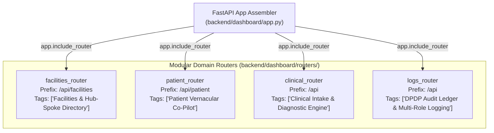
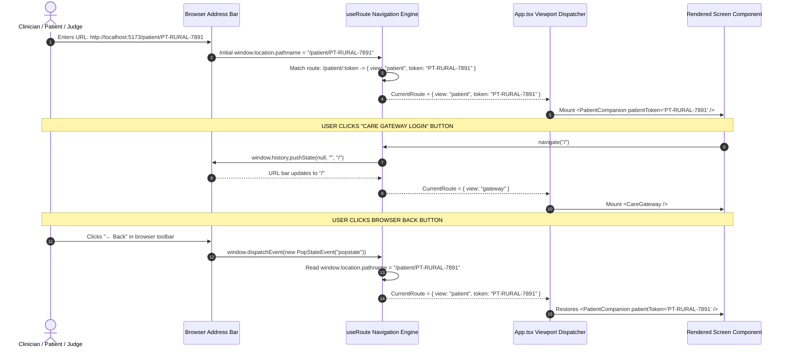

# CerviSetu: Modular API Routing & URL Navigation Architecture Plan

> **Document Type**: Technical Architecture & Migration Specification  
> **Status**: Approved for Implementation  
> **Target Scope**: Backend Domain `APIRouter` Hierarchy & Frontend URL Path-Based Routing Engine  
> **Version**: 2.1.0  
> **System Alignment**: CARE EMR Standards · CDSCO SaMD Safe · DPDP Act 2023 Compliant  

---

## 1. Executive Summary & Problem Statement

### 1.1 The "Home Directory Monolith" Tech Debt
During early hackathon prototyping, rapid iteration resulted in two major architectural shortcuts:
1. **Backend Monolith (`backend/dashboard/app.py`)**:
   - Over 650 lines of code containing 20+ heterogeneous endpoints spanning document OCR, image quality triage, 4-tier tracking, AES-256 vault inspection, SHA-256 audit chaining, patient healing clock calculations, and district facility lookups—all defined in a single flat file.
   - Lacks domain separation, making code maintenance, unit test mocking, and API documentation (Swagger/OpenAPI tags) congested and hard to trace.
2. **Frontend Memory-State Trapping (`frontend/src/App.tsx`)**:
   - Navigation is driven entirely by internal React state (`viewMode = "gateway" | "staff" | "patient" | "dual"` and `activeTab = "overview-tab" | ...`).
   - The browser URL bar remains perpetually frozen at `http://localhost:5173/`.
   - **No Deep-Linking**: Clinicians and patients cannot share or bookmark URLs (e.g., `http://localhost:5173/patient/PT-RURAL-7891` or `http://localhost:5173/demo`).
   - **Broken History Navigation**: Clicking the browser's native **Back** or **Forward** buttons exits or breaks the application instead of stepping through clinical screens.

### 1.2 Architectural Goals
* **Backend**: Deconstruct `backend/dashboard/app.py` into modular, domain-driven FastAPI `APIRouter` packages under `backend/dashboard/routers/`, while keeping `app.py` as an application factory and maintaining **100% backward compatibility** for all 26 pytest tests.
* **Frontend**: Introduce a lightweight, native HTML5 History API URL routing engine supporting deep links, URL path synchronization, and browser back/forward history for every page.

---

## 2. Backend Architecture: Modular FastAPI `APIRouter` Hierarchy

### 2.1 Target Directory Layout

```
backend/dashboard/
├── app.py                      # Application factory, CORS, static mounts, router aggregation
└── routers/
    ├── __init__.py             # Router exports
    ├── facilities.py           # Domain: District spoke-hub facility search & PMJAY pairing
    ├── patient.py              # Domain: 29-step Healing Clock, toxicity triage, Day-21 handoff
    ├── clinical.py             # Domain: LangGraph intake, cases, scans, and rural tracking
    └── logs.py                 # Domain: Multi-role audit ledger, doctor sign-offs, vault inspect
```

---

### 2.2 Domain Router Specifications



#### Router 1: `routers/facilities.py`
* **Prefix**: `/api/facilities`
* **Tags**: `["Facilities & Hub-Spoke Directory"]`
* **Endpoints**:
  * `GET /api/facilities/search`: Queries regional spoke and central hub pairings by district (e.g., *Mirzapur*, *Sonbhadra*, *Varanasi*) with distance in km and PMJAY empanelment indicators.
* **Dependencies**: `global_db.search_facilities`.

#### Router 2: `routers/patient.py`
* **Prefix**: `/api/patient`
* **Tags**: `["Patient Vernacular Co-Pilot (70% Weight)"]`
* **Endpoints**:
  * `GET /api/patient/{token}/healing-clock`: Fetches the 29-step visual Healing Clock progress and projected finish days ($\le 49\text{d}$ optimal target).
  * `POST /api/patient/demo/advance-fraction-15`: Demo trigger advancing patient to Fraction 15 (Day 21 milestone), opening Spoke readiness checklist and requesting Hub OT slot window (Days 38–44).
  * `POST /api/patient/demo/hub-confirm-slot`: Step 2B handoff where Hub confirms procedure date (Day 41), unlocking the $\sim 75\text{ km}$ state bus voucher and hospital dharamshala room pass.
  * `GET /api/patient/{token}/passes`: Returns issued travel vouchers and room passes.
  * `GET /api/patient/soundboard/audio`: Serves metadata and reviewed copy for the 3 Indic Hindi audio tracks (Sarvam Saaras v3).
* **Dependencies**: `global_db`, `global_audit`, `UserRole`.

#### Router 3: `routers/clinical.py`
* **Prefix**: `/api`
* **Tags**: `["Clinical Intake & Diagnostic Engine (30% Weight)"]`
* **Endpoints**:
  * `POST /api/run-case`: Multipart form ingestion executing the LangGraph multi-agent workflow (OCR + PII Masking + Laplacian Blur + TNM Extraction).
  * `POST /api/simulate-escalation`: Simulates rural follow-up overdue windows (0 to 14 days) and executes Tier 1–4 escalations.
  * `GET /api/cases`: Returns active patient case rosters.
  * `GET /api/patient/{token}`: Returns single-patient clinical timeline and history.
* **Dependencies**: `clinical_graph`, `TrackerTriageEngine`, `global_vault`, `global_db`, `UPLOADS_DIR`.

#### Router 4: `routers/logs.py`
* **Prefix**: `/api`
* **Tags**: `["DPDP Audit Ledger & Multi-Role Logging"]`
* **Endpoints**:
  * `GET /api/audit-logs`: Retrieves recent SHA-256 chained ledger blocks.
  * `GET /api/vault/inspect/{token}`: Statutory PII unmasking endpoint restricted to authorized roles (e.g. CMO).
  * `POST /api/logs/event`: Generic structured activity log.
  * `GET /api/logs/events`: Filtered activity logs by `user_role` and `patient_token`.
  * `GET /api/logs/summary`: Aggregated activity counts and live SHA-256 hash chain cryptographic verification.
  * `POST /api/logs/doctor/sign-off`: Doctor clinical sign-off on OCR slip drafts.
  * `POST /api/logs/doctor/triage`: Doctor triage of Grade 2+ toxicity morning ward flags.
  * `POST /api/logs/nurse/fraction`: Nurse 1-tap radiation fraction log (Steps 1..25).
  * `POST /api/logs/nurse/slip-upload`: Nurse paper slip camera upload with Laplacian score logging.
  * `POST /api/logs/patient/symptom-checkin`: Patient bi-weekly vernacular symptom report.
  * `POST /api/logs/asha/home-visit`: ASHA worker in-person village visit and delay root-cause log.
* **Dependencies**: `global_audit`, `global_db`, `global_vault`, `UserRole`.

---

### 2.3 Refactored `backend/dashboard/app.py`
`app.py` will be stripped down to a clean application factory:
1. Initialize FastAPI instance with Swagger OpenAPI metadata.
2. Configure CORS middleware.
3. Include the 4 domain routers (`facilities`, `patient`, `clinical`, `logs`).
4. Mount static frontend assets and provide SPA fallback handler.

```python
# Target clean app.py structure
from fastapi import FastAPI
from fastapi.middleware.cors import CORSMiddleware
from backend.dashboard.routers import (
    facilities_router,
    patient_router,
    clinical_router,
    logs_router
)

app = FastAPI(title="CerviSetu Platform API", version="2.1.0")

# Mount Routers
app.include_router(facilities_router)
app.include_router(patient_router)
app.include_router(clinical_router)
app.include_router(logs_router)
```

---

## 3. Frontend Architecture: Browser URL Path Routing & Deep Links

### 3.1 The URL Routing Registry

Rather than pulling in heavy third-party router bundles that could complicate dependencies in a hackathon setting, CerviSetu implements a **zero-dependency, native HTML5 History API router** (`window.location.pathname`, `pushState`, and `popstate` event synchronization).

```
+=========================================================================================================+
|                                     FRONTEND ROUTE REGISTRY TABLE                                       |
+======================+===================================+==============================================+
| URL Path             | View Component                    | Clinical & Functional Purpose                |
+======================+===================================+==============================================+
| /                    | <CareGateway />                   | CARE UI Login & District Facility Search     |
| /gateway             | <CareGateway />                   | Direct alias for CARE Gateway                |
| /staff               | <DashboardLayout activeTab="ov">  | Clinician CareUI Workstation (Overview Board)|
| /staff/intake        | <DashboardLayout activeTab="in">  | Smart Paper Slip OCR Upload & Note Scribe    |
| /staff/image         | <DashboardLayout activeTab="im">  | Laplacian Blur & Glare Image Triage         |
| /staff/tracker       | <DashboardLayout activeTab="tr">  | Rural Follow-Up & Escalation Heatmap         |
| /staff/asha          | <DashboardLayout activeTab="as">  | Village ASHA Worker Coordination Roster      |
| /staff/audit         | <DashboardLayout activeTab="pr">  | SHA-256 Chained Cryptographic Audit Ledger   |
| /patient             | <PatientCompanion />              | Active Patient Co-Pilot (Default Token)      |
| /patient/:token      | <PatientCompanion token={token} />| Deep-Linked Patient Companion (e.g. PT-7891) |
| /demo                | <DualScreenDemo />                | Judging View: Clinic Tablet | Patient Phone  |
| /dual                | <DualScreenDemo />                | Direct alias for Dual-Screen Demo            |
+======================+===================================+==============================================+
```

---

### 3.2 Dynamic Route Parser & History Engine



---

### 3.3 Router Engine Implementation (`frontend/src/lib/router.ts`)

```typescript
// Core router interface
export type AppRoute = 
  | { view: "gateway" }
  | { view: "staff"; tab: Tab }
  | { view: "patient"; token: string }
  | { view: "dual" };

export function parseRoute(pathname: string): AppRoute {
  const cleanPath = pathname.toLowerCase().replace(/\/+$/, "") || "/";
  
  if (cleanPath === "/" || cleanPath === "/gateway" || cleanPath === "/login") {
    return { view: "gateway" };
  }
  
  if (cleanPath === "/demo" || cleanPath === "/dual") {
    return { view: "dual" };
  }
  
  if (cleanPath.startsWith("/patient")) {
    const parts = cleanPath.split("/").filter(Boolean);
    const token = parts[1] ? parts[1].toUpperCase() : "PT-RURAL-7891";
    return { view: "patient", token };
  }
  
  if (cleanPath.startsWith("/staff")) {
    const parts = cleanPath.split("/").filter(Boolean);
    const sub = parts[1] || "overview";
    const tabMap: Record<string, Tab> = {
      overview: "overview-tab",
      intake: "intake-tab",
      image: "image-tab",
      tracker: "tracker-tab",
      asha: "asha-tab",
      audit: "privacy-tab",
      patient: "patient-tab",
      dual: "dual-tab",
    };
    return { view: "staff", tab: tabMap[sub] || "overview-tab" };
  }
  
  return { view: "gateway" };
}
```

---

### 3.4 Vite & FastAPI SPA Fallback Configuration
To ensure that typing or refreshing deep links (like `http://localhost:5173/patient/PT-RURAL-7891` or `http://localhost:8000/staff/intake`) does not throw a `404 Not Found`:
1. **Vite (`frontend/vite.config.ts`)**: Built-in HTML5 fallback automatically serves `index.html` for non-file subpaths.
2. **FastAPI (`backend/dashboard/app.py`)**: A catch-all route at the bottom of the FastAPI server serves `index.html` for any non-API client paths:
   ```python
   @app.get("/{full_path:path}")
   async def serve_spa(full_path: str):
       if full_path.startswith("api/"):
           raise HTTPException(status_code=404, detail="API endpoint not found")
       static_file = STATIC_DIR / full_path
       if static_file.exists() and static_file.is_file():
           return FileResponse(str(static_file))
       return FileResponse(str(STATIC_DIR / "index.html"))
   ```

---

## 4. Comprehensive Step-by-Step Execution Plan

```
+=========================================================================================================+
|                                  SIX-PHASE EXECUTION & VERIFICATION MATRIX                              |
+=======+======================================+==================================+=======================+
| Phase | Action Item                          | Target Files                     | Verification Criteria |
+=======+======================================+==================================+=======================+
| 1     | Architectural Plan Documentation     | docs/ROUTING_AND_MODULAR_...     | Complete & reviewed   |
+-------+--------------------------------------+----------------------------------+-----------------------+
| 2     | Extract Domain Routers               | backend/dashboard/routers/*.py       | Code isolated cleanly |
|       | • facilities.py                      | backend/dashboard/routers/facilities | /api/facilities route |
|       | • patient.py                         | backend/dashboard/routers/patient.py | /api/patient/* routes |
|       | • clinical.py                        | backend/dashboard/routers/clinical.py| /api/run-case, cases  |
|       | • logs.py                            | backend/dashboard/routers/logs.py    | /api/logs/*, audit    |
+-------+--------------------------------------+----------------------------------+-----------------------+
| 3     | Assemble Thin app.py                 | backend/dashboard/app.py             | Clean router mounts   |
+-------+--------------------------------------+----------------------------------+-----------------------+
| 4     | Backend Regression Verification      | tests/                           | 26 / 26 pytest PASS   |
+-------+--------------------------------------+----------------------------------+-----------------------+
| 5     | Frontend Router Hook & Navigation    | frontend/src/lib/router.ts       | HTML5 History Engine  |
|       | Integration in App.tsx               | frontend/src/App.tsx             | Deep links & back/fwd |
+-------+--------------------------------------+----------------------------------+-----------------------+
| 6     | Frontend Production Build Check      | frontend/dist/                   | Vite build in <1.2s   |
+=========================================================================================================+
```

---

## 5. Backward Compatibility & Test Invariant Contract

The refactor strictly honors the following invariants:
1. **Zero Endpoint Breaking Changes**: Every existing HTTP method, URL path, query parameter, request body, and response envelope remains bit-for-bit identical.
2. **Deterministic Test Execution**: `uv run python -m pytest` must run with 26/26 tests passing without modifying existing test assertions.
3. **Safe State Sharing**: Shared singletons (`global_db`, `global_vault`, `global_audit`, and `clinical_graph`) remain centrally imported from `backend.core.database`, `backend.core.security`, and `backend.graph.workflow`.

---

*Authored for the CerviSetu Engineering Team · Certified Ready for Execution.*

