# CerviSetu (सर्वाइसेतु) — Comprehensive Video Demo Script & Walkthrough Guide

> **Document Purpose**: Complete, turn-key video demonstration production script, camera direction, and narrative voiceover for CerviSetu.  
> **Target Run Time**: 7 to 9 Minutes (Modular: can be adapted to a 3-minute executive pitch or an 8-minute comprehensive technical review).  
> **Presenter Tone**: Authoritative, clinically grounded, empathetic, and evidence-driven.  
> **Target Audience**: Health Hackathon Judges, Clinical Oncologists, Ministry of Health & Family Welfare (MoHFW) / National Health Authority (NHA) Evaluators, and Public Health Technologists.  
> **Submission Links**:
> - 🌐 **Live Web MVP**: [https://cervi-setu.pages.dev/](https://cervi-setu.pages.dev/)
> - ▶️ **Implementation Video Walkthrough**: [Watch on Google Drive](https://drive.google.com/file/d/16l-TvH1dR5j1hMcbAAils9efy5uEkBBj/view?usp=sharing)
> - 📄 **2-Page Solution Brief**: [View on Google Drive](https://drive.google.com/file/d/1BsL-AtmQBqwCRf0Hlhza8K8Dn3J2iIAw/view?usp=sharing)
> - 📊 **Presentation / Pitch Deck**: [Open Google Slides](https://docs.google.com/presentation/d/1DWDuXUPUlsiF7aNQ_xHp2cximp8js2nM/edit?usp=sharing&ouid=112906296684609349584&rtpof=true&sd=true)

---

## Production Setup & Pre-Recording Checklist

Before hitting **Record**, ensure your local environment is configured for a flawless live capture:

### 1. Terminal & Backend Boot
```bash
# Terminal 1: Launch FastAPI backend with pre-warmed database
.\.venv\Scripts\python.exe main.py --serve --port 8000
```
*Verify that `http://localhost:8000/api/cases` returns HTTP 200.*

### 2. Browser Tab Order (Open in Chromium / Chrome at 1080p, 100% Zoom)
To enable seamless one-click tab switches or fluid in-app navigation, bookmark or preload these URLs:
1. **Tab 1 (The Showcase)**: `http://localhost:8000/` (Landing Page)
2. **Tab 2 (The Gateway)**: `http://localhost:8000/gateway` (Facility Directory & Role Gateway)
3. **Tab 3 (Staff Console)**: `http://localhost:8000/staff/overview` (Ward Board)
4. **Tab 4 (Dual-Screen Mirror)**: `http://localhost:8000/demo` (Live Clinic Tablet + Patient Phone Sync)

### 3. Demo Credentials Cheat Sheet
* **Staff Login**: Click **"Staff Workstation"** on `/gateway` or `/` (Bypasses login for hackathon evaluation).
* **Patient Mobile Login**: Enter **`9876543210`**. The sandbox OTP is displayed on-screen (`123456`).
* **Featured Patient Token**: `PT-RURAL-7891` (Clinical identity: *Shanti Devi*, 48y, FIGO Stage IIB Cervical Carcinoma).

---

## Structural Roadmap & Sequence of Pages

```mermaid
flowchart LR
    P1["1. Landing Page\n(/)"] -->|"Explore Protocol & AI"| P2["2. Care Gateway\n(/gateway)"]
    P2 -->|"Staff Sign-in"| P3["3. Staff Workstation\n(/staff/overview)"]
    P3 -->|"Screening Continuum"| P3B["3B. Prevention\n(/staff/prevention)"]
    P3B -->|"Slip Ingestion"| P3C["3C. Clinical Intake\n(/staff/intake)"]
    P3C -->|"Active Delivery"| P3D["3D. Encounter & Hub\n(/staff/encounter)"]
    P3D -->|"Adherence Risk"| P3E["3E. Escalations\n(/staff/tracker)"]
    P3E -->|"Village Dispatch"| P3F["3F. ASHA Network\n(/staff/asha)"]
    P3F -->|"Cryptographic Check"| P3G["3G. Audit Ledger\n(/staff/audit)"]
    P3G -->|"Patient View"| P4["4. Patient Portal\n(/patient/:token)"]
    P4 -->|"Live Synchrony"| P5["5. Dual-Screen Demo\n(/demo)"]
```



---

## ACT 1: Prologue — The Clinical Need, Rural Reality & The 56-Day Clock

### Scene 1.1: The Human & Epidemiological Reality
* **URL**: `http://localhost:8000/` (Top of Landing Page)
* **Visual**: Camera pans slowly over the CerviSetu teal ribbon emblem and bold headline: *"Keeping every cervical cancer patient inside the 56 day curative window, from district spoke to tertiary hub."*
* **On-Screen Text / Lower-Third**: `Cervical Cancer in India: ~127,000 New Cases/Year · ~80,000 Deaths/Year`

#### Voiceover Script (Spoken with gravitas)
> *"In India today, a woman dies of cervical cancer every seven minutes. It is the second most common cancer among Indian women, claiming over 80,000 lives every year. Yet, clinically, cervical cancer is almost entirely preventable—and highly curable if caught early and treated without interruption.*
>
> *Why then are so many women dying? Because over 70% of India's population lives in rural districts, while more than 85% of advanced radiation technology is concentrated in tier-one metropolitan hospitals. When a rural woman is diagnosed—usually at locally advanced Stage II or III—she faces the 'Triple Delay': delay in recognizing symptoms, delay in navigating a distant tertiary hospital 150 kilometers away, and catastrophic delay in completing her treatment."*

---

### Scene 1.2: The Radiobiological Imperative — Why 56 Days?
* **Action**: Scroll smoothly down to the **56 Day Curative Protocol** section (`#protocol`) or click the interactive slider on the Hero Studio.
* **Visual**: Highlight the radiobiological countdown clock: **49-Day Target / 56-Day Curative Ceiling**.
* **On-Screen Callout**: `Radiobiological Penalty: 0.8% – 1.2% Daily Loss in Pelvic Tumor Control Beyond Day 56`

#### Voiceover Script (Fact & Research Grounding)
> *"Here is the critical scientific fact that differentiates cervical cancer from almost every other solid tumor: **Radiobiology enforces an unforgiving 56-day deadline**.*
>
> *According to international GEC-ESTRO, ABS, and Indian National Cancer Grid (NCG) guidelines, the standard curative treatment is Concurrent Chemo-Radiotherapy—or CCRT. This requires 25 daily fractions of External Beam Radiation (EBRT) combined with 4 high-dose-rate intracavitary brachytherapy sessions.*
>
> *Landmark radiobiology studies—including Perez, Vitzthum, and the GEC-ESTRO cohorts—prove that around the fourth week of radiation, surviving tumor stem cells undergo **accelerated clonogenic repopulation**. If the total overall treatment time stretches beyond 56 days, pelvic tumor control drops at an alarming rate of **0.8% to 1.2% per day of delay**.*
>
> *In rural India, the median treatment time currently stands at **72 days**. Over 60% of rural patients who finish external radiation at their local district hospital drop out before receiving brachytherapy at the regional hub due to cost, fear, lack of lodging, or machine breakdowns. A treatment that was curative becomes purely palliative.*
>
> *This is why we built **CerviSetu**—an AI-orchestrated, hub-and-spoke clinical network designed to keep every rural cervical cancer patient inside the 56-day curative window."*

---

## ACT 2: The Landing Page & Interactive Showcase

### Scene 2.1: The Interactive Hero Studio (Voice, Vault & Timeline)
* **URL**: `http://localhost:8000/` (Hero Section)
* **Action**: 
  1. Click through the Hero Studio tabs: **"IVR Voice"**, **"Zero-ID Vault"**, and **"56-Day Timeline"**.
  2. In the **Zero-ID Vault** tab, toggle the switch from **"Unmasked Point-of-Care"** to **"AES-256 Tokenized"**.
  3. In the **Timeline** tab, drag the day slider from **Day 14** to **Day 42** and point out the spoke-to-hub handoff threshold.

#### Voiceover Script
> *"On the landing page, we demonstrate the three foundational pillars of the CerviSetu platform:*
>
> *First, **Privacy by Architecture**. Under India's Digital Personal Data Protection (DPDP) Act 2023, sensitive health data cannot be exposed indiscriminately. Our zero-knowledge token vault isolates all direct identifiers—Aadhaar, phone numbers, and home villages—encrypting them with AES-256-GCM. Cloud agents and AI models only ever see synthetic tokens like `PT-RURAL-7891`.*
>
> *Second, **Vernacular Voice Outreach**. Recognizing that rural literacy barriers prevent patients from reading SMS alerts, we integrate Sarvam AI's Indic neural voices to communicate adherence reminders in regional dialects.*
>
> *Third, the **Active Curative Clock**, tracking the patient's transition from local district teletherapy to regional tertiary brachytherapy."*

---

### Scene 2.2: Spatial Document OCR Studio (Handwritten Prescription Ingestion)
* **Action**: Scroll down to the **Vision OCR Studio** section (`#vision-ocr`).
* **On-Screen Interactions**:
  1. Show the sample oncologist prescription sheet with handwritten staging (`Stage IIB`), histology (`Squamous Cell Carcinoma`), and fraction prescription (`25 Fr EBRT + 4 Fr HDR Brachy`).
  2. Point out the animated laser scan beam.
  3. **Hover over the bounding boxes**: Notice how hovering over the *FIGO Staging* capsule on the prescription simultaneously highlights the corresponding row in the Structured Entity Table on the right.
  4. Toggle the **"2D Coordinate Wireframe"** to show normalized IoU coordinates (`top`, `left`, `width`, `height`).
  5. Mention the **Laplacian Blur Quality Guard** ($\sigma^2 \ge 85.0$).

#### Voiceover Script
> *"The entry point for rural care begins with paper. Frontline nurses at district daycare centers are overwhelmed with paper OPD slips and handwritten oncologist prescriptions.*
>
> *Our **Spatial Document OCR Studio** ingests raw smartphone photos of clinical slips. Before any AI inference occurs, our computer vision pipeline applies a **Laplacian Blur Variance filter**—if the image variance is below 85.0, it instantly prompts the nurse with retake guidance to prevent hallucinatory extraction.*
>
> *Once verified, Sarvam Vision extracts key clinical entities: tumor site, FIGO staging, lymph node status, and dose fractionation with 98% confidence. Notice the synchronized two-way hover tracing between the physical prescription geometry and the structured JSON output—and with one toggle, direct patient identifiers are replaced with sovereign cryptographic tokens."*

---

### Scene 2.3: Sarvam Indic Voice Studio & Multi-Agent LangGraph Canvas
* **Action**: 
  1. Scroll to the **Speech Studio** (`#speech-studio`). Click the dialect selector (**Hindi**, **Bhojpuri**, **Bengali**, **Marathi**, **Tamil**, **Telugu**).
  2. Click **Play Audio** to let the audience hear Sarvam AI's `bulbul:v4-flash` voice synthesize a warm, clinical reminder in authentic Indic cadence.
  3. Scroll down to the **Agent Flow** section (`#agent-flow`) to show the live LangGraph execution DAG (`ocr_intake` $\rightarrow$ `pii_token_vault` $\rightarrow$ `image_triage` $\rightarrow$ `radiotherapy_clock` $\rightarrow$ `rural_tracker`).
  4. Briefly showcase the **District Impact Calculator** (`#impact-calculator`) showing annual lives saved, travel kilometers spared, and out-of-pocket costs reduced across a district of 2 million people.

#### Voiceover Script
> *"Next is our **Indic Voice Intelligence**. Using Sarvam AI's `bulbul:v4-flash` model, CerviSetu generates dialect-accurate clinical prompts. Here is a reminder synthesized for an adherence check in Bhojpuri:*
>
> *(Play 2–3 seconds of audio clip)*
>
> *Beneath the surface, a **LangGraph Multi-Agent DAG** coordinates clinical reasoning. The intake agent extracts staging, the token vault shields PII, the radiobiology agent schedules the 56-day timeline, and the rural tracking agent monitors adherence across district spokes. Our impact modeling shows that for an average rural district like Mirzapur, proactive hub-and-spoke coordination saves 142 lives annually and spares rural families over 850,000 kilometers of unnecessary round-trip travel."*

---

## ACT 3: The Care Gateway & Hub-and-Spoke Infrastructure

### Scene 3.1: District Facility Search & Unified Role Access
* **URL**: Open `http://localhost:8000/gateway` (or click **"Staff Workstation"** / **"Care Gateway"** from header).
* **Action**:
  1. In the District Search bar, type `Mirzapur` and press **Enter** (or click Search).
  2. Show the resulting facilities:
     - **District Daycare Spoke (12.5 km)**: *Mirzapur District Oncology Daycare & Spoke Clinic* (EBRT Fractions 1–25, Weekly Cisplatin).
     - **Central Brachytherapy Hub (75.0 km)**: *Regional Cancer Centre (RCC) Brachytherapy Hub* (HDR Brachytherapy Fractions 26–29, PAC, Patient Dharamshala).
  3. Click the primary action button: **"Enter Staff Workstation"**.

#### Voiceover Script
> *"Let's move into the clinical workflow. We arrive at the **CerviSetu Care Gateway**.*
>
> *In India's public health system, care is stratified. A patient in Mirzapur shouldn't travel 75 kilometers to Varanasi every single day for six weeks just for a 10-minute radiation fraction. Instead, CerviSetu maps the patient to a **District Daycare Spoke** 12 kilometers from her village for daily external beam radiation and chemotherapy hydration, reserving the **Tertiary Cancer Centre Hub** for the four complex brachytherapy sessions.*
>
> *Let's log in to the authenticated Staff Workstation."*

---

## ACT 4: The Staff Workstation — Clinical Coordination & Safety

### Scene 4.1: The Traffic-Light Ward Board (Overview Tab)
* **URL**: `http://localhost:8000/staff/overview`
* **Visual**: Show the high-density clinical dashboard.
* **Key UI Elements to Point Out**:
  1. **Top Metric Cards**: Active CCRT Cases, In 49d Target Window, Near 56d Limit, LINAC Spoke Uptime (98.4%).
  2. **Traffic-Light Patient Roster**:
     - 🔴 **Red Lane (Critical / Near Breach)**: `PT-RURAL-7891` (8 days overdue, Day 46 of 56, Tier 4 Escalation).
     - 🟡 **Amber Lane (Warning / 48h Missed)**: `PT-RURAL-4421` (6 days overdue, Tier 3 ASHA dispatch).
     - 🟢 **Green Lane (On Schedule)**: `PT-RURAL-9034` (Day 18, 0 days overdue, on track).
  3. Click on patient row **`PT-RURAL-7891`** to open the clinical encounter.

#### Voiceover Script
> *"We are now inside the **CareUI Staff Workstation**, designed specifically for radiation oncologists and oncology nurses.*
>
> *The **Traffic-Light Ward Board** groups active patients by their radiobiological risk clock. Patients in green are on schedule. Patients in amber have missed 48 hours and require community follow-up. And patients in red—like **PT-RURAL-7891**, Shanti Devi—are at immediate risk of breaching the 56-day curative limit.*
>
> *Notice that the system displays both the clinical token for audit logging and the unmasked verified patient identity for point-of-care clinical safety, eliminating the dangerous risk of wrong-patient radiation delivery."*

---

### Scene 4.2: The Prevention & Screening Continuum
* **URL**: `http://localhost:8000/staff/prevention` (Click **"Prevention"** in sidebar navigation).
* **Visual**: Show the 4-phase continuum: HPV Vaccination, Visual Inspection with Acetic Acid (VIA) / Pap / HPV-DNA Screening, Thermal Ablation / LEEP Precancer Treatment, and Surveillance.
* **Key Point**: Highlight that CerviSetu supports the entire WHO **90-70-90 Cervical Cancer Elimination Target** (90% girls vaccinated, 70% women screened, 90% women with precancer/cancer treated).

#### Voiceover Script
> *"CerviSetu doesn't begin at the radiation bunker—it spans the entire continuum of care.*
>
> *In the **Prevention & Screening Tab**, district healthcare teams manage community HPV vaccination camps, VIA and HPV-DNA screening rosters, and track single-visit thermal ablation for cervical pre-cancer lesions. By closing the loop before invasive carcinoma develops, the platform directly advances the WHO 90-70-90 elimination strategy."*

---

### Scene 4.3: Clinical Intake Studio (Blur Guard & PII Shield)
* **URL**: `http://localhost:8000/staff/intake`
* **Action**:
  1. Demonstrate uploading or inspecting a scanned clinical slip.
  2. Show the **Image Quality Guard**: Laplacian Variance score displayed with green/red status.
  3. Show the **Zero-Knowledge PII Shield**: Observe how the patient's name and Aadhaar number are immediately stripped and tokenized into `PT-ANON-XXXX` before data hits the diagnostic reasoning model.
  4. Show the AI Diagnostic Extraction: Tumor Histology, FIGO Staging, and Recommended CCRT Regimen.

#### Voiceover Script
> *"In the **Clinical Intake Studio**, frontline staff digitize paper records in seconds.*
>
> *Our computer vision pipeline runs an on-device Laplacian blur check. If a worker snaps an unreadable photo in a poorly lit village clinic, the system catches it before erroneous data corrupts the patient's chart. Once verified, the PII Shield replaces all demographic identifiers with an AES-256 token, and Groq's high-speed inference extracts the staging and treatment parameters for oncologist sign-off."*

---

### Scene 4.4: Active Clinical Encounter & The Spoke-to-Hub Bridge
* **URL**: `http://localhost:8000/staff/encounter` (or select `PT-RURAL-7891`).
* **Visual**: The complete CCRT clinical management interface for Shanti Devi.
* **On-Screen Interactions**:
  1. **Chemotherapy Clearance Checklist**: Show labs (Hemoglobin 10.4, ANC 2200, Platelets 180k, Creatinine 0.85). Point out the **Clinical Safety Guardrail**: *"Chemotherapy held due to low counts? Daily EBRT must continue without interruption!"*
  2. **1-Tap Fraction Logger**: Click **"Log Fraction 15 Delivered"**. Point out the **60-Second Undo Guard** that pops up, allowing the technologist to reverse an accidental double-tap.
  3. **The Hub Referral Bridge Tab** (Click **"Hub Bridge"**):
     - Show **Pre-Anesthetic Clearance (PAC)** initiated at Fraction 10.
     - Show **Pelvic Response Verification** at Fraction 15.
     - Show **Tertiary Dharamshala Lodging & Free Bus Pass** issued for Fraction 26 at the Regional Cancer Centre.

#### Voiceover Script
> *"Now let's examine the **Clinical Encounter**.*
>
> *Notice our critical clinical safety guardrails. In public hospitals, when a patient's absolute neutrophil count drops or creatinine rises slightly, physicians frequently halt all treatment. CerviSetu alerts the clinician: **'Chemo can be held, but daily radiation must continue'**—protecting the 56-day clock.*
>
> *When the technologist logs a radiation fraction, our **60-Second Undo Buffer** prevents double-click reporting errors.*
>
> *Most importantly, observe the **Split-Phase Hub-Spoke Referral Bridge**. Traditional systems wait until Fraction 25 to refer the patient to the tertiary hospital, resulting in a three-week wait for a brachytherapy bed. CerviSetu initiates lab work and anesthetic clearance at **Fraction 10**, confirms tumor regression at **Fraction 15**, and locks in the tertiary hospital OT slot, lodging pass, and subsidized bus ticket by **Fraction 22**. The transition from spoke to hub is seamless and zero-delay."*

---

### Scene 4.5: Rural Adherence Tracker & 4-Tier Escalation Heatmap
* **URL**: `http://localhost:8000/staff/tracker`
* **Visual**: The 4-Tier Escalation Matrix.
* **Action**:
  1. Walk through the 4 progressive tiers:
     - **Tier 1 (Day +1 / 24h Missed)**: Multilingual WhatsApp / SMS nudge.
     - **Tier 2 (Day +2 / 48h Missed)**: Automated Sarvam AI interactive voice call (IVR) in local dialect.
     - **Tier 3 (Day +3 / 72h Missed)**: Dispatch order to village ASHA worker for home visit.
     - **Tier 4 (Day +5 / 120h Missed)**: Emergency unmasking and statutory District Chief Medical Officer (CMO) intervention dossier.
  2. Click **"Run Escalation Cycle"** button to demonstrate the automated background cron job.

#### Voiceover Script
> *"When a rural patient misses an appointment, time is of the essence. In the **Escalation Tracker**, CerviSetu deploys a 4-Tier Adherence Protocol:*
>
> *At 24 hours missed, Tier 1 sends a vernacular WhatsApp message.  
> At 48 hours, Tier 2 triggers an automated interactive phone call powered by Sarvam AI.  
> At 72 hours, Tier 3 dispatches an ASHA community health worker directly to the patient's village.  
> And if five days elapse, Tier 4 generates an emergency statutory dossier for the District Chief Medical Officer to authorize a 108 emergency transport escort.*
>
> *This ensures no patient slips through the cracks unnoticed."*

---

### Scene 4.6: ASHA Network Field Coordination
* **URL**: `http://localhost:8000/staff/asha`
* **Visual**: Show the field ticket table with village sectors (e.g., *Gram Panchayat Chunar, Sector 4*).
* **Key Point**: Highlight **Stigma-Safe Design**. The ticket displays the patient's name and landmark, but masks the oncological diagnosis as *"Women's Health Follow-up"* (`महिला स्वास्थ्य सेवा`) to prevent social ostracization in rural villages.
* **Action**: Click on a ticket and show the recorded outcomes (*Patient contacted, transportation arranged, financial barrier resolved*).

#### Voiceover Script
> *"In the **ASHA Coordination Tab**, field tickets are routed to accredited community health workers.  
> Notice our stigma-safe clinical design: to protect the patient from village discrimination, the mobile ticket is badged simply as maternal and women's health follow-up, while equipping the ASHA worker with exact village landmarks, verified caregiver contacts, and transport support options."*

---

### Scene 4.7: Security Check & Cryptographic Audit Ledger
* **URL**: `http://localhost:8000/staff/audit`
* **Visual**: The SHA-256 block-chained audit ledger.
* **LIVE SECURITY DEMONSTRATION**:
  1. Point out the cryptographic hash chaining: each log entry contains its own `block_hash` calculated from the `prev_hash`, timestamp, actor, and patient token.
  2. Click the primary button: **"Verify Chain Integrity"**.
  3. Watch the modal/banner return: `Status: SUCCESS · 842 Blocks Verified · Tamper Detected: FALSE · DPDP Act 2023 Compliant`.
  4. Showcase the **Vault Inspection Tool**: Enter token `PT-RURAL-7891`, click Decrypt, and show the authorized emergency de-anonymization record logged under DPDP Section 9 emergency exemption.

#### Voiceover Script (Crucial Security Check)
> *"Now, let's perform our **Live Security & Privacy Audit**.*
>
> *Every clinical action, AI inference, and consent event in CerviSetu is immutably recorded in a **SHA-256 Block-Chained Audit Ledger**.  
> Watch as I click **'Verify Chain Integrity'**.*
>
> *(Click button and pause 1 second)*
>
> *The system verifies every block back to genesis. Zero tampering detected.  
> Furthermore, all patient credentials adhere to India's DPDP Act 2023: Aadhaar and mobile numbers are stored exclusively as keyed HMAC-SHA256 hashes, patient sessions are secured via signed HttpOnly cookies, and emergency identity unmasking requires explicit statutory justification that is permanently audited."*

---

## ACT 5: The Patient Experience — ABHA Login & Healing Companion

### Scene 5.1: Patient Authentication via ABDM / ABHA Sandbox
* **URL**: `http://localhost:8000/gateway` (Click Gateway or open `/gateway`).
* **Action**:
  1. Click on the **Patient Portal** section.
  2. Choose **"Mobile OTP Login"** and enter demo mobile number: `9876543210`.
  3. Enter the sandbox OTP shown on screen (`123456`) and click **Verify & Login**.
  4. *(Alternative: briefly toggle to ABHA Registration tab to show the 4 explicit DPDP consent checkboxes: Identity, Clinical Records, Adherence Outreach, and Cross-Facility Referral).*

#### Voiceover Script
> *"Now let's switch entirely to the **Patient Experience**.*
>
> *Patients log in securely through the Ayushman Bharat Digital Mission (ABDM) sandbox. Whether using their 14-digit ABHA ID or their registered mobile number, authentication generates a cryptographically signed, HttpOnly session cookie scoped strictly to that individual patient.*
>
> *Under our zero-trust architecture, a patient can never access or leak another patient's medical records."*

---

### Scene 5.2: The Bilingual Patient Portal (English & Hindi)
* **URL**: Resolves automatically to `http://localhost:8000/patient/:token` (e.g., `PT-RURAL-7891`).
* **Action**:
  1. Click the **Language Switcher** in the header to toggle between **English** and **Hindi (हिन्दी)**.
  2. Highlight the key patient widgets:
     - **Next Session Card**: Clear calendar display (*"Tomorrow: External Beam Radiation Session 15 at Mirzapur Spoke"* / *"कल: सत्र 15 - बाह्य विकिरण"*).
     - **Healing Progress Bar**: Shows completed sessions (e.g., *14 of 29 Sessions Completed - 48%*).
     - **Curative Window Status**: *"On Track — Expected Completion within 56 Days"* with green checkmark.
     - **Treatment Journey Timeline**: Interactive history showing completed sessions, planned rest days, and upcoming hub brachytherapy sessions.
  3. Show the **Synthetic Demo Patient Banner**: demonstrating ethical compliance and sandbox boundary isolation during testing.

#### Voiceover Script
> *"Welcome to the **CerviSetu Healing Companion**.*
>
> *For a rural patient and her family, cancer treatment is terrifying and disorienting. CerviSetu translates complex radiobiology into simple, empowering visual clarity.*
>
> *With a single tap, the entire portal switches to fluent, empathetic Hindi. The patient sees exactly when her next session is scheduled, where to go, and watches her 29-step healing progress bar advance day by day.*
>
> *Most importantly, she receives constant positive reinforcement that her treatment is on track inside the curative window. There are no medical jargon traps—just clear, compassionate accompaniment."*

---

## ACT 6: The Dual-Screen Synchronized Demonstration

### Scene 6.1: Real-Time Clinic Tablet & Patient Phone Sync
* **URL**: `http://localhost:8000/demo`
* **Visual**: The screen splits cleanly into two simulated devices:
  - **Left Screen**: Clinic Radiation Technologist Tablet (`CareUI Clinic Console`).
  - **Right Screen**: Patient Mobile Phone (`Hindi Patient Companion`).
* **LIVE INTERACTION**:
  1. On the **Left Screen**, click **"Log Fraction 15 Administered"**.
  2. Watch the **Right Screen** update in real time:
     - Fraction count increments from 14 to 15.
     - Progress bar jumps forward.
     - The next session automatically schedules for the following morning.
     - A green adherence confirmation badge illuminates.

#### Voiceover Script (The "Climax" Moment)
> *"To see the full power of CerviSetu, look at this side-by-side dual-screen demonstration.*
>
> *On the left is the radiation technologist's tablet at the district hospital. On the right is the patient's smartphone in her village.*
>
> *Watch what happens when the technologist logs Fraction 15:*
>
> *(Click button on left screen)*
>
> *Instantly, the live data synchronizes. The patient's healing clock advances, her next appointment is confirmed, and the tertiary cancer centre in Varanasi receives automated confirmation that she is on track for brachytherapy. One click at the district spoke coordinates the entire state-wide oncology continuum."*

---

## ACT 7: Epilogue — Summary, Policy Alignment & Call to Action

### Scene 7.1: Architecture, Interoperability & Rollout Readiness
* **URL**: Return to `http://localhost:8000/` or display full-screen closing slide.
* **Visual**: Display system architecture summary graphic with logos: `FastAPI`, `LangGraph`, `Sarvam AI`, `Groq LPU`, `React 19`, `ABDM FHIR R4`, and `DPDP Act 2023`.

#### Voiceover Script (Strong Closing Pitch)
> *"CerviSetu is not a concept or a wireframe. It is a fully functioning, end-to-end platform built on modern, battle-tested technology:*
>
> *1. **Open-Source & Standard-Aligned**: Designed to integrate directly with the CARE EMR open-source ecosystem, National Cancer Grid (NCG) guidelines, and ABDM FHIR R4 registries.  
> 2. **Sovereign Indian AI**: Powered by Sarvam AI Indic voice synthesis and Groq high-speed LPU reasoning.  
> 3. **Uncompromising Privacy**: Built from the ground up to comply with the DPDP Act 2023 and CDSCO non-diagnostic software standards.  
> 4. **Life-Saving Impact**: By closing the rural hub-and-spoke gap, CerviSetu ensures that no woman is denied curative cervical cancer treatment simply because of where she was born.*
>
> *Every rural cancer patient deserves curative treatment completed within 56 days—without losing their identity or their dignity.*
>
> *Thank you. We are CerviSetu."*

---

## Quick Reference: Presenter Teleprompter & Key Facts Card

Keep this summary table visible on your second monitor while recording:

| Section | Target URL | Primary Action / Visual | Key Research Fact to Cite |
|:---|:---|:---|:---|
| **Prologue** | `/` | Pan over headline & 56-day badge | ~127k cases, ~80k deaths in India; 0.8%–1.2% daily pelvic control loss beyond Day 56 (*Perez / GEC-ESTRO*). |
| **Hero Studio** | `/` | Toggle Zero-ID Vault & Timeline slider | DPDP Act 2023 AES-256-GCM tokenization isolates direct PII from AI models. |
| **Vision OCR** | `/#vision-ocr` | Hover over staging capsule; wireframe toggle | Laplacian Blur variance filter ($\sigma^2 \ge 85.0$) rejects illegible village scans. |
| **Voice Studio** | `/#speech-studio` | Play Sarvam AI Bhojpuri audio sample | Sarvam AI `bulbul:v4-flash` in 6 Indic languages bridges rural illiteracy. |
| **Gateway** | `/gateway` | Search `Mirzapur` district spoke vs hub | Separates 25 local spoke EBRT fractions from 4 tertiary hub brachy fractions. |
| **Ward Board** | `/staff/overview` | Show Red/Amber/Green patient lanes | Traffic-light board prioritizes patients approaching the 49d target / 56d ceiling. |
| **Encounter** | `/staff/encounter` | 1-tap fraction logger + Hub Bridge | Chemo hold safety alert + PAC initiated at Fraction 10 instead of waiting for Day 25. |
| **Tracker** | `/staff/tracker` | Run automated escalation cycle | 4 tiers: 24h WhatsApp $\rightarrow$ 48h Sarvam IVR $\rightarrow$ 72h ASHA visit $\rightarrow$ 120h CMO dossier. |
| **Audit Ledger** | `/staff/audit` | Click **"Verify Chain Integrity"** | Immutable SHA-256 chained blocks verify end-to-end data integrity and legal compliance. |
| **Patient Portal** | `/patient/:token` | Switch language to Hindi (हिन्दी) | Clear, stigma-free 29-step progress bar; session-protected via HttpOnly cookies. |
| **Dual Screen** | `/demo` | Log fraction on left; watch right sync | Real-time synchronization between clinic tablet and patient village smartphone. |

---
*Created for Health Hackathon 2026 • CerviSetu Care Collective*

