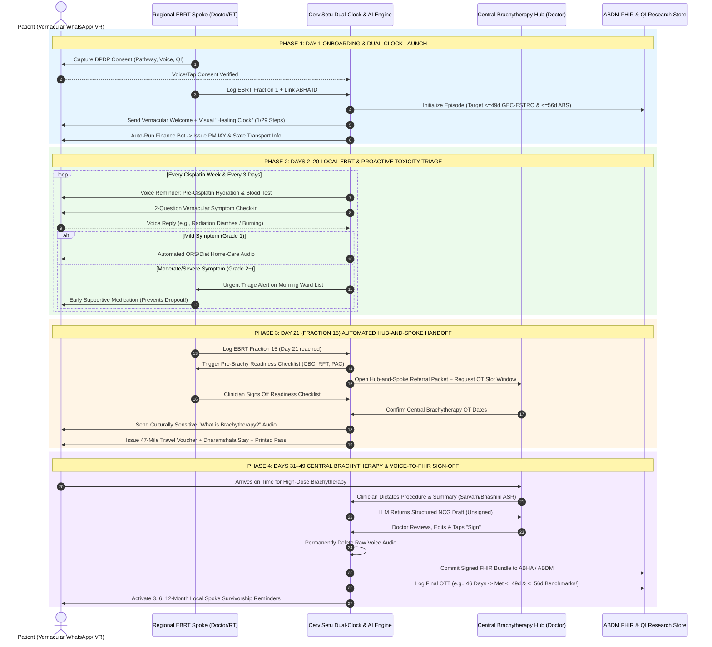

# CerviSetu: Hub-Spoke Care Pathway Sequence Diagram

> For the comprehensive master specification covering all features, system architecture, Level 0/1 DFDs, and all 5 workflow sequence diagrams, refer to [SYSTEM_ARCHITECTURE_AND_FEATURES.md](file:///c:/Users/perci/Documents/projects_2026/health_hackathon/docs/SYSTEM_ARCHITECTURE_AND_FEATURES.md).

